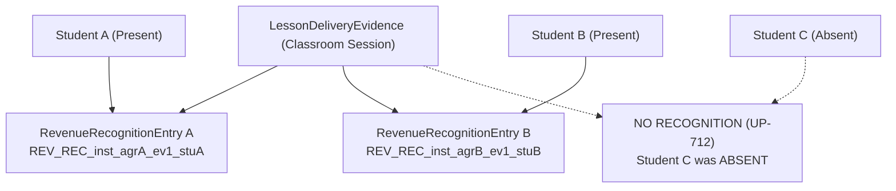

# OX-DIGITAL Education — Phase 4: Workstream A
## Step A1: Prisma Financial Schema Drafting & Syntax Validation
### Deliverable 5: Accrual Revenue Recognition Persistence Specification

**Workspace:** `D:\OX-DIGITAL\Mathe\OX-DIGITAL-GITHUB`  
**Target:** `docs/phase-4/workstream-a/step-a1/REVENUE_RECOGNITION_PERSISTENCE.md`  
**Execution Authorization:** EXPLICITLY APPROVED BY PRODUCT OWNER FOR STEP A1 ONLY  
**Date:** November 4, 2026  
**Author:** Lead Software Architect & Financial Systems Designer  

---

## 1. Executive Summary

In educational center operations, earned revenue is governed by the accrual accounting principle: cash collected from a student upon enrollment represents an unearned customer advance liability; earned income is recognized **ONLY** upon the actual, verified delivery of educational lessons.

This document specifies the persistence implementation for Domain 7 Accrual Revenue Recognition drafted into `LessonDeliveryEvidence` and `RevenueRecognitionEntry` in Step A1. It demonstrates full fidelity to the accepted Phase 2.0B Increment 2 domain contracts (`packages/shared/src/accounting/center/revenueRecognitionEngine.ts` and `evidence.ts`), preserving all certified evidence requirements, exact minor-unit piaster arithmetic, deterministic `HALF_UP` rounding, multi-student group evidence handling, and replay idempotency.

---

## 2. Model Specifications in `schema.prisma`

### 2.1 `LessonDeliveryEvidence` (Canonical Table #EXT-1)
Lines 1111–1142 in `schema.prisma`:
```prisma
model LessonDeliveryEvidence {
  id               String                 @id @default(uuid())
  institutionId    String
  branchId         String
  lessonId         String
  centerGroupId    String
  teacherUserId    String
  supervisorUserId String
  sessionNumber    Int
  deliveredAt      DateTime
  certifiedAt      DateTime
  status           EvidenceStatus         @default(CERTIFIED)
  attendanceCount  Int                    @default(0)
  supervisorNotes  String?
  digitalSignature String                 // Cryptographic certification signature
  createdAt        DateTime               @default(now())
  updatedAt        DateTime               @updatedAt

  institution      Institution            @relation(fields: [institutionId], references: [id], onDelete: Restrict)
  branch           Branch                 @relation(fields: [branchId], references: [id], onDelete: Restrict)
  lesson           Lesson                 @relation(fields: [lessonId], references: [id], onDelete: Restrict)
  centerGroup      CenterGroup            @relation(fields: [centerGroupId], references: [id], onDelete: Restrict)
  teacher          User                   @relation("TeacherLessonDeliveryEvidence", fields: [teacherUserId], references: [id], onDelete: Restrict)
  supervisor       User                   @relation("SupervisorLessonDeliveryEvidence", fields: [supervisorUserId], references: [id], onDelete: Restrict)

  revenueEntries   RevenueRecognitionEntry[]

  @@unique([lessonId, centerGroupId, deliveredAt])
  @@index([institutionId, branchId])
  @@index([institutionId, deliveredAt])
  @@index([status])
}
```

### 2.2 `RevenueRecognitionEntry` (Canonical Table #EXT-3)
Lines 1144–1177 in `schema.prisma`:
```prisma
model RevenueRecognitionEntry {
  id               String                    @id @default(uuid())
  idempotencyKey   String                    @unique // Format: REV_REC_${institutionId}_${agreementId}_${evidenceId}_${studentId}
  institutionId    String
  branchId         String
  agreementId      String
  studentId        String
  evidenceId       String
  unitIndex        Int                       // 1-based session unit index
  amountRecognized Decimal                   @db.Decimal(12, 2)
  currency         String                    @default("EGP")
  status           RecognitionStatus         @default(POSTED)
  recognizedAt     DateTime                  @default(now())

  // Reversal details
  reversedAt       DateTime?
  reversedByUserId String?
  reversalReason   String?

  institution      Institution               @relation(fields: [institutionId], references: [id], onDelete: Restrict)
  branch           Branch                    @relation(fields: [branchId], references: [id], onDelete: Restrict)
  agreement        StudentFinancialAgreement @relation(fields: [agreementId], references: [id], onDelete: Restrict)
  student          User                      @relation("StudentRevenueRecognition", fields: [studentId], references: [id], onDelete: Restrict)
  evidence         LessonDeliveryEvidence    @relation(fields: [evidenceId], references: [id], onDelete: Restrict)

  @@unique([institutionId, evidenceId, studentId])
  @@index([agreementId, recognizedAt])
  @@index([institutionId, studentId])
  @@index([evidenceId])
  @@index([status])
}
```

---

## 3. Mandatory Domain Invariant Guarantees

In accordance with Phase 2.0B Increment 2:

### 3.1 Dual-Prerequisite Recognition Rule
Revenue recognition cannot occur unless two independent conditions are simultaneously proven:
1. **Certified Delivery Evidence:** Mandatory foreign key linking `RevenueRecognitionEntry.evidenceId` to a `LessonDeliveryEvidence` record whose status is `CERTIFIED`.
2. **Verified Student Attendance:** Evidence must confirm the student was physically `PRESENT` in the classroom for that certified session.

### 3.2 Matching Identity & Tenancy Invariant
The executing service asserts that:
$$\texttt{evidence.institutionId} \equiv \texttt{agreement.institutionId} \equiv \texttt{student.institutionId}$$
$$\texttt{evidence.branchId} \equiv \texttt{agreement.branchId}$$
$$\texttt{agreement.status} \equiv \texttt{'ACTIVE'}$$

### 3.3 Deterministic `HALF_UP` Valuation & Remainder Absorption
In strict accordance with Phase 2.0B Increment 2 (`packages/shared/src/accounting/center/revenueAllocation.ts` line 128), equal-session valuation uses deterministic `HALF_UP`:
$$\texttt{standardUnitValue} = \texttt{physicalCampusAmount.divide(totalSessionsCount, 'HALF\_UP')}$$

On the final eligible physical session ($i = \text{totalSessionsCount}$):
$$\text{Final Unit Amount} = \text{physicalCampusAmount} - \sum_{k=1}^{N-1} \text{amountRecognized}_k$$
This deterministically absorbs any fractional piaster remainder, ensuring cumulative recognized revenue never deviates by a single piaster from `physicalCampusAmount`.

### 3.4 Cumulative Agreement Price Ceiling
Cumulative earned revenue entries across an agreement lifecycle can never exceed `physicalCampusAmount`:
$$\sum \text{RevenueRecognitionEntry.amountRecognized} \le \texttt{StudentFinancialAgreement.physicalCampusAmount}$$

---

## 4. Idempotency & Multi-Student Group Handling

In educational centers, a single physical classroom session covers a group of 20–30 enrolled students. The database schema resolves this using two complementary constraints:



1. **Composite Business Constraint:**
   ```prisma
   @@unique([institutionId, evidenceId, studentId])
   ```
   * **Multi-Student Sharing:** Multiple students (Student A, Student B) can have revenue recognized against the exact same delivery evidence record (`evidenceId`) because their `studentId` values differ.
   * **Duplicate Prevention:** A student cannot have revenue recognized more than once against the same delivery evidence under ANY agreement (`hasConsumed(evidenceId, studentId)`).
2. **Deterministic Domain Idempotency Key:**
   ```prisma
   idempotencyKey String @unique
   ```
   * Constructed dynamically using the accepted domain format:
     $$\texttt{REV\_REC\_\{institutionId\}\_\{agreementId\}\_\{evidenceId\}\_\{studentId\}}$$
   * Replay requests with the same key return the existing posted record with `isIdempotentReplay: true`.

---

## 5. Append-Only Compensating Reversals

If a certified lesson delivery is subsequently disputed, revoked, or canceled:
1. **Zero Database Row Deletion:** The original `RevenueRecognitionEntry` record is **NEVER** deleted.
2. **Status Transition & Audit Stamping:** The record's status transitions to `REVERSED`, stamped with `reversedAt`, `reversedByUserId`, and `reversalReason`.
3. **Duplicate Prevention Post-Reversal:** Because the unique constraint on `idempotencyKey` and `@@unique([institutionId, evidenceId, studentId])` remains occupied in PostgreSQL by the reversed record, any subsequent recognition attempt with that same evidence fails closed with `InvalidEvidenceError`, exactly matching Increment 2 domain invariants.
4. **General Ledger Deferral:** General ledger journal entries (`JournalEntry` / `JournalLine`) are deferred under Gate `UP-701`.

