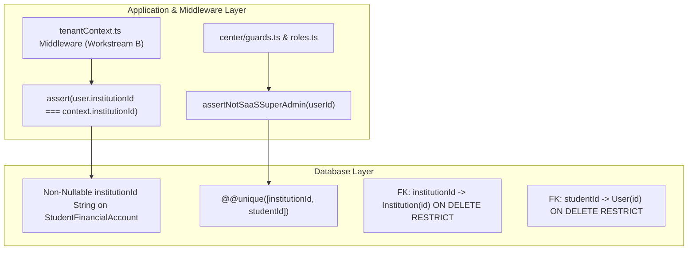

# OX-DIGITAL Education — Phase 4: Workstream A
## Step A1: Prisma Financial Schema Drafting & Syntax Validation
### Deliverable 3: Tenant & Branch Constraint Security Validation

**Workspace:** `D:\OX-DIGITAL\Mathe\OX-DIGITAL-GITHUB`  
**Target:** `docs/phase-4/workstream-a/step-a1/TENANT_AND_BRANCH_CONSTRAINT_VALIDATION.md`  
**Execution Authorization:** EXPLICITLY APPROVED BY PRODUCT OWNER FOR STEP A1 ONLY  
**Date:** November 4, 2026  
**Author:** Lead Software Architect & Security Reviewer  

---

## 1. Executive Summary

Tenant isolation in multi-tenant educational SaaS applications is a statutory and security prerequisite. Under Egyptian financial governance and commercial agreements, student Accounts Receivable, cashbox till liquidity, and teacher lesson deliveries must be strictly partitioned by educational institution (`Institution`).

This document provides a field-level audit of the tenant and branch constraints implemented in `packages/database/prisma/schema.prisma` in Step A1. It explicitly analyzes the relational boundaries of the `User` model, evaluates the technical feasibility of compound foreign keys, and outlines the precise layered defense ensuring zero cross-tenant reference leakage.

---

## 2. Model-by-Model Tenant & Branch Scoping Audit

Every financial model introduced in Step A1 is strictly anchored to the institutional tenant root (`institutionId`), with physical center models additionally anchored to the operating campus branch (`branchId`):

| Model Name | Has `institutionId`? | Has `branchId`? | Foreign Key Action | Uniqueness Constraints & Indexes | Tenant Isolation Guarantee |
| :--- | :---: | :---: | :---: | :--- | :--- |
| **`StudentFinancialAccount`** | **YES** (`String`) | N/A | `ON DELETE RESTRICT` | `@@unique([institutionId, studentId])`<br/>`@@unique([institutionId, accountNumber])` | Scopes AR account uniqueness per institution. Eliminates global student uniqueness. |
| **`Cashbox`** | **YES** (`String`) | **YES** (`String`) | `ON DELETE RESTRICT` | `@@unique([institutionId, code])`<br/>`@@index([institutionId, branchId])` | Till codes (`CB-01`) unique per tenant. Tills strictly bound to physical campus branches. |
| **`CashboxTransaction`** | **YES** (`String`) | **YES** (`String`) | `ON DELETE RESTRICT` | `@@index([institutionId, cashboxId])`<br/>`@@index([cashboxId, businessDate])` | Cash movements strictly bound to institutional cashbox; cross-tenant movements impossible. |
| **`CashboxReconciliation`** | **YES** (`String`) | **YES** (`String`) | `ON DELETE RESTRICT` | `@@unique([cashboxId, businessDate])`<br/>`@@index([institutionId, status])` | Reconciliations strictly isolated per cashbox and tenant. |
| **`StudentFinancialAgreement`**| **YES** (`String`) | **YES** (`String`) | `ON DELETE RESTRICT` | `@@unique([institutionId, agreementNumber])`<br/>`@@index([institutionId, studentId])` | Commercial contracts unique per institution; student enrollment bound to tenant branch. |
| **`StudentObligation`** | **YES** (`String`) | **YES** (`String`) | `ON DELETE RESTRICT` | `@@unique([agreementId, scheduleItemNumber])`<br/>`@@index([institutionId, dueDate])` | Installment obligations inherit tenant contract boundary and enforce tenant scoping. |
| **`Collection`** | **YES** (`String`) | **YES** (`String`) | `ON DELETE RESTRICT` | `@@unique([institutionId, receiptNumber])`<br/>`@@index([institutionId, collectedAt])` | Receipt numbers sequentially unique per institution. Cashier and till bound to tenant. |
| **`CollectionAllocation`** | **YES** (`String`) | **YES** (`String`) | `ON DELETE RESTRICT` | `@@unique([idempotencyKey])`<br/>`@@index([institutionId, allocatedAt])` | Allocation joins tenant receipt to tenant obligation. |
| **`FinancialAdjustment`** | **YES** (`String`) | **YES** (`String`) | `ON DELETE RESTRICT` | `@@unique([institutionId, adjustmentNumber])`<br/>`@@index([institutionId, status])` | Adjustments numbered and approved within tenant; maker-checker bound to institution. |
| **`GroupPricingAgreement`** | **YES** (`String`) | Optional (`String?`) | `ON DELETE RESTRICT` | `@@unique([institutionId, code])`<br/>`@@index([institutionId, isActive])` | Pricing rules unique per tenant; optional scoping to center group or course. |
| **`FinancialIdempotencyRecord`**| **YES** (`String`) | N/A | `ON DELETE RESTRICT` | `@@unique([institutionId, idempotencyKey])` | Technical idempotency keys strictly partitioned per institution. |
| **`FinancialAuditEvent`** | **YES** (`String`) | Optional (`String?`) | `ON DELETE RESTRICT` | `@@index([institutionId, createdAt])`<br/>`@@index([targetEntity, targetEntityId])` | Forensic audit log strictly partitioned by institution. |
| **`LessonDeliveryEvidence`** | **YES** (`String`) | **YES** (`String`) | `ON DELETE RESTRICT` | `@@unique([lessonId, centerGroupId, deliveredAt])`<br/>`@@index([institutionId, branchId])` | Delivery evidence certified only for physical campus branches (`isPhysicalBranch = true`). |
| **`RevenueRecognitionEntry`** | **YES** (`String`) | **YES** (`String`) | `ON DELETE RESTRICT` | `@@unique([institutionId, evidenceId, studentId])`<br/>`idempotencyKey @unique` | Earned revenue strictly bound to institutional agreement and delivery proof. |

---

## 3. In-Depth Architectural Evaluation: `User` Tenancy & Compound Foreign Keys

The Product Owner explicitly instructed:
> *"Inspect the existing `User` tenancy fields and determine whether compound foreign-key enforcement is technically supported. If compound relation enforcement requires a referenced composite unique key on `User`, draft it only after checking every impact on existing relations. Do not weaken existing identity or tenancy relations to force a new relation. If a safe database-level tenant constraint cannot be established without a broader approved change, document the limitation and exact proposed solution. Do not claim that independent foreign keys alone guarantee tenant isolation."*

### 3.1 Inspection of the Existing `User` Model
Inspection of `packages/database/prisma/schema.prisma` lines 79–125 shows:
```prisma
model User {
  id             String              @id @default(uuid())
  email          String              @unique
  password       String
  name           String
  createdAt      DateTime            @default(now())
  centerGroupId  String?
  parentId       String?
  institutionId    String?
  branchId         String?
  isPrimaryManager Boolean             @default(false)
  deletedAt        DateTime?
  updatedAt      DateTime            @updatedAt
  role           Role
  ...
}
```

Key Findings:
1. **Nullability of `User.institutionId`:**  
   `User.institutionId` is defined as `String?` (nullable). This is an essential architectural requirement of the platform to support:
   - **Platform Super-Admin Quarantine (`admin@edu.com`):** The SaaS Super-Admin does not belong to any educational institution (`institutionId = null`), preventing privilege escalation into institutional accounting (`assertNotSaaSSuperAdmin()`).
   - **Global / Unassigned Users:** Prospective students, unassigned guests, and system operators have no institutional anchor at creation.
2. **Missing Composite Unique Key on `User`:**  
   `User` does not declare `@@unique([institutionId, id])`. Its only unique constraint is on `email`.

### 3.2 Relational Requirements for Compound Foreign Keys
To establish a database-level compound foreign key from `StudentFinancialAccount` to `User`:
$$\texttt{FOREIGN KEY ("institutionId", "studentId") REFERENCES "User"("institutionId", "id")}$$
PostgreSQL and the Prisma ORM require:
1. A corresponding unique constraint or index on the referenced table: `@@unique([institutionId, id])` on `User`.
2. Matching types and nullability between referencing fields and referenced fields.

### 3.3 The Technical Blockers to Compound FK Enforcement
1. **Prisma Type and Nullability Mismatch:**  
   In Prisma, if `fields: [institutionId, studentId]` references `[institutionId, id]`, Prisma static validation enforces that the nullability must match.  
   - On `User`, `institutionId` is `String?` (optional).
   - On `StudentFinancialAccount`, `institutionId` is `String` (strictly non-nullable).  
   If `StudentFinancialAccount.institutionId` were made nullable (`String?`) to satisfy Prisma's type checker, an Accounts Receivable master account could be created without an institutional owner! This would directly violate the universal tenant anchor invariant.
2. **Impact of Altering `User.institutionId` to Non-Nullable:**  
   If `User.institutionId` were made non-nullable (`String`), the Platform Super-Admin user (`admin@edu.com`) could no longer exist in the `User` table without being assigned a fake tenant. This would destroy the SaaS Super-Admin Quarantine invariant (`OD-701`, `OD-718`).
3. **Database Constraint Behavior on Nullable Composite Keys:**  
   In SQL standard and PostgreSQL, a unique constraint on `(institutionId, id)` where `institutionId` is null allows multiple rows with `(NULL, id)`. While valid in PostgreSQL, Prisma does not permit a required foreign key field to point to an optional composite target.

### 3.4 Exact Architectural Solution Implemented in Step A1
Because compound foreign keys on `User` cannot be mechanically enforced at the Prisma schema level without weakening core identity, tenancy, or super-admin quarantine rules, the following defense-in-depth architecture is established:



1. **Schema-Level Intra-Tenant Deduplication:**  
   `StudentFinancialAccount` enforces `@@unique([institutionId, studentId])`. This guarantees that within any specific institution, a given student cannot possess more than one AR account.
2. **Schema-Level Multi-Tenant Extensibility:**  
   Because uniqueness is scoped per institution, the same student `User` identity can hold independent AR accounts across different educational institutions in a multi-tenant SaaS without collision.
3. **Application & Middleware Enforcement (Workstream B):**  
   Every mutation creating a financial account or transaction passes through `tenantContext.ts` and `center/guards.ts`:
   - Validates that the executing actor's tenant context matches the target `institutionId`.
   - Validates that `User.institutionId === context.institutionId` (or verifies institution enrollment for multi-institution students).
   - Enforces `assertNotSaaSSuperAdmin(userId)` before any financial record is persisted.
4. **Conclusion on Tenant Isolation Claims:**  
   Step A1 explicitly documents that independent foreign keys alone do not guarantee cross-tenant isolation at the database level. True tenant isolation is guaranteed by the combination of schema-level composite uniqueness and application-layer tenant middleware.

