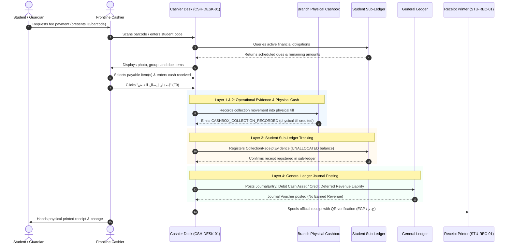
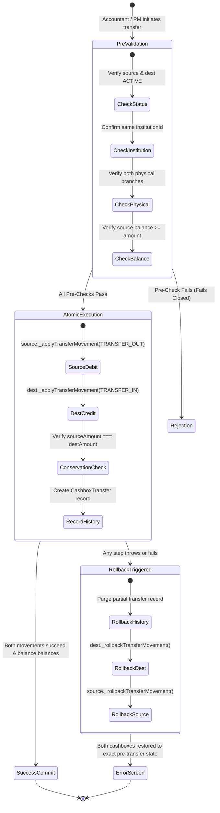
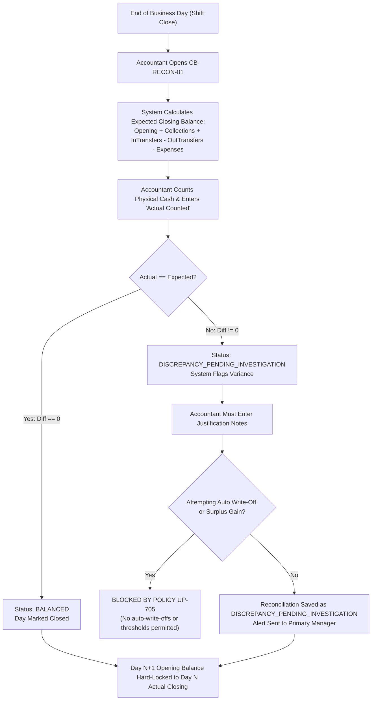
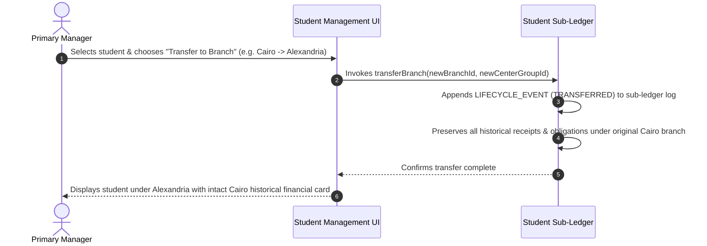
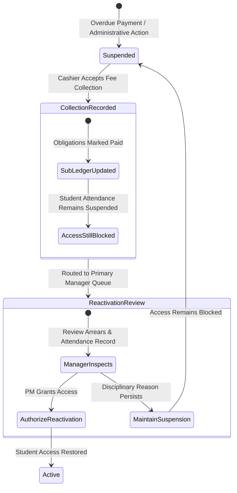
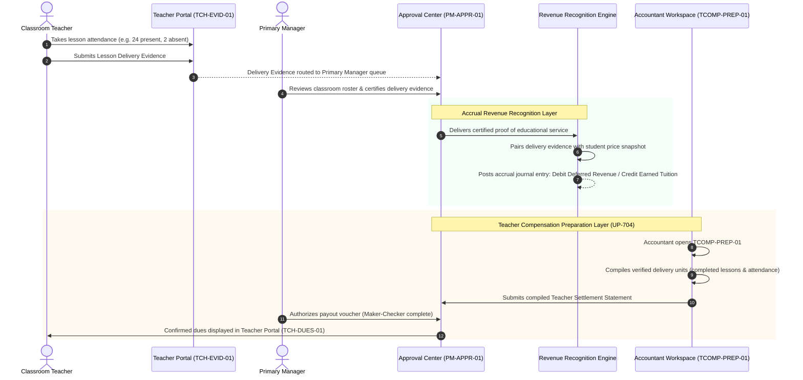

# OX-DIGITAL Education — UI/UX Design Track — Phase 1
# Document 5: Core Financial & Operational Workflows
**Document ID:** `UI_UX_PHASE_1_CORE_WORKFLOWS`  
**Status:** REVISED & ALIGNED — READY FOR PRODUCT OWNER REVIEW  
**Date:** 2026-11-03  
**Workspace:** `D:\OX-DIGITAL\Mathe\OX-DIGITAL-GITHUB`  
**Classification:** Process Modeling & Operational Workflows  

---

## 1. Frontline Student Fee Collection & Financial Layer Decoupling

### Objective
High-speed, error-resistant collection of student tuition and fees at campus reception desks, strictly maintaining the boundary between operational cash collection, student sub-ledger tracking, general ledger posting, and accrual revenue recognition.

### Financial Architecture Decoupling (Four Distinct Layers)
To prevent accounting distortion, frontline collection is decoupled into four explicit layers:
1. **Operational Collection Evidence:** The cashier records student payment details, generating a unique, signed `CollectionReceiptEvidence` document containing receipt number, timestamp, cashier ID, branch ID, payer details, and tender method.
2. **Physical Cashbox Movement:** A typed `CashMovement` (`CASH_IN`) is recorded against the branch cashbox till, physically increasing the cashier till balance.
3. **Student Sub-Ledger Tracking:** In the student's sub-ledger account, the payment is registered as an unallocated collection advance (`StudentBalanceBucket.UNALLOCATED`) or allocated to scheduled obligations (`ALLOCATED`). This tracks student-level fulfillment, NOT general ledger income.
4. **General Ledger Journal Posting:** An automated double-entry journal entry posts:
   - **Debit:** Cashbox Asset (Account `1010` - Cash on Hand).
   - **Credit:** Deferred Student Collections / Unearned Revenue Liability (Account `2210`).
   - **Zero Recognized Revenue:** Earned revenue is NEVER posted upon collection.

### UX Fail-Safe Controls
- **Idempotency Defense:** The collection button disables immediately with a spinner upon click, preventing double charges from duplicate clicks.
- **Terminology Enforcement:** The UI labels the document `إيصال قبض` (Receipt), never `فاتورة إيراد` (Revenue Invoice), explicitly communicating that fee collection is not recognized income.
- **Strict Currency:** All values default to and validate as Egyptian Pounds (`EGP` / `ج.م`).

---

## 2. Inter-Cashbox Funds Transfer Workflow (Atomic Two-Sided)

### Objective
Secure transfer of cash between reception tills and the campus safe or between physical desks within the same institution.

### UX Controls
- **Live Destination Status Guard:** If destination cashbox is `INACTIVE` or `SUSPENDED`, the transfer UI disables the destination option with an explanatory badge.
- **Two-Sided Audit Inspection:** Viewing transfer history displays both the `TRANSFER_OUT` movement on the source till and the linked `TRANSFER_IN` on the destination safe.

---

## 3. Daily Closing Cashbox Reconciliation Workflow (Continuous Chain)

### Objective
Physical cash count verification and formal business date closing for campus cashboxes under strict `UP-705` governance.

### Governance Invariants (`UP-705`)
- **Zero Discrepancy Tolerance:** The UI permits no variance threshold. Any non-zero difference triggers `DISCREPANCY_PENDING_INVESTIGATION`.
- **No Automatic Absorption:** The interface strictly disables auto write-off or surplus gain recognition.
- **Contiguous Continuity:** Day N+1 opening balance is hard-locked to Day N actual physical closing count.

---

## 4. Student Branch Transfer, Financial Suspension & Withdrawal

### Objective
Managing student branch mobility, financial suspensions, and withdrawals while strictly decoupling collection from access reactivation and preserving append-only financial audit trails.

### 4.1 Branch Transfer Flow

### 4.2 Financial Suspension & Access Reactivation Decoupling
To enforce institutional governance, financial suspension, fee collection, review, and educational access reactivation are strictly decoupled into distinct states:
1. **Suspension State (`SUSPENDED_FINANCIAL`):** Student attendance and classroom entry are blocked due to overdue fee obligations.
2. **Frontline Collection State:** Frontline cashier is permitted to accept fee payments, generating a collection receipt and crediting the sub-ledger.
3. **No Automatic Reactivation:** Payment does **NOT** automatically lift attendance suspension or reactivate educational access.
4. **Reactivation Review & Approval:** Reactivation requires explicit administrative authorization by the Primary Manager or an authorized policy permission:

### 4.3 Student Withdrawal Flow (`UP-706`)
- **Status:** Under `UP-706`, automated refund execution is blocked fail-closed pending legal and commercial policy review.
- **Workflow:** When a student formally withdraws:
  1. Primary Manager transitions student status to `WITHDRAWN`.
  2. Sub-ledger preserves 100% of historical receipts, obligations, and allocations intact.
  3. The UI presents refund requests, review, approval, and adjustments as decoupled states without committing to an unapproved refund formula.

---

## 5. Teacher Lesson Delivery Evidence & Accrual Recognition

### Objective
Coupling physical educational delivery evidence with accrual revenue recognition and teacher compensation settlement.

### Governance Guard (`UP-704`)
- **No Unapproved Revenue Share Calculations:** The UI displays confirmed physical delivery units (lessons completed, students attended). Variable revenue-sharing percentages remain disabled and configurable pending formal Product Owner policy resolution.
