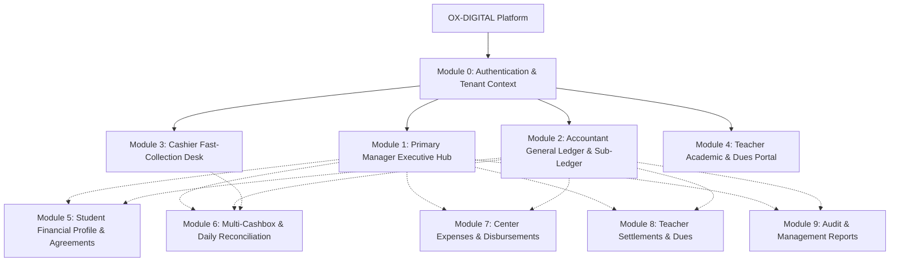

# OX-DIGITAL Education — UI/UX Design Track — Phase 1
# Document 2: Product Information Architecture & Navigation
**Document ID:** `UI_UX_PHASE_1_INFORMATION_ARCHITECTURE`  
**Status:** COMPLETE — READY FOR PRODUCT OWNER REVIEW  
**Date:** 2026-11-03  
**Workspace:** `D:\OX-DIGITAL\Mathe\OX-DIGITAL-GITHUB`  
**Classification:** UX Architecture & Navigation System  

---

## 1. Product Information Architecture Overview

OX-DIGITAL Education is architected as a commercial, multi-tenant SaaS platform serving physical educational centers and multi-branch educational institutions. 

### 1.1 Structural Principles
1. **Single Institution Root with Branch Dimensions:** Each educational center operates under an authoritative `Institution` record. All accounting transactions share the institution's General Ledger, partitioned by physical `Branch` dimensions.
2. **Role-Tailored Workspaces:** The application replaces monolithic dashboards with four dedicated role-specific operational workspaces:
   - **Primary Manager:** Executive oversight, branch aggregation, financial governance, approvals, and academic policy.
   - **Accountant:** General ledger, sub-ledger allocations, cashbox balancing, expense verification, and reconciliation.
   - **Cashier:** High-throughput, focused frontline collection, receipt generation, and till verification.
   - **Teacher:** Personal lesson delivery, attendance records, assigned groups, and verified settlement tracking.
3. **Branch-Scoped Context Engine:** A persistent header control displays and scopes data to the user's active branch (or "All Branches" for the Primary Manager).



---

## 2. Navigation Architecture & Global Layout

The platform uses a standardized, responsive **Three-Zone Layout Shell** optimized for Arabic RTL reading flow (with full support for LTR toggle):

### 2.1 Zone Breakdown
1. **Zone A: Global Top App Bar (Header):**
   - **Institution Branding & Logo:** Displays current center name.
   - **Active Branch Selector (Pill Dropdown):**
     - Primary Manager: Shows active branch with option for `[كل الفروع - All Branches]` consolidated view.
     - Accountant / Cashier / Teacher: Shows bound physical campus branch (read-only if single-branch assigned; selectable if multi-branch assigned).
   - **Role Badge Chip:** Visually denotes current access persona (`مدير رئيسي`, `محاسب`, `أمين صندوق`, `معلم`).
   - **Quick Actions:** New collection receipt (Cashier/Accountant), quick search (Cmd+K).
   - **User Profile Menu:** Profile view, Dark/Light theme toggle, Language selector (العربية / English), Secure Logout.
2. **Zone B: Primary Navigation Rail (Right Sidebar in RTL):**
   - Collapsible desktop sidebar (280px expanded, 72px icon-only rail).
   - Clean iconography (Lucide React) with active indicators in primary brand red (`--primary: #b62626` / provisional `#9e1b1b`).
   - Role-filtered navigation items (strictly no dead links or unauthorized screens).
3. **Zone C: Fluid Workspace Canvas (Content Area):**
   - Dynamic Breadcrumb trail (`الرئيسية > الطلاب > الملف المالي > إيصال قبوضات`).
   - Sticky contextual page header with Title, Subtitle, Metric badges, and Primary Action Buttons.
   - Responsive multi-column grid with horizontal scroll protection for financial tables.

---

## 3. Comprehensive Screen Inventory & Hierarchy

### Module 0: Authentication & Institution Context
| Screen ID | Screen Name (Arabic / English) | Route | Primary Persona | Purpose |
| :--- | :--- | :--- | :--- | :--- |
| `AUTH-01` | تسجيل الدخول المركزي / Unified Login | `/login` | Public / All | Secure credential verification, password authentication, and initial JWT token acquisition. |
| `AUTH-02` | استعادة كلمة المرور / Password Recovery | `/forgot-password` | Public / All | Self-service password reset request via email. |
| `AUTH-03` | إعادة تعيين كلمة المرور / Reset Password | `/reset-password` | Public / All | Secure reset token confirmation and new password establishment. |
| `AUTH-04` | قبول دعوة المدير الرئيسي / Director Onboarding | `/invitation/accept` | Primary Manager | Cryptographic Option 3B invitation token verification and institution account binding. |
| `AUTH-05` | شاشة رفض الوصول / Permission Denied | `/unauthorized` | All Authenticated | Standardized HTTP 403 screen explaining authorization boundary and active role. |

---

### Module 1: Primary Manager Executive Hub
| Screen ID | Screen Name (Arabic / English) | Route | Primary Persona | Purpose |
| :--- | :--- | :--- | :--- | :--- |
| `PM-DASH-01` | لوحة المؤشرات التنفيذية / Executive Dashboard | `/manager/dashboard` | Primary Manager | Consolidated institution overview: verified collections, outstanding balances, active students, cashbox totals, pending approvals. |
| `PM-BR-01` | بطاقة أداء الفروع / Branch Performance | `/manager/branches` | Primary Manager | Comparative operational health across physical campus branches. |
| `PM-APPR-01` | مركز الموافقات المالية / Approval Center | `/manager/approvals` | Primary Manager | Maker-Checker review queue for expense disbursements, fee adjustments, and cross-branch requests. |
| `PM-AUDIT-01` | سجل التدقيق والرقابة / Audit Trail Explorer | `/manager/audit-log` | Primary Manager | Immutable audit log of all financial, tenancy, and security events. |
| `PM-USER-01` | إدارة مستخدمي المؤسسة / Staff & Roles | `/manager/staff` | Primary Manager | Assignment of Accountant, Cashier, and Teacher personnel to physical branches. |

---

### Module 2: Accountant General Ledger & Sub-Ledger Workspace
| Screen ID | Screen Name (Arabic / English) | Route | Primary Persona | Purpose |
| :--- | :--- | :--- | :--- | :--- |
| `ACC-DASH-01` | لوحة المحاسب المالية / Accounting Workspace | `/accountant/dashboard` | Accountant | Daily collection totals, unallocated receipts, cashbox discrepancies pending review, upcoming dues. |
| `ACC-STU-01` | دفتر أستاذ الطلاب المساعد / Student Sub-Ledger Directory | `/accountant/subledger` | Accountant | Comprehensive searchable directory of student financial agreements, dues, and payment arrangements. |
| `ACC-REC-01` | سجل إيصالات القبض / Collection Receipts Register | `/accountant/receipts` | Accountant | Master register of all frontline collections, allocation status, and payment method audit. |
| `ACC-ALLOC-01` | تخصيص المقبوضات على الالتزامات / Allocation Engine | `/accountant/allocations` | Accountant | FIFO and manual obligation allocation workspace matching unallocated receipts to student obligations. |
| `ACC-REV-01` | شاشة التسويات وإلغاء القيود / Reversal & Adjustment Desk | `/accountant/reversals` | Accountant | Append-only compensating reversal initiator for bounced receipts, incorrect cash movements, or voided entries. |
| `ACC-GL-01` | قيود اليومية المحاسبية / Journal Entry Explorer | `/accountant/journal` | Accountant | Read-only inspection of balanced double-entry accrual revenue postings (Deferred Revenue -> Earned Tuition). |

---

### Module 3: Cashier Fast-Collection Desk
| Screen ID | Screen Name (Arabic / English) | Route | Primary Persona | Purpose |
| :--- | :--- | :--- | :--- | :--- |
| `CSH-DESK-01` | منصة التحصيل السريع / Rapid Collection Terminal | `/cashier/collect` | Cashier | High-speed, focused single-screen workflow: find student, verify photo/group, view pending due items, enter cash/card, issue receipt. |
| `CSH-TX-01` | سجل مقبوضات الوردية / Shift Transaction History | `/cashier/shift-receipts` | Cashier | Immediate list of receipts collected by current cashier during active business date with reprint capability. |
| `CSH-CLOSE-01` | إغلاق الوردية الفعلي / Cashier Shift Handover | `/cashier/handover` | Cashier | Counted cash declaration and transfer preparation for physical branch main safe. |

---

### Module 4: Teacher Academic & Dues Portal
| Screen ID | Screen Name (Arabic / English) | Route | Primary Persona | Purpose |
| :--- | :--- | :--- | :--- | :--- |
| `TCH-DASH-01` | لوحة المعلم الأكاديمية / Teacher Overview | `/teacher/overview` | Teacher | Personal schedule, today's group lessons, attendance summary, confirmed dues statement. |
| `TCH-GRP-01` | مجموعاتي التعليمية / My Center Groups | `/teacher/groups` | Teacher | Student rosters, academic progress, and group lesson schedule. |
| `TCH-EVID-01` | إثبات الحضور والدروس / Lesson Delivery Evidence | `/teacher/evidence` | Teacher | Submitting classroom attendance proof as formal academic delivery evidence. |
| `TCH-DUES-01` | كشف المستحقات المالية / My Verified Dues | `/teacher/dues` | Teacher | Read-only breakdown of approved compensation, verified delivery units, and historical disbursements. |

---

### Module 5: Student Financial Profile & Agreements
| Screen ID | Screen Name (Arabic / English) | Route | Primary Persona | Purpose |
| :--- | :--- | :--- | :--- | :--- |
| `STU-FIN-01` | الملف المالي الشامل للطالب / Student Financial Profile | `/students/:id/financial` | PM, Accountant | Master financial ledger card: Price snapshot, payment arrangements, balance breakdown, receipt history. |
| `STU-AGR-01` | إنشاء اتفاقية مالية / Create Financial Agreement | `/students/:id/agreements/new` | Accountant, PM | Structured arrangement builder: catalog price, discount reason, net price, scheduled dues calendar. |
| `STU-REC-01` | تفاصيل إيصال القبض / Receipt Detail & Print | `/receipts/:receiptId` | PM, Acc, Cashier | Official thermal / A4 printable collection receipt with QR verification, cashbox reference, and student ID. |

---

### Module 6: Cashbox Operations & Daily Reconciliation
| Screen ID | Screen Name (Arabic / English) | Route | Primary Persona | Purpose |
| :--- | :--- | :--- | :--- | :--- |
| `CB-LIST-01` | خزائن الفرع ونقاط البيع / Branch Cashbox Register | `/cashboxes` | PM, Accountant | Multi-cashbox listing for physical campus: Tills, Safes, Reception boxes, current cash balances. |
| `CB-VIEW-01` | دفتر حركات الخزينة / Cashbox Movement Ledger | `/cashboxes/:id` | PM, Accountant | Append-only ledger of Collections, Expenses, Transfers In/Out, and Reversals with rolling balances. |
| `CB-XFER-01` | تحويل نقدية بين الخزائن / Inter-Cashbox Transfer | `/cashboxes/transfer` | PM, Accountant | Two-sided atomic transfer modal between physical cashboxes of the same institution. |
| `CB-RECON-01` | إقفال ومطابقة النقدية اليومية / Daily Closing Reconciliation | `/cashboxes/:id/reconcile` | PM, Accountant | Business date closing: Opening balance + Net movements = Expected Closing vs. Actual Counted Count. |
| `CB-DISC-01` | تقرير الفروقات والتحقيق / Discrepancy Investigation | `/cashboxes/:id/discrepancies` | PM, Accountant | Tracking pending investigation shortages or surpluses under UP-705 (strictly zero auto-write-off). |

---

### Module 7: Center Expenses & Petty Cash Disbursements
| Screen ID | Screen Name (Arabic / English) | Route | Primary Persona | Purpose |
| :--- | :--- | :--- | :--- | :--- |
| `EXP-LIST-01` | سجل المصروفات والنثريات / Center Expenses Register | `/expenses` | PM, Accountant | Itemized campus operational expenses, voucher references, categories, and payment cashbox references. |
| `EXP-NEW-01` | تسجيل مستند صرف / Record Expense Voucher | `/expenses/new` | Accountant | Entry form for petty cash disbursement, required physical voucher number, category, and cashbox balance check. |

---

### Module 8: Teacher Compensation & Settlements
| Screen ID | Screen Name (Arabic / English) | Route | Primary Persona | Purpose |
| :--- | :--- | :--- | :--- | :--- |
| `TCOMP-PREP-01`| إعداد مستحقات المعلمين / Teacher Dues Preparation | `/teacher-dues/prepare` | Accountant | Compiling verified lesson delivery evidence and student attendance counts for payroll review. |
| `TCOMP-REV-01` | اعتماد مستحقات المعلمين / Teacher Settlement Approval | `/teacher-dues/approve` | Primary Manager | Executive sign-off on prepared teacher settlements based on approved institutional compensation rules. |
| `TCOMP-HIST-01`| سجل الصرف والتسويات / Teacher Settlement History | `/teacher-dues/history` | PM, Accountant | Historical disbursement vouchers and bank/cash payment logs. |

---

### Module 9: Reports & Governance Analytics
| Screen ID | Screen Name (Arabic / English) | Route | Primary Persona | Purpose |
| :--- | :--- | :--- | :--- | :--- |
| `REP-COL-01` | تقرير المقبوضات حسب الفرع / Branch Collections Report | `/reports/collections` | PM, Accountant | Date-filtered total cash and electronic fee receipts partitioned by physical campus branch. |
| `REP-DUE-01` | تقرير الأرصدة المستحقة والمتأخرة / Outstanding Dues Aging | `/reports/outstanding-dues`| PM, Accountant | Student balance aging analysis based on scheduled arrangement due dates. |
| `REP-RECON-01`| تقرير مطابقة الخزائن المجمع / Consolidated Cashbox Report | `/reports/cashbox-summary` | PM, Accountant | Multi-branch daily closing balances, surplus/shortage audit log, and continuity verification. |
| `REP-EXP-01` | تقرير المصروفات التشغيلية / Operational Expense Report | `/reports/expenses` | PM, Accountant | Categorized operational expense spend per branch against approved vouchers. |
| `REP-EARN-01` | تقرير الإيرادات المحققة المكتسبة / Earned Revenue Report | `/reports/earned-revenue` | PM, Accountant | Accrual tuition earned from delivered academic lessons (strictly decoupled from fee collections). |

---

## 4. Breadcrumb & Deep-Linking Hierarchy

All screens participate in a strictly defined navigation hierarchy ensuring that users never lose context when investigating drill-down financial records:

```text
[لوحة التحكم / Dashboard]
 └── [الطلاب / Students]
      └── [الملف المالي: أحمد محمود / Financial Profile: Ahmed Mahmoud]
           ├── [إنشاء اتفاقية مالية / Create Agreement]
           ├── [تفاصيل إيصال القبض REC-001 / Receipt Detail]
           └── [تخصيص المقبوضات / Allocate Collection]

[لوحة التحكم / Dashboard]
 └── [الخزائن / Cashboxes]
      └── [خزينة الاستقبال الرئيسية / Main Reception Till]
           ├── [حركات الخزينة / Ledger Movements]
           ├── [تحويل بين الخزائن / Inter-Cashbox Transfer]
           └── [إقفال اليومية ومطابقة النقدية / Daily Closing]
```

