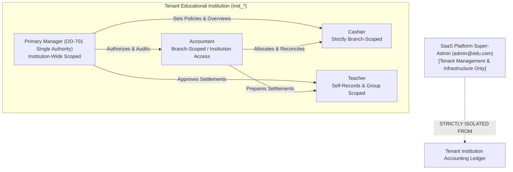

# OX-DIGITAL Education — UI/UX Design Track — Phase 1
# Document 3: Role-Permission Matrix & Access Governance
**Document ID:** `UI_UX_PHASE_1_ROLE_PERMISSION_MATRIX`  
**Status:** COMPLETE — READY FOR PRODUCT OWNER REVIEW  
**Date:** 2026-11-03  
**Workspace:** `D:\OX-DIGITAL\Mathe\OX-DIGITAL-GITHUB`  
**Classification:** Security Architecture & Access Control Specification  

---

## 1. Persona Definitions & Access Boundaries

The platform enforces a strict, four-role institutional access architecture established in Phase 2.0A.3 and validated throughout Phase 2.0B.

### 1.1 Four Authoritative Institution Personas

1. **Primary Manager (`PRIMARY_MANAGER`):**
   - **Scope:** Institution-wide across all physical campus branches. Exactly one Primary Manager per institution.
   - **Authority:** Approves financial policies, signs off on expense vouchers above thresholds, approves teacher compensation settlements, conducts executive audits, manages staff assignments, and accesses consolidated multi-branch reports.
   - **Restrictions:** Cannot edit posted General Ledger entries (append-only immutability).
2. **Accountant (`ACCOUNTANT`):**
   - **Scope:** Institutional financial accounting, assigned either to specific branches or all branches by the Primary Manager.
   - **Authority:** Manages student financial agreements, records fee schedules, manages cashboxes, processes collections, enters operational expenses, executes daily closing reconciliations, initiates append-only reversals, and prepares teacher settlements.
   - **Restrictions:** Cannot approve their own approval-required disbursements (Maker-Checker); cannot delete posted records; cannot modify academic delivery evidence.
3. **Cashier (`CASHIER`):**
   - **Scope:** Strictly bound to an active physical cashbox till within a designated physical campus branch.
   - **Authority:** Fast frontline fee collection from students, issuance of official collection receipts, viewing shift collection history, and executing shift cash handover.
   - **Restrictions:** Strictly barred from General Ledger journal entries, student sub-ledger debt write-offs, teacher payroll/compensation, operational expenses, institution-wide reports, and unallocated balance manipulation.
4. **Teacher (`TEACHER`):**
   - **Scope:** Strictly personal, scoped exclusively to their own assigned center groups and scheduled classroom lessons.
   - **Authority:** Takes classroom attendance, submits lesson delivery evidence, reviews personal verified delivery counts, and views approved settlement history.
   - **Restrictions:** Strictly barred from all institutional accounting ledgers, cashboxes, other teachers' compensation records, fee collection desks, or self-approving compensation dues.

### 1.2 Explicit Non-Personas & Prohibited Roles
- **Branch Manager Role is FORBIDDEN:** Under approved Product Owner decision OD-701, no "Branch Manager" role exists. Branch oversight belongs directly to the Primary Manager with branch dimensions.
- **SaaS Platform Super-Admin (`admin@edu.com`) is ISOLATED:** The platform super-admin manages SaaS subscription contracts, global tenant provisioning, and server infrastructure. The super-admin is cryptographically prevented from operating educational center cashboxes, issuing student fee receipts, or altering tenant accounting ledgers (OD-718 guard).

---

## 2. Screen-Level Access Control Matrix

**Legend:**
- **`FULL`**: Can view, create, execute, and submit actions.
- **`READ`**: Can view and inspect data; no mutation controls displayed.
- **`PREPARE`**: Can draft and compile items for Maker-Checker review.
- **`APPROVE`**: Can authorize or reject items submitted for review.
- **`SELF`**: Can view and manage records strictly bound to their own authenticated user ID.
- **`NONE`**: Access denied; route blocked by route guard; navigation link hidden.

| Screen ID | Screen Name | Route | Primary Manager | Accountant | Cashier | Teacher | Branch Scope Rule |
| :--- | :--- | :--- | :---: | :---: | :---: | :---: | :--- |
| **`AUTH-01`** | Unified Login | `/login` | `FULL` | `FULL` | `FULL` | `FULL` | Universal |
| **`AUTH-02`** | Password Recovery | `/forgot-password` | `FULL` | `FULL` | `FULL` | `FULL` | Universal |
| **`AUTH-03`** | Reset Password | `/reset-password` | `FULL` | `FULL` | `FULL` | `FULL` | Universal |
| **`AUTH-04`** | Director Onboarding | `/invitation/accept` | `FULL` | `NONE` | `NONE` | `NONE` | Institution Root |
| **`AUTH-05`** | Permission Denied | `/unauthorized` | `FULL` | `FULL` | `FULL` | `FULL` | Universal |
| **`PM-DASH-01`** | Executive Dashboard | `/manager/dashboard` | `FULL` | `NONE` | `NONE` | `NONE` | All Branches / Filterable |
| **`PM-BR-01`** | Branch Performance | `/manager/branches` | `FULL` | `NONE` | `NONE` | `NONE` | All Branches |
| **`PM-APPR-01`** | Approval Center | `/manager/approvals` | `APPROVE` | `NONE` | `NONE` | `NONE` | All Branches |
| **`PM-AUDIT-01`** | Audit Trail Explorer | `/manager/audit-log` | `READ` | `NONE` | `NONE` | `NONE` | All Branches |
| **`PM-USER-01`** | Staff & Roles | `/manager/staff` | `FULL` | `NONE` | `NONE` | `NONE` | All Branches |
| **`ACC-DASH-01`** | Accounting Workspace | `/accountant/dashboard` | `READ` | `FULL` | `NONE` | `NONE` | Bound Branch(es) |
| **`ACC-STU-01`** | Student Sub-Ledger | `/accountant/subledger` | `READ` | `FULL` | `NONE` | `NONE` | Bound Branch(es) |
| **`ACC-REC-01`** | Collection Receipts | `/accountant/receipts` | `READ` | `FULL` | `NONE` | `NONE` | Bound Branch(es) |
| **`ACC-ALLOC-01`** | Allocation Engine | `/accountant/allocations` | `READ` | `FULL` | `NONE` | `NONE` | Bound Branch(es) |
| **`ACC-REV-01`** | Reversal Desk | `/accountant/reversals` | `APPROVE` | `PREPARE` | `NONE` | `NONE` | Bound Branch(es) |
| **`ACC-GL-01`** | Journal Explorer | `/accountant/journal` | `READ` | `READ` | `NONE` | `NONE` | Bound Branch(es) |
| **`CSH-DESK-01`** | Rapid Collection Desk| `/cashier/collect` | `NONE` | `FULL` | `FULL` | `NONE` | Active Cashbox Branch |
| **`CSH-TX-01`** | Shift History | `/cashier/shift-receipts` | `NONE` | `READ` | `SELF` | `NONE` | Current Cashbox Till |
| **`CSH-CLOSE-01`** | Shift Handover | `/cashier/handover` | `NONE` | `READ` | `FULL` | `NONE` | Current Cashbox Till |
| **`TCH-DASH-01`** | Teacher Overview | `/teacher/overview` | `READ` | `NONE` | `NONE` | `SELF` | Own Groups / Lessons |
| **`TCH-GRP-01`** | My Center Groups | `/teacher/groups` | `READ` | `NONE` | `NONE` | `SELF` | Assigned Groups Only |
| **`TCH-EVID-01`** | Delivery Evidence | `/teacher/evidence` | `APPROVE` | `NONE` | `NONE` | `FULL` | Assigned Lessons Only |
| **`TCH-DUES-01`** | My Verified Dues | `/teacher/dues` | `READ` | `READ` | `NONE` | `SELF` | Own Compensation Only |
| **`STU-FIN-01`** | Student Financial Card| `/students/:id/financial`| `READ` | `FULL` | `READ (Due Only)`| `NONE`| Student Home Branch |
| **`STU-AGR-01`** | Create Agreement | `/students/:id/agreements/new`| `APPROVE`| `FULL` | `NONE` | `NONE` | Student Home Branch |
| **`STU-REC-01`** | Receipt Detail & Print| `/receipts/:receiptId` | `READ` | `FULL` | `READ` | `NONE` | Originating Branch |
| **`CB-LIST-01`** | Branch Cashboxes | `/cashboxes` | `READ` | `FULL` | `NONE` | `NONE` | Bound Branch(es) |
| **`CB-VIEW-01`** | Cashbox Ledger | `/cashboxes/:id` | `READ` | `FULL` | `NONE` | `NONE` | Specific Cashbox Branch |
| **`CB-XFER-01`** | Inter-Cashbox Transfer| `/cashboxes/transfer` | `APPROVE` | `FULL` | `NONE` | `NONE` | Source & Dest Branches |
| **`CB-RECON-01`** | Daily Closing Reconcile| `/cashboxes/:id/reconcile`| `READ` | `FULL` | `NONE` | `NONE` | Specific Cashbox Branch |
| **`CB-DISC-01`** | Discrepancy Investigate| `/cashboxes/:id/discrepancies`| `FULL`| `PREPARE`| `NONE` | `NONE` | Specific Cashbox Branch |
| **`EXP-LIST-01`** | Expenses Register | `/expenses` | `READ` | `FULL` | `NONE` | `NONE` | Bound Branch(es) |
| **`EXP-NEW-01`** | Record Expense Voucher| `/expenses/new` | `NONE` | `FULL` | `NONE` | `NONE` | Bound Branch(es) |
| **`TCOMP-PREP-01`**| Prep Teacher Dues | `/teacher-dues/prepare` | `NONE` | `FULL` | `NONE` | `NONE` | Bound Branch(es) |
| **`TCOMP-REV-01`** | Approve Teacher Dues | `/teacher-dues/approve` | `APPROVE` | `NONE` | `NONE` | `NONE` | All Branches |
| **`TCOMP-HIST-01`**| Settlement History | `/teacher-dues/history` | `READ` | `FULL` | `NONE` | `NONE` | Bound Branch(es) |
| **`REP-COL-01`** | Collections Report | `/reports/collections` | `READ` | `READ` | `NONE` | `NONE` | Filterable by Branch |
| **`REP-DUE-01`** | Dues Aging Report | `/reports/outstanding-dues`| `READ` | `READ` | `NONE` | `NONE` | Filterable by Branch |
| **`REP-RECON-01`** | Cashbox Consolidation | `/reports/cashbox-summary` | `READ` | `READ` | `NONE` | `NONE` | Multi-Branch Consolidated |
| **`REP-EXP-01`** | Expense Report | `/reports/expenses` | `READ` | `READ` | `NONE` | `NONE` | Filterable by Branch |
| **`REP-EARN-01`** | Earned Revenue Report | `/reports/earned-revenue` | `READ` | `READ` | `NONE` | `NONE` | Institution Consolidated |

---

## 3. Maker-Checker Segregation of Duties

To protect institutional financial integrity, the UI strictly enforces dual-custody segregation of duties:

1. **Expense Disbursements:**
   - *Maker:* Accountant enters expense voucher, attaches physical invoice receipt, and submits.
   - *Checker:* Primary Manager reviews and approves disbursement.
   - *Enforcement:* The Primary Manager cannot create unverified petty cash entries; the Accountant cannot mark their own entries as approved.
2. **Teacher Compensation Settlements:**
   - *Maker:* Accountant compiles delivery evidence and attendance units via `TCOMP-PREP-01`.
   - *Checker:* Primary Manager approves the settlement statement via `TCOMP-REV-01`.
   - *Enforcement:* Teachers have zero write access to settlement calculations.
3. **Reversal of Posted Transactions:**
   - *Maker:* Accountant flags transaction, records mandatory audit reason, and prepares reversal record.
   - *Checker:* Primary Manager authorizes compensating reversal movement.
   - *Enforcement:* Frontend never renders "Edit" or "Delete" buttons for posted financial movements.
4. **Inter-Cashbox Physical Transfers:**
   - Source cashier or accountant initiates `TRANSFER_OUT` at `CB-XFER-01`.
   - Counterpart cashbox recipient confirms receipt (`TRANSFER_IN`).
   - Atomic domain engine ensures both movements commit or both rollback.

---

## 4. Cross-Branch & Tenant Isolation Enforcement

1. **Header Branch Scoping:**
   - When a user selects a branch in the header pill dropdown, an `activeBranchId` state is updated in the application context.
   - All subsequent queries append `?branchId=${activeBranchId}`.
   - If an unauthorized user manually alters the URL parameter or attempts cross-branch access, backend middleware rejects with `CROSS_BRANCH_ACCESS_DENIED` and the UI renders `AUTH-05`.
2. **Cross-Institution Isolation:**
   - Institutional boundaries are immutable. A user from `inst_synth_alpha` can never view records from `inst_synth_beta`.
   - The UI never exposes institution pickers or multi-tenant selectors to institution-level users.

