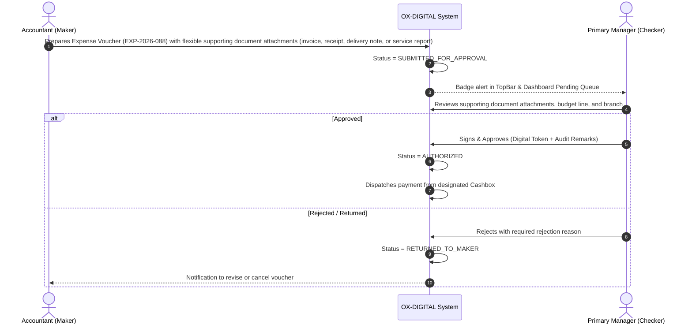

# OX-DIGITAL Education — UI/UX Phase 2 (Batch 2)
# Document 1: Primary Manager Dashboard Specification
**Document ID:** `PRIMARY_MANAGER_DASHBOARD_SPEC`  
**Status:** COMPLETE & AUTHORITATIVE — READY FOR PRODUCT OWNER REVIEW  
**Date:** 2026-11-03  
**Workspace:** `D:\OX-DIGITAL\Mathe\OX-DIGITAL-GITHUB`  
**Target Path:** `docs/ui-ux/phase-2/batch-2-primary-manager/PRIMARY_MANAGER_DASHBOARD_SPEC.md`  
**Classification:** Executive Interface & Financial Metrics Specification  

> [!NOTE] Demonstration Data Policy
> All figures, balances, student counts, teacher settlements, transaction logs, institution names, and branch codes cited in this document and accompanying interactive prototypes are **SYNTHETIC DEMONSTRATION DATA (DEMO DATA — NOT REAL)**. They are designed to illustrate layout density, spatial hierarchy, and data flow without referencing actual database records.

---

## 1. Executive Role Context & Dashboard Objective

The **Primary Manager (`PRIMARY_MANAGER`)** serves as the ultimate institutional authority (Executive Director / Managing Partner / General Manager) within the OX-DIGITAL Education multi-tenant architecture. 

### 1.1 Core Mission of the Dashboard
The Primary Manager Dashboard (`PM-DASH-01`) is designed to provide immediate, actionable visibility into the operational, financial, and regulatory health of the entire educational center. It eliminates guesswork by establishing strict accounting segregation across all campus branches:
1. **Instant Consolidated Governance:** Switch seamlessly between an institution-wide consolidated view (`INST-01`) and individual branch perspectives (`BR-01`, `BR-02`, `BR-ONLINE`).
2. **Defensive Financial Clarity:** Enforces the fundamental four-tier financial separation:
   $$\text{Financial Agreement (Contract)} \neq \text{Amount Due (Schedule)} \neq \text{Actual Collection (Cash/Bank)} \neq \text{Recognized Revenue (Delivered Services)}$$
   Under no circumstances is uncollected tuition or unearned agreement value presented as recognized revenue.
3. **Maker-Checker Authorization Hub:** Serves as the central approval gate for operational expense vouchers, cashbox transfer requests, student fee adjustments, and closing reconciliations prepared by the Accountant.
4. **Zero Speculative Forecasting:** Presents only verified historical facts, verified attendance evidence, and confirmed cash ledger balances. No automated future revenue projections or unauthorized tax calculations.

---

## 2. Dashboard Layout Architecture & Widget Hierarchy

The dashboard layout reuses the approved Batch 1 Application Shell geometry (64px TopBar, 260px collapsible Sidebar, 1600px max canvas) with high-density Arabic RTL ergonomics.

### 2.1 Spatial Organization Grid

```text
+-----------------------------------------------------------------------------------------------------------------------+
| [TOPBAR: Institution Identity | Branch Selector: "المركز بالكامل (عرض موحد)" | Search | Bell | Theme | User Avatar]  |
+-----------------------------------------------------------------------------------------------------------------------+
| SIDEBAR (260px)       | BREADCRUMBS: الرئيسية > لوحة القيادة التنفيذية (PM-DASH-01)        [تحديث البيانات] [تصدير تقرير]     |
| - لوحة القيادة        |-----------------------------------------------------------------------------------------------|
| - الفروع (3)          | SECTION 1: EXECUTIVE KPI SUMMARY TILES (4 Primary Financial Metrics)                          |
| - الاعتمادات والموافقات | +------------------+ +------------------+ +------------------+ +------------------+          |
| - الخزائن والنقدية    | | إجمالي التحصيلات | | المستحقات المتأخرة | | السيولة بالخزائن | | الإيراد المحقق  |          |
| - شؤون الطلاب المالية | | 110,500.00 ج.م   | | 39,700.00 ج.م    | | 86,400.00 ج.م    | | 93,000.00 ج.م   |          |
| - مستحقات المعلمين    | +------------------+ +------------------+ +------------------+ +------------------+          |
| - التقارير المالية    |-----------------------------------------------------------------------------------------------|
|                       | SECTION 2: OPERATIONAL ALERT & PENDING APPROVALS BAR (Maker-Checker Gateways)                 |
|                       | [!] 3 طلبات صرف معلقة (7,850 ج.م) | [?] 1 فروقات خزينة قيد التحقيق (UP-705) | [*] 2 تسوية حصص |
|                       |-----------------------------------------------------------------------------------------------|
|                       | SECTION 3: SPLIT OPERATIONAL CANVAS (2:1 Grid Ratio)                                          |
|                       | +-----------------------------------------------+ +-----------------------------------------+ |
|                       | | WIDGET A: BRANCH PERFORMANCE CARDS            | | WIDGET B: PENDING APPROVALS QUEUE       | |
|                       | | - فرع الدقي (رئيسي): 62,000 ج.م (خزينة: OK)    | | 1. سند صرف صيانة معامل (2,500 ج.م)      | |
|                       | | - فرع مدينة نصر: 48,500 ج.م (خزينة: OK)       | | 2. تسوية فروقات إغلاق خزينة (UP-705)    | |
|                       | | - الفرع الأونلاين: مؤجل — خارج النطاق المالي  | | 3. طلب خصم استثنائي لطالب (500 ج.م)     | |
|                       | +-----------------------------------------------+ +-----------------------------------------+ |
|                       |-----------------------------------------------------------------------------------------------|
|                       | SECTION 4: RECENT AUDITED TRANSACTIONS & CASHBOX LEDGER FEED                                  |
|                       | [جدول أحدث المقبوضات والتحويلات المعتمدة - 10 عمليات مع التفاصيل، الكاشير، والفرع]             |
+-----------------------------------------------------------------------------------------------------------------------+
```

---

## 3. Financial KPI Definitions & Mathematical Rules

Every metric displayed on the Primary Manager Dashboard adheres to strict accounting definitions. No composite or ambiguous numbers are permitted.

| KPI Widget | Arabic Metric Label | Calculation Formula / Rule | Financial Meaning & Protection |
| :--- | :--- | :--- | :--- |
| **KPI-01: Actual Collections** | **إجمالي التحصيلات الفعلية** | $$\sum \text{Movement}_{\text{amount}} \quad \forall \; \text{type} = \text{COLLECTION}$$ for selected scope & period | Real cash and electronic receipts actually secured and debited to cashbox/bank accounts. |
| **KPI-02: Overdue Receivables** | **المبالغ والدفعات المتأخرة والواجبة** | $$\sum (\text{Payment}_{\text{due}} - \text{Payment}_{\text{paid}}) \quad \forall \; \text{due\_date} \le \text{Today}$$ | Total scheduled tuition payments past their due date that students have not settled. Does not count unbilled future scheduled payments. |
| **KPI-03: Total Cashbox Liquidity** | **إجمالي رصيد الخزائن النقدية** | $$\sum \text{Cashbox}_{\text{currentBalance}} \quad \forall \; \text{branch} \in \text{Scope}$$ | Actual physical cash sitting inside physical center reception tills and the main vault. |
| **KPI-04: Recognized Revenue** | **الإيراد التعليمي المحقق** | Derived strictly from the **approved immutable course allocation plan** and **certified lesson-delivery evidence** | Value of educational services actually delivered to students under the allocation plan. **Never equals agreement total or unearned collections.** |
| **KPI-05: Pending Approvals** | **العمليات المعلقة للاعتماد** | $$\text{Count}(\text{Vouchers}_{\text{SUBMITTED}} + \text{Discrepancies}_{\text{PENDING}} + \text{Adjustments}_{\text{PENDING}})$$ | Total Maker-Checker requests awaiting Primary Manager review and digital sign-off. |

---

## 4. Multi-Branch Scope Filtering & Behavior

The Primary Manager possesses exclusive authority to toggle between aggregated enterprise metrics and branch-specific operational details via the TopBar Branch Selector.

### 4.1 Scope Modes

1. **Consolidated Institution Scope (`INST-CONSOLIDATED`):**
   - **Label:** `المركز بالكامل (عرض موحد - شامل الفروع)`
   - **Behavior:** Aggregates all active physical branches. Online subscriptions and gateway revenues are deferred and excluded from current operational totals.
   - **Financial Ledger:** Sums physical collections, cashbox balances, and expenses across all active campus accounts.
   - **Safety Assertion:** Every cashbox is strictly associated with an approved institution branch dimension (the Central Vault `CB-MAIN` is associated with Primary Branch `BR-01`). Intra-institution cashbox transfers (e.g. Branch Till $\to$ Central Vault) are treated as neutral balance movements strictly within the same institution without altering total institutional liquidity. Cross-institution transfers are prohibited.

2. **Physical Branch Scope (`BRANCH-PHYSICAL`):**
   - **Examples:** `فرع الدقي (الرئيسي)`, `فرع مدينة نصر`.
   - **Behavior:** Isolates KPIs, cashbox registers, receipt streams, and expense requests belonging strictly to the selected physical campus.
   - **Cashbox Filtering:** Restricts cashbox balances to the physical reception tills (`CB-01`, `CB-02`) and local branch safe.

3. **Online Digital Branch Scope (`BRANCH-ONLINE`):**
   - **Identifier:** `الفرع الأونلاين (مؤجل — خارج النطاق المالي الحالي)` (`Branch.isOnline = true`).
   - **Behavior:** Architectural placeholder preserved for future phases. Features zero active billing, zero gateway collections, zero subscriptions, and zero recognized revenue in the current physical-centers scope.
   - **Cashbox Distinction:** Physical cashbox tills are not applicable (`غير منطبق - لا توجد خزائن نقدية`); digital financial transactions remain deferred.

---

## 5. Maker-Checker Segregation & Approval Boundaries

The Primary Manager acts as the ultimate Checker for all financial events prepared by the Accountant (Maker).



### 5.1 Immutable Maker-Checker Safeguards
1. **Zero Self-Approval:** The Accountant can never approve, sign, or finalize their own submitted vouchers or reconciliations.
2. **Sole Authorization Authority:** The Primary Manager alone holds the cryptographic or session-level entitlement to authorize expense disbursements exceeding petty-cash limits, execute inter-branch transfers, and resolve cashbox discrepancy dossiers under `UP-705`.
3. **Audit Trail Retention:** Every approval and rejection logs the exact Primary Manager identity, timestamp, IP address, and mandatory justification comment.

---

## 6. Fail-Closed Policy Enforcement & Edge Cases

The Primary Manager Dashboard strictly respects all open architectural decisions:

| Policy ID | Area | Fail-Closed Rule Enforced in PM Dashboard | Prohibited Assumption |
| :--- | :--- | :--- | :--- |
| **`UP-705`** | **Cashbox Discrepancy Handling** | When physical count $\neq$ system balance at daily closing, the cashbox is placed in neutral **`قيد المراجعة والتحقيق` (Under Investigation)** status. No automated surplus absorption, shortage write-off, transfer to employee liability, or accounting entries are permitted. No mandatory investigation procedures or arbitrary thresholds are invented. | **Prohibited:** Speculating discrepancy thresholds (e.g. $\pm 50$ EGP), auto-balancing, transferring shortages to cashier liability, or treating shortages as operational losses without formal policy. |
| **`UP-704`** | **Teacher Compensation Basis** | Teacher records show approved lesson evidence and delivered attendance units only. Teacher compensation is not inferred from recognized student revenue or lesson counts. Compensation preparation indicates **`في انتظار اعتماد لائحة الأجور`**. | **Prohibited:** Applying default unit rates, per-student percentages, or flat session fees, or inferring dues from student revenue prior to explicit approval. |
| **`UP-701`** | **Statutory Chart of Accounts** | Ledger entries are mapped to internal educational operational categories only. | **Prohibited:** Assuming statutory Egyptian GAAP tax codes or commercial accounts. |
| **`UP-706`** | **Student Refund Calculation** | Refund requests display contract price, units consumed, and amounts paid, with status **`قيد المراجعة الإدارية والقانونية`**. | **Prohibited:** Automated refund calculations using unapproved depreciation formulas. |
| **`UP-710`** | **Financial Period Close** | Daily closings do not permanently lock historic ledger editing without explicit super-admin override. | **Prohibited:** Hard-locking fiscal years or months without an approved reopening mechanism. |

---

## 7. Responsive Breakpoint Matrix

The Primary Manager Dashboard maintains 100% operational fidelity across all approved viewports:

| Viewport | Screen Width | Sidebar State | KPI Grid | Main Canvas Layout |
| :--- | :--- | :--- | :--- | :--- |
| **Desktop Ultra** | $1440\text{px}+$ | Expanded ($260\text{px}$) | 4 Columns ($1 \times 4$) | 2-Column Split ($65\% : 35\%$) for Branch Cards & Approvals Queue |
| **Desktop Laptop** | $1280\text{px} - 1439\text{px}$ | Expanded ($260\text{px}$) | 4 Columns ($1 \times 4$) | 2-Column Split ($60\% : 40\%$) |
| **Tablet Landscape**| $1024\text{px} - 1279\text{px}$| Compact Rail ($72\text{px}$)| 2 Columns ($2 \times 2$) | 2-Column Split ($50\% : 50\%$) with horizontal table scrolling |
| **Tablet Portrait** | $768\text{px} - 1023\text{px}$ | Hidden Drawer (Off-canvas) | 2 Columns ($2 \times 2$) | Single Column Stacked ($100\%$ width per widget) |

---

## 8. Summary of Non-Negotiable Invariants

1. All data displayed in screenshots, prototypes, and specifications is explicitly labeled **`DEMO DATA — NOT REAL`**.
2. No independent Cashier role exists in menus, routes, or approval matrices.
3. No Branch Manager role exists (`OD-701`); branch oversight is executed directly by the Primary Manager.
4. Total agreement amounts are never presented as recognized income or earned revenue.
5. Tax calculations, VAT, withholding tax, and tax reports are completely excluded from design scope.
6. The dashboard displays a neutral design-only status (`حالة الاتصال غير معروضة في النموذج`) rather than fictitious live database connections.

