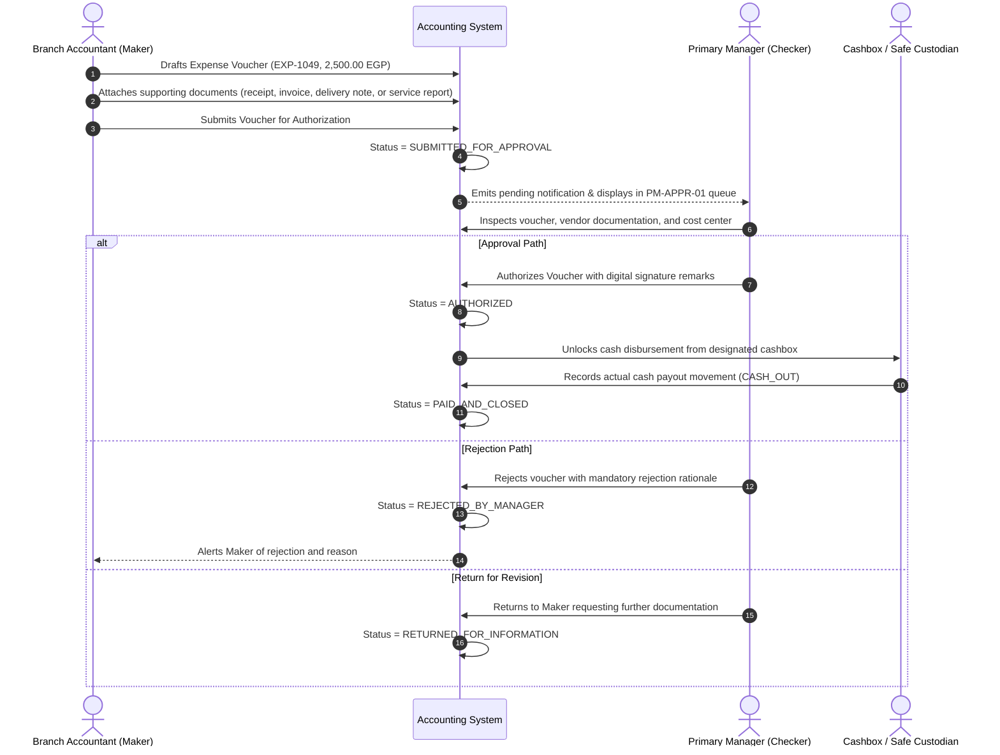
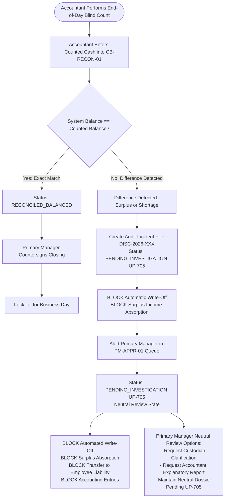
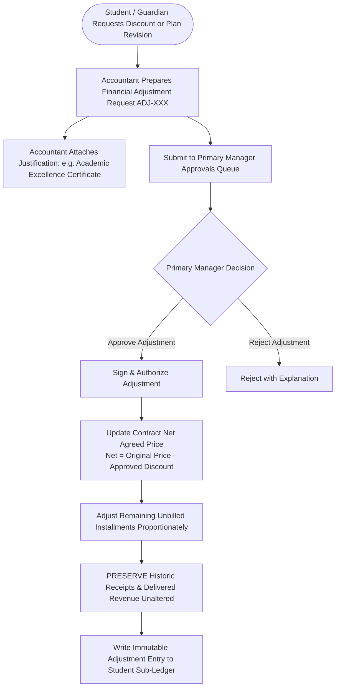
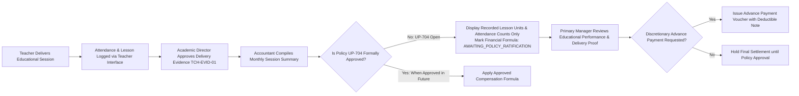

# OX-DIGITAL Education — UI/UX Phase 2 (Batch 2)
# Document 3: Primary Manager Operational & Approval Workflows
**Document ID:** `PRIMARY_MANAGER_WORKFLOWS`  
**Status:** COMPLETE & AUTHORITATIVE — READY FOR PRODUCT OWNER REVIEW  
**Date:** 2026-11-03  
**Workspace:** `D:\OX-DIGITAL\Mathe\OX-DIGITAL-GITHUB`  
**Target Path:** `docs/ui-ux/phase-2/batch-2-primary-manager/PRIMARY_MANAGER_WORKFLOWS.md`  
**Classification:** Operational Governance & Maker-Checker Workflows  

> [!NOTE] Demonstration Data Policy
> All persona identifiers, voucher numbers, transaction amounts, and branch titles in this document are **SYNTHETIC DEMONSTRATION DATA (DEMO DATA — NOT REAL)**.

---

## 1. Executive Summary & Workflow Principles

The workflows of the **Primary Manager (`PRIMARY_MANAGER`)** are built upon strict accounting segregation, Maker-Checker validation, and fail-closed state machines. 

### 1.1 Non-Negotiable Governance Rules
1. **Maker-Checker Segregation:** The Accountant acts as the **Maker** (preparing vouchers, documenting counts, calculating preliminary dues), while the Primary Manager acts as the sole authorized **Checker / Approver** (signing disbursements, authorizing adjustments, resolving closing variances).
2. **Fail-Closed Gateways:** No workflow is allowed to bypass unresolved policies (`UP-704`, `UP-705`, `UP-706`). When policy is open, the system transitions to a monitored `PENDING_INVESTIGATION` or `AWAITING_POLICY` state.
3. **Four-Tier Revenue Progression:** Workflows guarantee that money moves strictly through valid legal and accounting phases:
   $$\text{Agreement Signing} \longrightarrow \text{Schedule Due Date} \longrightarrow \text{Actual Cashbox Inflow} \longrightarrow \text{Delivered Service Recognition}$$

---

## 2. Workflow 1: Multi-Branch Consolidation & Campus Drill-Down

This workflow governs how the Primary Manager evaluates institution-wide health versus individual branch operations.

```mermaid
flowchart TD
    Start([Primary Manager Enters Dashboard]) --> TopBarFilter{Branch Selector State}
    TopBarFilter -->|All Branches (Consolidated)| AggregatedView[Load Consolidated Physical Center Metrics INST-01]
    TopBarFilter -->|Specific Physical Branch| BranchView[Load Physical Branch Context BR-01 / BR-02]
    TopBarFilter -->|Online Branch (Deferred Scope)| OnlineView[Load Digital Branch Shell BR-ONLINE\nisOnline: true]

    AggregatedView --> SumKPIs[Sum Physical Cashboxes across approved branches\nSum actual physical collections & overdue dues\nNeutralize intra-branch transfers]
    BranchView --> FilterKPIs[Isolate Branch Cashboxes CB-01/02\nDisplay local receipt journal\nHighlight branch daily closing status]
    OnlineView --> DigitalKPIs[Display Deferred Status Notice\nZero active financial collections/entries\nPhysical-centers-first policy enforcement]

    SumKPIs --> DisplayDash[Render PM-DASH-01 Viewport]
    FilterKPIs --> DisplayDash
    DigitalKPIs --> DisplayDash
```

### 2.1 Operational Flow Steps
1. **Default State:** Upon login, the dashboard defaults to **`المركز بالكامل (عرض موحد - الفروع الحضورية)`**. The system aggregates all validated movements across active physical educational campuses (Dokki, Nasr City), strictly enforcing the physical-centers-first accounting scope with online financial operations deferred.
2. **Branch Isolation:** When the Primary Manager selects a specific branch (e.g., `فرع الدقي`):
   - The UI displays an active scope badge: `نطاق العرض: فرع الدقي [DEMO]`.
   - The cashbox widget updates to reflect only the physical reception tills and safe assigned to that branch.
   - Pending Maker-Checker items filter down to items submitted by that branch's accountant.
3. **Conservation Assertion:** Total cashbox liquidity in consolidated mode equals the exact sum of individual branch cashbox balances, with internal transfers in transit verified as conservation-preserving.

---

## 3. Workflow 2: Maker-Checker Operational Expense Authorization

Operational disbursements require dual-control verification to prevent unauthorized cash leakage.



### 3.1 Validation Criteria for Primary Manager Approval
- **Document Completeness:** High-resolution digital attachment of the official vendor receipt, commercial invoice, service completion report, or delivery acknowledgement (flexible evidence without mandatory tax invoice or VAT/tax calculations).
- **Budgetary Cost Center:** Explicit attribution to a valid operational cost center (e.g. `صيانة معامل`, `نثريات تشغيل`, `مطبوعات دراسية`).
- **Cashbox Liquidity Check:** Real-time verification that the target cashbox has sufficient funds to disburse the amount without violating minimum till float rules.

---

## 4. Workflow 3: Daily Closing & Fail-Closed Discrepancy Review (`UP-705`)

This workflow governs the daily reconciliation of center reception tills, guaranteeing fail-closed treatment of any cash count discrepancy.



### 4.2 Fail-Closed Operational Invariants
1. **No Arbitrary Thresholds:** Even a minor difference (e.g. $10.00\text{ EGP}$) triggers the `UP-705` audit flow. The software does not provide an automated "allowable discrepancy tolerance" or invent mandatory procedures.
2. **Immutable Audit History:** The system balance, the custodian's entered blind count, and the variance are permanently logged in the cashbox sub-ledger.
3. **No Phantom Journal Entries:** Until `UP-705` is formally resolved by the Product Owner, the system creates no automated balancing journal entries.
4. **No Transfer to Employee Liability:** Discrepancies are held strictly under neutral administrative review without automatically shifting shortages into employee debt, writing off variances, or recognizing surplus income.

---

## 5. Workflow 4: Student Financial Adjustments & Discount Authorizations

This workflow manages discretionary fee waivers, sibling discounts, and academic scholarships.



### 5.1 Financial Integrity Checks
- **Preservation of Actuals:** Approved discounts adjust **future scheduled installments** or the net agreement balance. They never retroactively mutate past verified collection receipts.
- **Revenue Neutrality:** Revenue already recognized from previously delivered lessons remains intact.

---

## 6. Workflow 5: Teacher Compensation Review & Delivery Evidence Audit (`UP-704`)

This workflow governs the educational proof audit before teacher payments are authorized, strictly respecting open policy `UP-704`.



---

## 7. Workflow 6: Inter-Cashbox Transfer Authorization & Balance Conservation

Governs the physical movement of cash between reception tills and the central vault, enforcing the atomic conservation rules proven in Phase 2.0B Increments 1–4. Every cashbox is strictly associated with an approved institution branch dimension (e.g. Central Vault `CB-MAIN` belongs to Primary Branch `BR-01`). Transfers are strictly intra-institution; cross-institution transfers are impossible.

### 7.1 Multi-Stage Transfer Execution
1. **Transfer Request Initiation:**
   - Maker (Accountant / Till Custodian) submits transfer request: Source Till (e.g. `CB-01` at `BR-01`) $\to$ Destination Vault (`CB-MAIN` at `BR-01`), Amount: $X\text{ EGP}$.
2. **In-Flight Reservation:**
   - Source till moves funds to `TRANSFER_OUT_PENDING`.
3. **Manager Physical Verification & Acceptance:**
   - Primary Manager (or authorized branch vault custodian) physically counts cash packet.
   - Manager executes digital acceptance on `CB-MGT-01`.
4. **Atomic Conservation Execution:**
   - Source till balance debited: $\text{Balance}_{\text{src}} \leftarrow \text{Balance}_{\text{src}} - X$.
   - Destination vault balance credited: $\text{Balance}_{\text{dst}} \leftarrow \text{Balance}_{\text{dst}} + X$.
   - Both events record matching `transferId` and immutable sequential movement IDs.
   - Total institutional cashbox liquidity remains exactly unchanged:
     $$\Delta \text{Liquidity}_{\text{institution}} = 0$$

