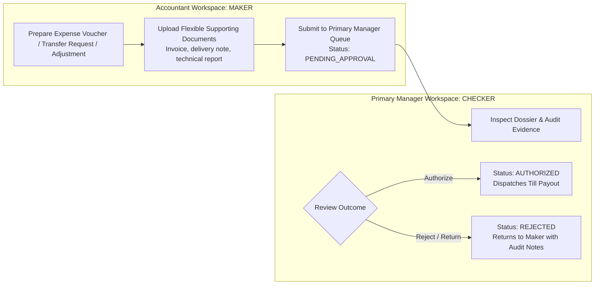

# OX-DIGITAL Education — UI/UX Phase 2 (Batch 3)
# Document 1: Accountant Dashboard & Financial Operations Workspace Specification
**Document ID:** `ACCOUNTANT_DASHBOARD_SPEC`  
**Status:** COMPLETE & AUTHORITATIVE — READY FOR PRODUCT OWNER REVIEW  
**Date:** 2026-11-04  
**Workspace:** `D:\OX-DIGITAL\Mathe\OX-DIGITAL-GITHUB`  
**Target Path:** `docs/ui-ux/phase-2/batch-3-accountant/ACCOUNTANT_DASHBOARD_SPEC.md`  
**Classification:** Operational Financial Systems Architecture & Daily Workspace Specification  

> [!NOTE] Demonstration Data Policy
> All persona names, student IDs, teacher dues, cashbox balances, voucher numbers, and financial metrics in this document and accompanying prototypes are **SYNTHETIC DEMONSTRATION DATA (DEMO DATA — NOT REAL)**.

---

## 1. Executive Mission & Workspace Philosophy

The **Accountant Dashboard & Financial Operations Workspace** provides the primary operational engine for OX-DIGITAL Education at the physical campus level. While the **Primary Manager Dashboard** (Batch 2) provides high-level executive oversight, institution-wide consolidation, policy governance, and final authorization (Checker), the **Accountant Workspace** (Batch 3) is a specialized, dense, high-efficiency ledger-entry and audit workspace designed for the **Accountant (Maker)**.

### 1.1 Core Design Directives
1. **Financial Operations System, Not a Manager Clone:** Dense, keyboard-accessible data tables, rapid receipt search, split-screen collection and allocation panels, explicit reconciliation checklists, and strict audit trails.
2. **Maker-Checker Segregation:** The Accountant prepares, calculates, collects, and documents financial transactions, but **never self-approves** expenditures, discrepancy write-offs, or policy exceptions.
3. **Four Independent Financial Layers:**
   - **Layer 1: Operational Evidence** (Receipts, certified attendance sheets, delivery evidence).
   - **Layer 2: Physical Cashbox Movement** (Till inflows, disbursements, atomic transfers).
   - **Layer 3: Student Sub-Ledger** (Agreements, payment schedules, outstanding balances).
   - **Layer 4: General Ledger Posting** (Append-only journal entries, neutral investigation holds).
4. **Physical Educational Centers First:** Operations are anchored in physical campuses (`فرع الدقي`, `فرع مدينة نصر`). The digital branch (`BR-ONLINE`) is recognized structurally as deferred (`مؤجل — خارج النطاق المالي الحالي`) with zero active billing or payment-gateway clearing.
5. **Strict Educational Payment Terminology:** Prohibition of consumer financing installment terms (`قسط`, `الأقساط`, `أقساط الطلاب`). Mandatory use of approved educational standards: `جدول استحقاق الدفعات والمواعيد`, `مسمى الدفعة`, `الدفعة المستحقة`, `المبالغ المتأخرة`, `المتبقي للسداد`.
6. **No Tax/VAT & No Speculative Forecasting:** Operations reflect strictly verified historical facts in Egyptian Pounds ($EGP$). Zero Egyptian VAT calculations, commercial tax withholding, or automated predictive curves.
7. **Four Distinct Domain Roles & Separate Permissions:** Exactly four domain roles exist (`PRIMARY_MANAGER`, `ACCOUNTANT`, `CASHIER`, `TEACHER`). The Cashier domain role is fully preserved. The current UI design does not include an independent Cashier Dashboard or navigation shell, but Cashier capabilities are not implicitly granted to the Accountant. The Accountant workspace and permissions are separately defined. Inter-cashbox transfers strictly follow a 5-stage lifecycle under Primary Manager — المدير الرئيسي authorization.

---

## 2. Workspace Navigation & Screen Architecture

The Accountant workspace encompasses nine interconnected operational modules, seamlessly embedded within the approved Batch 1 Application Shell:

| Code | Screen Name | Arabic Screen Title | Primary Operational Role |
| :--- | :--- | :--- | :--- |
| **`ACC-01`** | **Accountant Dashboard** | لوحة العمليات المالية اليومية | Daily cash pulse, till status, pending Maker-Checker submissions, quick alerts. |
| **`ACC-02`** | **Student Financial Accounts** | حسابات الطلاب والسجلات المالية | Student sub-ledger profiles, agreed price, payment schedules, collection history. |
| **`ACC-03`** | **Collection Workspace** | مكتب التحصيل وإصدار الإيصالات | High-velocity collection recording, explicit schedule item allocation, receipt generation. |
| **`ACC-04`** | **Receipt Management** | إدارة وتدقيق الإيصالات | Search, audit, reprint, and compensating reversal logging (no destructive deletion). |
| **`ACC-05`** | **Expense Preparation** | إعداد ومتابعة سندات الصرف | Voucher drafting, cost center assignment, flexible supporting document upload. |
| **`ACC-06`** | **Cashbox Operations** | إدارة حركات الخزائن والتحويلات | Till balances, intra-campus transfer drafting, physical cash movement register. |
| **`ACC-07`** | **Daily Reconciliation** | محاضر الجرد والإغلاق اليومي | End-of-day blind count entry, difference calculation, UP-705 neutral discrepancy review. |
| **`ACC-08`** | **Teacher Financial Evidence** | توثيق حصص وأدلة المعلمين | Delivery evidence compilation, attendance logs, holding dues pending UP-704 formula. |
| **`ACC-09`** | **Accountant Reports** | التقارير المالية والتشغيلية الأولية | Audited operational reports: daily collections, dues aging, reconciliation history. |

---

## 3. High-Fidelity Workspace Layout & Structural Geometry

The Accountant interface adheres strictly to the layout metrics established in Phase 2 — Batch 1:
- **TopBar Height:** 64px fixed header (`h-16`) containing institution branding, branch operational context (`فرع الدقي`), quick search (`Ctrl+K`), pending approval badge, and accountant user identity (`أحمد سمير - محاسب الفرع`).
- **Sidebar Width:** 260px expanded (`w-[260px]`), collapsible to 72px icon rail (`w-[72px]`).
- **Main Viewport Canvas:** Maximum container width 1600px (`max-w-[1600px]`), fluid responsive design down to 768px tablet mode.
- **Visual Typography & Numbers:** Primary font **Cairo** for Arabic RTL readability; **JetBrains Mono** with tabular figures (`font-variant-numeric: tabular-nums`) for currency amounts, voucher IDs, and mathematical ledgers.

```text
+--------------------------------------------------------------------------------------------------------------------------------+
| TOPBAR (h-16): [OX Logo] أكاديمية أوكس التعليمية | النطاق: [📍 فرع الدقي (حضوري) v] | بحث [Ctrl+K] | (🔔 2) | أحمد سمير (محاسب الفرع)  |
+--------------------------------------------------------------------------------------------------------------------------------+
| SIDEBAR (260px)        | MAIN OPERATIONAL VIEWPORT (max-w-[1600px])                                                            |
| - لوحة العمليات        | BREADCRUMBS: المحاسبة المالية > لوحة العمليات اليومية (ACC-01)          [+ تحصيل سريع] [+ سند صرف جديد]|
| - حسابات الطلاب        |-------------------------------------------------------------------------------------------------------|
| - مكتب التحصيل         | SECTION 1: بطاقات المؤشرات المالية والتشغيلية لليوم (DAILY OPERATIONAL METRICS)                        |
| - إدارة الإيصالات      | +-------------------+ +-------------------+ +-------------------+ +-------------------+               |
| - سندات الصرف          | | تحصيلات اليوم     | | سيولة الخزائن     | | دفعات متأخرة واجبة| | سندات قيد الاعتماد |               |
| - الخزائن والتحويلات   | | 12,400.00 ج.م     | | 38,400.00 ج.م     | | 18,200.00 ج.م     | | 2,500.00 ج.م (سند 1)|               |
| - الجرد والإغلاق       | +-------------------+ +-------------------+ +-------------------+ +-------------------+               |
| - أدلة المعلمين        |-------------------------------------------------------------------------------------------------------|
| - التقارير الأولية     | SECTION 2: تنبيهات الحوكمة وحالة الخزائن (GOVERNANCE STATUS & TILL ALERTS)                            |
|                        | [⚡ خزينة 1: إغلاق مطابق] [🔒 خزينة 2: مفتوحة للجلسة المسائية] [⚠️ فرع مدينة نصر: عجز قيد التحقيق UP-705] |
|                        |-------------------------------------------------------------------------------------------------------|
|                        | SECTION 3: شاشة العمليات المقسمة (SPLIT FINANCIAL DESK: QUICK ACTION & RECENT JOURNAL)                |
|                        | +-----------------------------------------------+ +-------------------------------------------------+ |
|                        | | نافذة التحصيل السريع والربط بجدول الدفعات    | | أحدث الحركات والإيصالات المسجلة بالفرع           | |
|                        | | - اختيار الطالب: عمر شريف فاروق (STU-8821)    | | #REC-9821 | عمر شريف | 750 ج.م | نقدي | مرحل       | |
|                        | | - المبلغ المطلوب: 1,000 ج.م (دفعة نوفمبر)     | | #REC-9818 | سارة عثمان| 600 ج.م | نقدي | مرحل       | |
|                        | | - المستلم فعلياً: [  750.00 ج.م  ]           | | #EXP-1049 | صيانة شبكات| 2,500 ج.م | بانتظار الاعتماد | |
|                        | | [  إصدار إيصال معتمد وطباعة معاينة  ]        | | #XFER-041 | تيل 1 -> الرئيسية | 5,000 ج.م | مكتمل  | |
|                        | +-----------------------------------------------+ +-------------------------------------------------+ |
+--------------------------------------------------------------------------------------------------------------------------------+
```

---

## 4. Daily Operational KPI Definitions & Calculation Rules

The Accountant Dashboard (`ACC-01`) features real-time operational indicators scoped specifically to the Accountant's authorized branch (`فرع الدقي`):

| KPI Widget | Arabic Metric Label | Exact Calculation Formula | Operational Meaning & Safeguards |
| :--- | :--- | :--- | :--- |
| **KPI-01: Today's Collections** | **تحصيلات اليوم الفعلية** | $$\sum \text{Receipt}_{\text{amount}} \quad \forall \; \text{branch} = \text{Branch}, \; \text{date} = \text{Today}$$ | Cash and electronic payments physically received and receipted by branch tills today. |
| **KPI-02: Branch Cashbox Liquidity**| **سيولة خزائن الفرع** | $$\sum \text{Cashbox}_{\text{balance}} \quad \forall \; \text{cashbox} \in \text{Branch}$$ | Total book cash available in authorized branch tills (`CB-01`: 24,500 + `CB-02`: 13,900 = 38,400 EGP). |
| **KPI-03: Overdue Student Dues** | **المبالغ المتأخرة والواجبة** | $$\sum (\text{Due}_{\text{amount}} - \text{Due}_{\text{paid}}) \quad \forall \; \text{due\_date} < \text{Today}$$ | Scheduled payments that have passed their due dates for students enrolled in the branch. |
| **KPI-04: Pending Expense Vouchers** | **سندات صرف بانتظار الاعتماد** | $$\sum \text{Voucher}_{\text{amount}} \quad \forall \; \text{status} = \text{SUBMITTED\_TO\_CHECKER}$$ | Expenditures prepared by the Accountant awaiting Primary Manager review and approval. |
| **KPI-05: Unallocated Cash Pool** | **مبالغ محصلة غير مخصصة** | $$\sum \text{Receipt}_{\text{unallocated}} \quad \forall \; \text{branch} = \text{Branch}$$ | Receipts accepted without explicit allocation to a scheduled payment (held in suspense). |

---

## 5. Maker-Checker Segregation Protocol for Accountants

To prevent fraud, cash leakage, or unverified ledger alterations, the Accountant operates under strict **Maker** boundaries:



### Prohibited Accountant Actions (Fail-Closed Guards)
1. **No Self-Authorization:** The Accountant cannot mark an expense voucher as `AUTHORIZED` or execute a cash disbursement from the till without the Primary Manager's Checker sign-off.
2. **No Destructive Edits/Deletions:** Posted receipts, movements, and reconciliations are strictly immutable. Corrections require compensating reversal entries with mandatory justification.
3. **No Shortage/Surplus Balancing:** The Accountant cannot write off cash discrepancies, absorb surpluses into revenue, or charge shortages to employee liabilities (`UP-705`).
4. **No Unapproved Teacher Calculations:** The Accountant cannot calculate dues or pay teachers using default percentage formulas (`UP-704`).
5. **No Unilateral Cashbox Transfers:** The Accountant cannot execute cash movements between cashboxes or vaults without Primary Manager authorization. Transfers adhere strictly to the 5-stage lifecycle (`Draft Request` -> `Primary Manager Authorization` -> `Rejection/Cancellation Handling` -> `Physical Dispatch TRANSFER_OUT` -> `Physical Receipt TRANSFER_IN`).

---

## 6. The Four-Tier Revenue Separation in Accountant Workflows

Every student payment interaction enforces strict accounting segregation:
$$\text{عقد اتفاق مالي (Agreement)} \neq \text{دفعة مجدولة مستحقة (Amount Due)} \neq \text{تحصيل نقدي فعلي (Collection)} \neq \text{إيراد تعليمي معترف به (Revenue)}$$

1. **Tuition Signing:** When a student signs a $5,500.00\text{ EGP}$ agreement, zero income is booked.
2. **Due Date Arrival:** When a $1,000.00\text{ EGP}$ scheduled payment due date arrives, it moves to `المبالغ المستحقة`, but still is not recognized income.
3. **Receipt Issuance:** When the student pays $750.00\text{ EGP}$ at the till, cashbox liquidity increases by $750.00\text{ EGP}$ and student remaining due decreases to $250.00\text{ EGP}$, but it is treated as **unearned customer deposit** (إيراد مؤجل).
4. **Certified Delivery:** Only when the teacher delivers verified classes and attendance is electronically certified under the **approved immutable allocation plan** is earned educational revenue booked.

---

## 7. Responsiveness & Accessibility Specifications
- **Desktop (1280px–1600px):** Optimized dense tables, side-by-side quick collection drawers, fixed headers, and tabular monospace numbers.
- **Compact Desktop (1024px):** Collapsible sidebar rail (72px), horizontal scrollbars on data-heavy tables with sticky primary identifier columns.
- **Tablet (768px):** Off-canvas slide-out navigation drawer, stacked single-column operational cards, modal dialogs full-screen with touch-friendly 44px hit targets.

