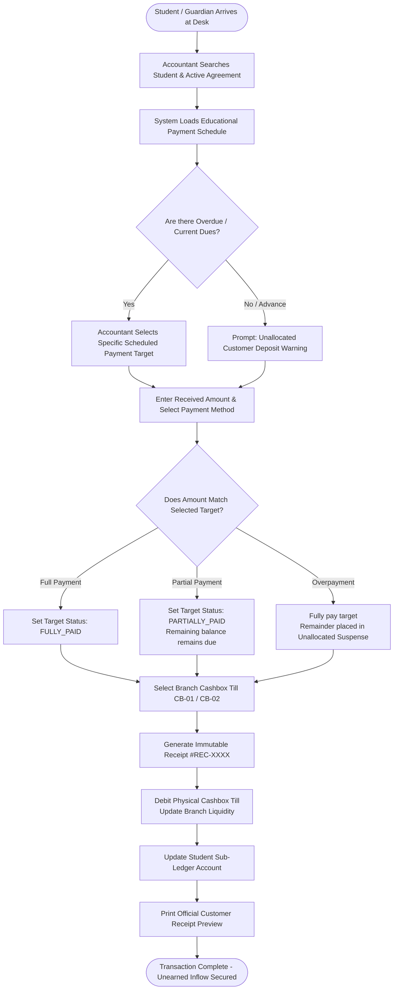
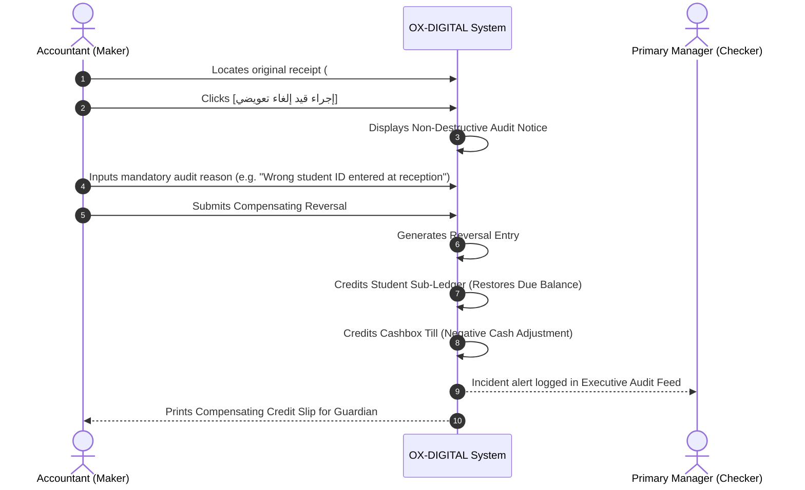
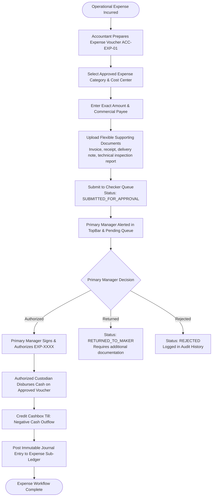
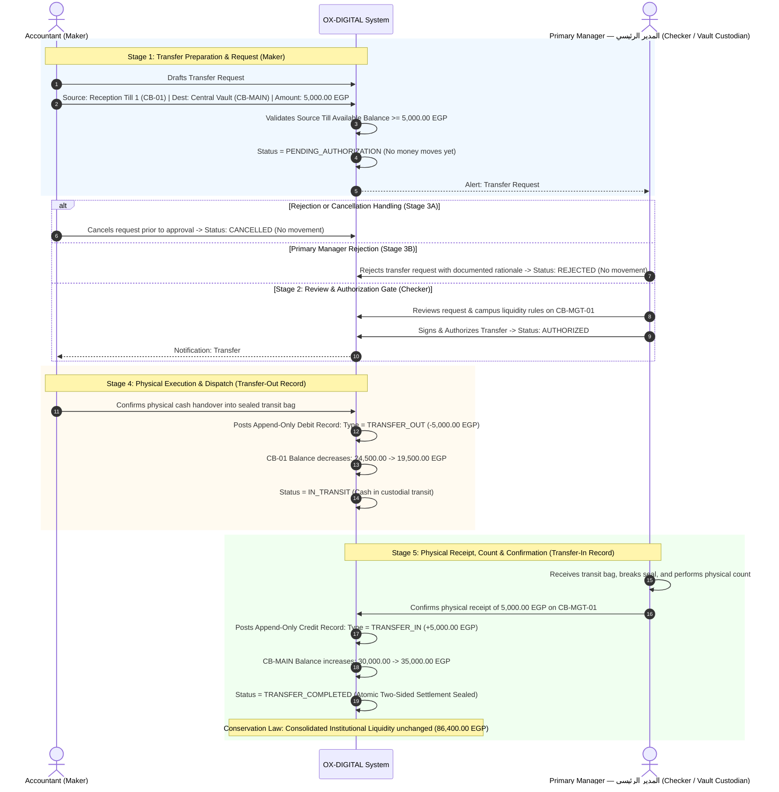
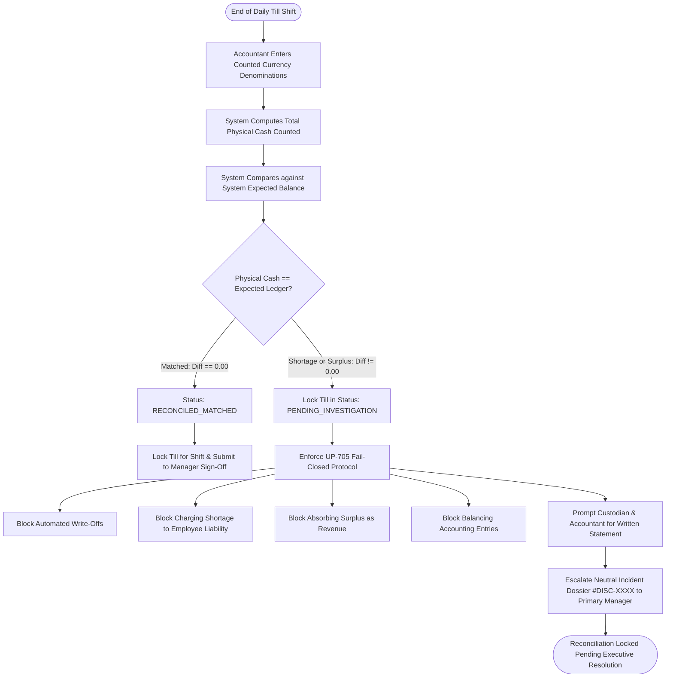
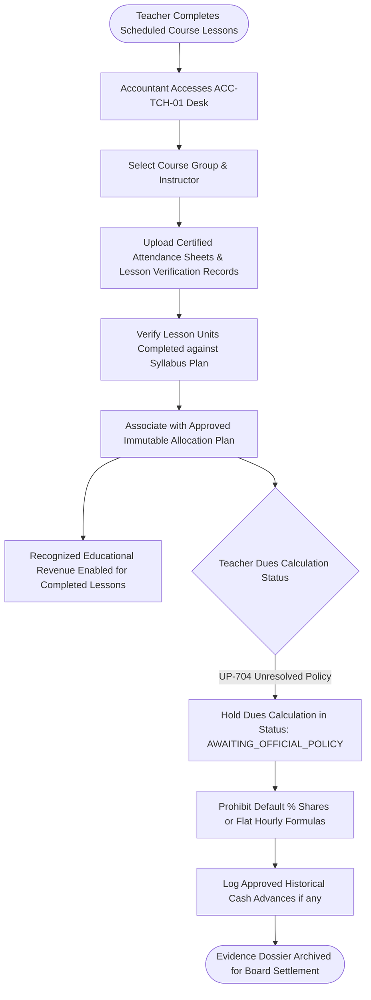

# OX-DIGITAL Education — UI/UX Phase 2 (Batch 3)
# Document 3: Accountant Operational Workflows & State Machines
**Document ID:** `ACCOUNTANT_WORKFLOWS`  
**Status:** COMPLETE & AUTHORITATIVE — READY FOR PRODUCT OWNER REVIEW  
**Date:** 2026-11-04  
**Workspace:** `D:\OX-DIGITAL\Mathe\OX-DIGITAL-GITHUB`  
**Target Path:** `docs/ui-ux/phase-2/batch-3-accountant/ACCOUNTANT_WORKFLOWS.md`  
**Classification:** Operational Business Logic & State Transition Systems  

> [!NOTE] Demonstration Data Policy
> All persona names, student IDs, teacher dues, cashbox balances, voucher numbers, and financial metrics in this document and accompanying prototypes are **SYNTHETIC DEMONSTRATION DATA (DEMO DATA — NOT REAL)**.

---

## 1. Architectural Foundations of Accountant Workflows

Accountant workflows are governed by three immutable principles established in the OX-DIGITAL Phase 2.0B baseline:
1. **The Maker-Checker Barrier:** The Accountant is strictly a **Maker** of financial movements and proposals. The Primary Manager is the sole authorized **Checker** for payouts, adjustments, and reconciliation sign-offs.
2. **The Append-Only Immutability Rule:** No posted receipt, till movement, voucher, or reconciliation record can be deleted or updated in place. Adjustments require compensating journal reversals (`REVERSAL`).
3. **The Four-Tier Revenue Progression:** Money moves through strict legal and accounting tiers:
   $$\text{عقد اتفاق مالي (Agreement)} \longrightarrow \text{دفعة مجدولة مستحقة (Due Date)} \longrightarrow \text{تحصيل نقدي بالخزينة (Collection)} \longrightarrow \text{إيراد معترف به (Revenue)}$$

---

## 2. Workflow 1: Collection Recording & Explicit Target Allocation

Governs how an Accountant receipts incoming student funds and allocates them to scheduled payments.

### 2.1 Operational Rules for Collections
1. **Explicit Allocation Mandate:** The Accountant must explicitly check which scheduled payment item(s) are being settled. Automated FIFO allocation without user confirmation is prohibited.
2. **Access Isolation:** Securing payment in the cashbox does **not** automatically grant academic course permissions or reactivate suspended students. Academic eligibility is governed separately by the academic service.
3. **Unallocated Suspense:** If a guardian pays more than the targeted scheduled payment without designating a future payment, the surplus is logged as `UNALLOCATED_CUSTOMER_DEPOSIT` and held on the student's sub-ledger.

---

## 3. Workflow 2: Compensating Reversal of an Erroneous Receipt

Governs how an Accountant corrects a data-entry error or misallocated collection receipt without deleting historical records.

### 2.2 Reversal Safeguards
- **Original Unmodified:** `#REC-9821` retains its original status with an immutable pointer: `reversalReference = #REV-014`.
- **Till Balance Protection:** A reversal can only execute if the physical till contains sufficient cash to cover the refund.

---

## 4. Workflow 3: Operational Expense Voucher Preparation & Authorization

Governs the Maker-Checker workflow for campus operating expenditures (repairs, utilities, supplies).

### 4.1 Supporting Document Flexibility
- **No Statutory Tax Constraint:** Supporting documents accept commercial receipts, supplier bills, delivery notes, and technical inspection sheets. No VAT invoices or withholding certificates are required or calculated.

---

## 5. Workflow 4: Cashbox Transfer Authorization Lifecycle & Intra-Campus Custody Handover

Governs the secure, atomic transfer of surplus cash between physical cashboxes (e.g. from reception tills to the central vault). The workflow strictly enforces a 5-stage authorization and execution lifecycle preserving the two-sided append-only ledger and institutional conservation of liquidity.

### 5.1 Detailed Breakdown of the 5-Stage Transfer Lifecycle
1. **Stage 1: Transfer Preparation / Request (Maker — Accountant):**
   - The Accountant drafts a transfer request specifying source cashbox (`CB-01`), destination cashbox (`CB-MAIN`), amount (`5,000.00 EGP`), and operational reason (e.g. morning shift surplus deposit).
   - System verifies source available liquidity and sets status to `PENDING_AUTHORIZATION`. Zero physical or ledger funds move at this stage.
2. **Stage 2: Review and Approval Gate (Checker — Primary Manager):**
   - Primary Manager evaluates the transfer request against security thresholds and campus liquidity needs.
   - If acceptable, the Primary Manager authorizes the request (`AUTHORIZED`). No automated approval or lower threshold exists; all inter-cashbox transfers require explicit Primary Manager authorization or policy confirmation.
3. **Stage 3: Rejection or Cancellation Handling:**
   - **Maker Cancellation:** Prior to authorization, the drafting Accountant may cancel the request (`CANCELLED`).
   - **Checker Rejection:** The Primary Manager may reject the request with a mandatory documented justification (`REJECTED`). The request is archived without any ledger entries.
   - **Transit Discrepancy:** If physical cash counted at delivery differs from dispatched amount, the incident is placed into `TRANSIT_DISCREPANCY_INVESTIGATION` under Primary Manager review, with zero automated write-offs.
4. **Stage 4: Physical Execution & Dispatch (`TRANSFER_OUT` Record):**
   - Upon Primary Manager authorization, the sender initiates physical dispatch in an authorized custody envelope.
   - System records an append-only debit ledger entry (`MovementType: TRANSFER_OUT`) from the source till. Status transitions to `IN_TRANSIT`.
5. **Stage 5: Physical Receipt & Confirmation (`TRANSFER_IN` Record):**
   - Destination custodian (Primary Manager for Central Vault) inspects the envelope and performs a physical verification count.
   - Destination custodian confirms receipt in the system. The system writes an append-only credit entry (`MovementType: TRANSFER_IN`).
   - Status advances to `TRANSFER_COMPLETED`. The two-sided transaction is atomically finalized, preserving the conservation law of institutional liquidity across the four approved cashboxes: CB-01 (24,500.00) + CB-02 (13,900.00) + CB-MAIN (30,000.00) + CB-03 (18,000.00) = 86,400.00 EGP.

---

## 6. Workflow 5: End-of-Day Blind Cash Count & Fail-Closed Reconciliation

Governs daily till reconciliations, enforcing the `UP-705` fail-closed protocol for discrepancies.

---

## 7. Workflow 6: Teacher Lesson Delivery Evidence Compilation

Governs how educational service delivery is documented without making speculative compensation calculations.

