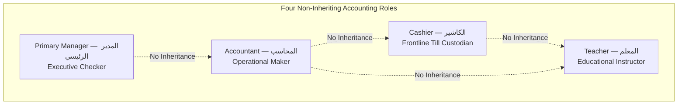

# OX-DIGITAL Education — UI/UX Phase 2 (Batch 4)
# Document 4: Student Financial Profile Role-Based Access Control & Permission Matrix
**Document ID:** `STUDENT_FINANCIAL_PROFILE_PERMISSION_MATRIX`  
**Status:** COMPLETE & AUTHORITATIVE — READY FOR PRODUCT OWNER REVIEW  
**Date:** 2026-11-04  
**Workspace:** `D:\OX-DIGITAL\Mathe\OX-DIGITAL-GITHUB`  
**Target Path:** `docs/ui-ux/phase-2/batch-4-student-financial-profile/STUDENT_FINANCIAL_PROFILE_PERMISSION_MATRIX.md`  
**Classification:** Security Architecture & Functional Access Control Gates  

> [!NOTE] Demonstration Data Policy
> All persona names, student IDs, voucher numbers, and financial metrics in this document and accompanying prototypes are **SYNTHETIC DEMONSTRATION DATA (DEMO DATA — NOT REAL)**.

---

## 1. Governance Architecture: Four Independent Roles

In strict accordance with Phase 1 decisions (`OD-701`, `OD-702`, `OD-718`) and Phase 2.0B baselines, the accounting domain recognizes exactly **four independent roles**:

1. **Primary Manager — المدير الرئيسي (`PRIMARY_MANAGER`):** Executive institution-wide governance, Checker for all financial adjustments, refund reviews, and cross-branch audits.
2. **Accountant — المحاسب (`ACCOUNTANT`):** Branch-scoped operational Maker, sub-ledger manager, explicit allocation operator, reversal preparer, and financial dossier compiler.
3. **Cashier — الكاشير (`CASHIER`):** Frontline physical cashbox custodian. Operates designated physical till stations (e.g. `CB-01`, `CB-02`). Possesses **no independent profile dashboard or navigation shell**. Operates strictly under till-scoped collection protocols.
4. **Teacher — المعلم (`TEACHER`):** Educational instructor. Submits certified lesson delivery evidence; possesses **zero access** to student financial sub-ledgers, agreements, or collection histories.

*System Invariant:* No role inheritance exists between these four roles. The Accountant does **not** inherit Cashier capabilities, and the Cashier does **not** inherit Accountant capabilities. Platform administrators (`admin@edu.com`) are strictly isolated outside the institutional tenant shell (`OD-718`). There is no Branch Manager role (`OD-701`).

---

## 2. Granular Role-Based Access Control (RBAC) Matrix

The table below details capabilities within the Student Financial Profile subsystem:

| Functional Capability | Primary Manager — المدير الرئيسي | Accountant — المحاسب | Cashier — الكاشير | Teacher — المعلم |
| :--- | :---: | :---: | :---: | :---: |
| **Profile Navigation & Discovery** | Full Institutional | Assigned Campus (`BR-01`) | Prohibited (Till Lookup Only)| Prohibited |
| **View Agreement & Pricing Details**| **Full** | **Full (Assigned Campus)** | Prohibited | Prohibited |
| **Modify Contractual Pricing Scheme**| **Sole Authority** | Prohibited | Prohibited | Prohibited |
| **View Payment Schedule Milestones**| **Full** | **Full** | View Due Amount at Till | Prohibited |
| **Record Frontline Cash Collection** | Audit View Only | Full (Financial Desk) | **Full (Assigned Till Station)**| Prohibited |
| **Execute Explicit Payment Allocation**| Full | **Full (Maker)** | Prohibited | Prohibited |
| **Consume Advance Suspense Balance** | Full | **Full (Explicit Order)** | Prohibited | Prohibited |
| **Draft Compensating Reversal** | Full Review | **Full (Maker Draft)** | Prohibited | Prohibited |
| **Authorize Compensating Reversal**| **Checker Gate (Sole Auth)**| **PROHIBITED (No Self-Auth)**| Prohibited | Prohibited |
| **Submit Formal Refund Request** | Full Review | **Full (Maker Dossier)** | Prohibited | Prohibited |
| **Authorize Tuition Refund Payout**| **LOCKED (Pending UP-706)**| **PROHIBITED** | Prohibited | Prohibited |
| **View Revenue Recognition Ledger**| **Full** | **Full** | Prohibited | Prohibited |
| **Link Delivery Evidence to Revenue**| Full | **Full (Certified Sheets)** | Prohibited | Upload Own Class Logs Only |
| **View Student Historical Transitions**| **Full Multi-Branch** | **Full (Current & Past)** | Prohibited | Prohibited |
| **Download Official Student Statement**| **Full Institutional** | **Full (Branch Context)** | Prohibited | Prohibited |

---

## 3. Strict Prohibitions & Fail-Closed Guardrails

To prevent unauthorized transactions, fraud, or sub-ledger corruption, the Student Financial Profile enforces seven programmatic barriers:

### Barrier 1: Maker-Checker Segregation (`OD-702`)
- **Prohibition:** An Accountant who prepares a compensating reversal or refund request cannot approve it.
- **System Guard:** Reversal authorization and refund sign-off buttons are completely omitted from the Accountant interface.

### Barrier 2: Sub-Ledger Immutability
- **Prohibition:** No user can edit, overwrite, or delete a posted collection receipt, agreement milestone, or allocation record.
- **System Guard:** Database mutations execute exclusively via append-only compensating entries (`REVERSAL`). Every reversal requires a recorded audit rationale and retains an immutable reference to the original record.

### Barrier 3: Fail-Closed Refund Policy (`UP-706`)
- **Prohibition:** The system cannot calculate, estimate, or authorize student refunds using arbitrary pro-rata or administrative formulas.
- **System Guard:** All refund requests are held in `قيد المراجعة الإدارية والقانونية (PENDING_LEGAL_REVIEW)` until the Product Owner and Legal Counsel issue a binding policy.

### Barrier 4: Separation of Academic Holds from Financial Obligations
- **Prohibition:** Academic suspensions cannot erase accrued financial debt, and cash collections cannot bypass academic prerequisite verifications.
- **System Guard:** Academic and financial statuses operate on independent state machines.

### Barrier 5: Decoupled Revenue Recognition
- **Prohibition:** Revenue cannot be recognized upon agreement signing, cash receipt intake, or attendance without certified delivery evidence.
- **System Guard:** The revenue recognition pipeline requires two valid independent inputs: an approved immutable allocation plan and a certified attendance sheet.

### Barrier 6: Cashier Profile Isolation
- **Prohibition:** Frontline cashiers cannot browse comprehensive student financial profiles, examine historical tuition contracts, or view teacher settlements.
- **System Guard:** Cashiers access only an operational till collection modal allowing student code search, current obligation verification, and receipt issuance at their assigned till (`CB-01`, `CB-02`).

### Barrier 7: Campus Isolation
- **Prohibition:** An Accountant assigned to Dokki Campus (`BR-01`) cannot view or modify transactions belonging to students solely enrolled in Nasr City Campus (`BR-02`).
- **System Guard:** All sub-ledger queries are scoped to the authenticated user's branch context token.

### Barrier 8: Unverified Opening Balances & Legacy Records (`UP-711`)
- **Prohibition:** Neither Accountant nor Cashier can manually inject or approve legacy opening balances into student accounts as confirmed collections.
- **System Guard:** Under open policy `UP-711`, opening balances remain unapproved and legacy payment records are subject to source-document reconciliation before inclusion in confirmed collection or revenue KPIs.

