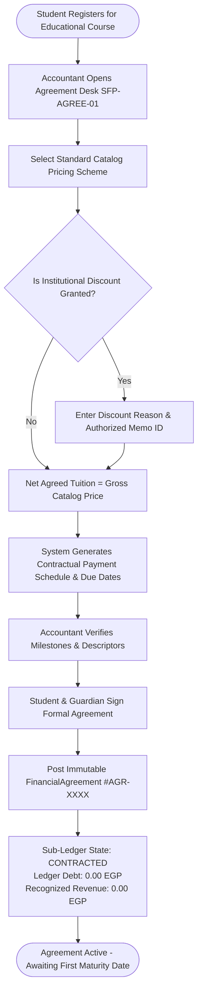
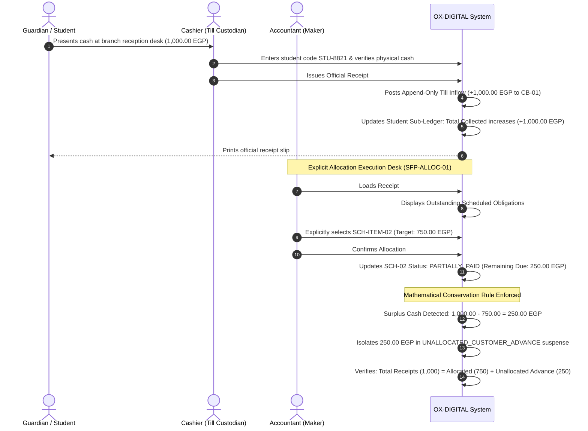
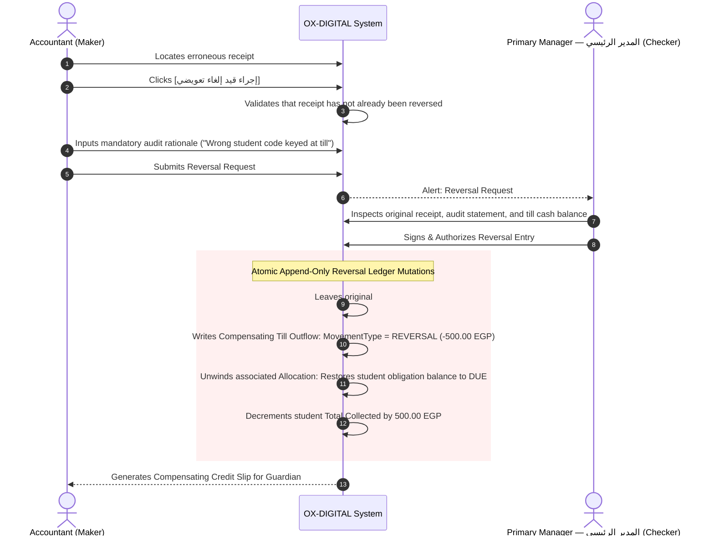
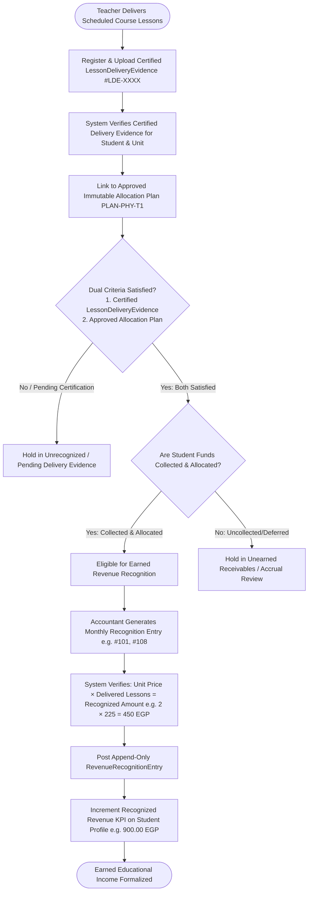
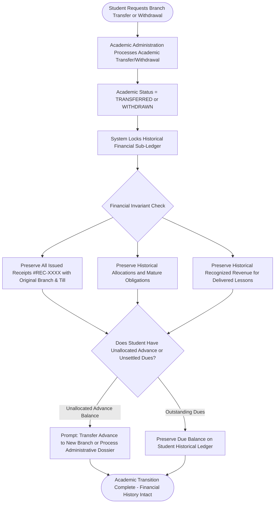
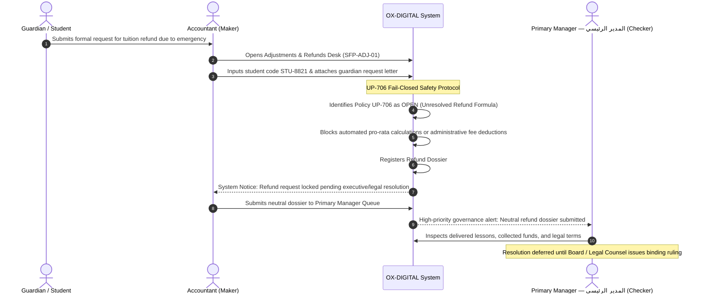

# OX-DIGITAL Education — UI/UX Phase 2 (Batch 4)
# Document 3: Student Financial Profile Operational Workflows & State Machines
**Document ID:** `STUDENT_FINANCIAL_PROFILE_WORKFLOWS`  
**Status:** COMPLETE & AUTHORITATIVE — READY FOR PRODUCT OWNER REVIEW  
**Date:** 2026-11-04  
**Workspace:** `D:\OX-DIGITAL\Mathe\OX-DIGITAL-GITHUB`  
**Target Path:** `docs/ui-ux/phase-2/batch-4-student-financial-profile/STUDENT_FINANCIAL_PROFILE_WORKFLOWS.md`  
**Classification:** Operational Business Logic & Transaction State Lifecycle  

> [!NOTE] Demonstration Data Policy
> All persona names, student IDs, voucher numbers, and financial metrics in this document and accompanying prototypes are **SYNTHETIC DEMONSTRATION DATA (DEMO DATA — NOT REAL)**.

---

## 1. Architectural Foundations of Student Financial Workflows

Workflows within the Student Financial Profile adhere to four foundational invariants:
1. **Four Independent Roles:** Interactions are modeled between four distinct roles (`PRIMARY_MANAGER`, `ACCOUNTANT`, `CASHIER`, `TEACHER`) without inheritance.
2. **Maker-Checker Segregation:** The Accountant acts as **Maker** (drafting agreements, proposing allocations, preparing adjustment dossiers). The Primary Manager acts as **Checker** (authorizing discounts, compensating reversals, policy exceptions).
3. **Four-Tier Revenue Segregation:** Contractual Agreement $\neq$ Due Amount $\neq$ Cash Collection $\neq$ Recognized Revenue.
4. **Append-Only Immutability:** No posted financial record is ever deleted or modified in place. Adjustments execute strictly through compensating journal reversals (`REVERSAL`).

---

## 2. Workflow 1: Agreement Onboarding & Payment Schedule Generation

Governs the legal-financial onboarding of a student, defining contracted tuition, applying authorized discounts, and establishing the immutable schedule of payments.

### 2.1 Operational Rules:
- **Price Catalog Independence:** If the center alters its standard course group fee in the future, the student's existing signed agreement remains completely unaffected.
- **Zero Premature Recognition:** Signing the agreement books 0.00 EGP in educational revenue.

---

## 3. Workflow 2: Collection Inflow, Explicit Allocation & Advance Suspense

Governs cash intake at the till, explicit allocation against mature payment schedule items, and isolation of unallocated surplus funds.

### 3.1 Operational Safeguards:
- **No Silent FIFO Allocation:** The system refuses to auto-allocate cash to obligations without explicit Accountant designation.
- **No Academic Access Couplings:** Booking the receipt does not automatically lift academic suspensions or issue course badges.

---

## 4. Workflow 3: Non-Destructive Compensating Reversal of an Allocated Receipt

Governs the correction of an erroneous collection receipt without altering historical ledger entries.

---

## 5. Workflow 4: Earned Educational Revenue Recognition

Governs how educational service delivery is recognized as earned income, strictly requiring BOTH certified `LessonDeliveryEvidence` for the student and unit, AND the approved immutable allocation plan (`PLAN-PHY-T1`).

### 5.1 Revenue Recognition Invariants:
- **Agreement $\neq$ Revenue:** Signing a 5,500 EGP agreement recognizes zero revenue.
- **Collection $\neq$ Revenue:** Collecting 1,000 EGP at the till is deferred unearned income until certified delivery occurs.
- **Attendance Sheets Alone $\neq$ Revenue:** Attendance sheets without certified `LessonDeliveryEvidence` AND an approved immutable allocation plan (`PLAN-PHY-T1`) cannot book revenue. Both prerequisites must be simultaneously satisfied.
- **Evidence Trail:** Every recognized entry (e.g. #101, #108) must explicitly link to its certified delivery evidence document (`#LDE-PHY-01`, `#LDE-PHY-02`) and approved allocation schedule (`PLAN-PHY-T1`). Units pending certification (`#LDE-PHY-03`) remain at 0.00 EGP recognized.

---

## 6. Workflow 5: Academic Transfer or Withdrawal with Financial Record Preservation

Governs the handling of students transferring between branches or withdrawing, preserving the historical financial integrity.

### 6.1 Historical Balances & UP-711 Neutrality
Academic transitions and legacy record transfers do not imply approval of opening balances. Under unresolved policy `UP-711`, legacy payment records remain subject to source-document reconciliation and cannot be included in confirmed collection or revenue KPIs without verified source records.

---

## 7. Workflow 6: Refund Request Lifecycle with UP-706 Fail-Closed Gate

Governs how refund requests are submitted and held under strict administrative/legal review without premature calculations.

