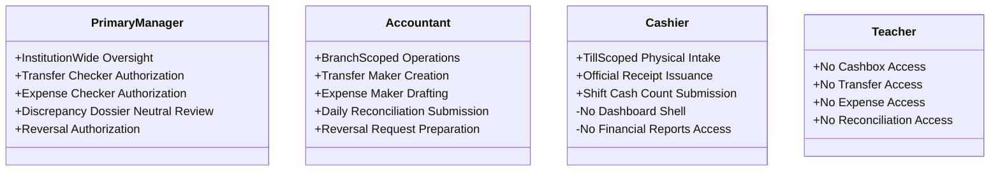

# OX-DIGITAL Education — UI/UX Phase 2 (Batch 5)
# Document 1: Cashbox Management Specification
**Document ID:** `CASHBOX_MANAGEMENT_SPEC`  
**Status:** COMPLETE & AUTHORITATIVE — READY FOR PRODUCT OWNER REVIEW  
**Date:** 2026-11-04  
**Workspace:** `D:\OX-DIGITAL\Mathe\OX-DIGITAL-GITHUB`  
**Target Path:** `docs/ui-ux/phase-2/batch-5-cashbox-management/CASHBOX_MANAGEMENT_SPEC.md`  
**Classification:** Financial Sub-Ledger Systems Architecture & Cashbox Operations Specification  

> [!NOTE] Demonstration Data Policy
> All persona names, user IDs, voucher numbers, and financial metrics in this document and accompanying prototypes are **SYNTHETIC DEMONSTRATION DATA (DEMO DATA — NOT REAL)**.

---

## 1. Mission & Architectural Philosophy

The **Cashbox Management Workspace** is the frontline physical liquidity control and cash management sub-ledger for OX-DIGITAL Education. It governs physical till intake, secure cash storage, internal vault transfers, petty cash disbursements, and end-of-shift cashbox reconciliations across educational centers.

Unlike generic point-of-sale registers or standard commercial retail cash drawers, the Cashbox Management sub-ledger is engineered strictly around the core accounting principles established across Phase 1, Phase 2.0B, and Batches 1–4:

### 1. The Four-Tier Financial Separation Invariant
$$\text{عقد اتفاق مالي (Agreement)} \neq \text{دفعة مجدولة مستحقة (Amount Due)} \neq \text{تحصيل نقدي بالخزينة (Collection)} \neq \text{إيراد تعليمي معترف به (Revenue)}$$
- Ingesting a cash payment at a physical cashbox (`COLLECTION`) increases physical center cash liquidity and creates a customer advance/unearned deposit.
- Cash collection does **not** create a second student collection record, does **not** automatically allocate student payment schedule targets, and does **not** recognize earned educational revenue.
- Separation is preserved across the physical till movement, the collection receipt, the student sub-ledger, and the general ledger.

### 2. Physical Educational Centers Scope (Physical-First)
- Active financial operations are strictly restricted to **physical educational centers** (`فرع الدقي`, `فرع مدينة نصر`).
- The Online Branch (`Branch.isOnline`) exists only as an architectural baseline for future scope. Online subscriptions, digital payment gateway settlements (Fawry/Paymob), recurring billing, and digital revenue recognition are deferred (`مؤجل — خارج النطاق المالي الحالي`).
- Every active cashbox is strictly anchored to an approved physical institution branch.

### 3. Institutional Cash Position & Cash-in-Transit Accounting
- The institution's financial position distinguishes clearly between cash settled inside cashboxes and cash physically in transit between cashboxes:
  $$\text{Cashbox Book Balances} = \sum_{i \in \{\text{CB-01, CB-02, CB-MAIN, CB-03}\}} \text{Book Closing Balance}_i = 86,400.00\text{ EGP}$$
  $$\text{Cash in Transit (TRF-104)} = 1,500.00\text{ EGP}$$
  $$\text{Total Institutional Cash Position} = \text{Cashbox Book Balances} + \text{Cash in Transit} = 86,400.00 + 1,500.00 = 87,900.00\text{ EGP}$$
- **Authoritative Transfer Accounting Rules:**
  1. **At Physical Dispatch:** Source cashbox book balance decreases by transfer amount, and `Cash in Transit` increases by the exact same amount. Total institutional cash position remains unchanged.
  2. **Before Physical Receipt:** Destination cashbox is **never** credited while cash is in transit. Funds are tracked explicitly as in-transit cash.
  3. **At Confirmed Physical Receipt:** Designated authorized receiving custodian verifies and counts banknotes; `Cash in Transit` decreases by transfer amount, and destination cashbox book balance increases by the exact same amount.
  4. **Strict Non-Duplication:** The same cash amount is **never** counted simultaneously in the source cashbox, in-transit, and destination cashbox.
  5. **Liquidity Neutrality:** Internal transfers are strictly liquidity-neutral ($\Delta \text{Total Institutional Cash Position} = 0.00\text{ EGP}$).

### 4. Non-Destructive Immutability & Compensating Reversals
- Posted cashbox movements (`COLLECTION`, `DISBURSEMENT`, `TRANSFER_IN`, `TRANSFER_OUT`) are **strictly immutable**.
- Deletion or in-place editing of posted financial movements is prohibited.
- Operational corrections execute exclusively through append-only compensating reversal entries (`REVERSAL`), preserving an unbroken audit trail and audit accountability.

### 5. Fail-Closed Neutral Treatment of Unresolved Policies
- **`UP-705` (Cashbox Discrepancy Sign-Off & Tolerances):** When physical counted cash differs from the expected book balance, the reconciliation is flagged as `DISCREPANCY_PENDING_INVESTIGATION`. The system prohibits automatic shortage write-offs, surplus income recognition, transferring shortages to cashier/employee liability, creating balancing journal entries, or applying speculative monetary tolerance thresholds.
- **`UP-701` (Statutory Chart of Accounts Review):** Cash movements and expense vouchers utilize operational categories without exposing unverified statutory account codes.
- **`UP-704` (Teacher Pay Qualifying Base):** Cash disbursements cannot calculate or deduct teacher share percentages from student cash receipts.
- **`UP-706` (Student Refund Formula):** Cash disbursements for refunds require approved legal review dossiers; zero automated cashbox refund payouts.

---

## 2. Authoritative Cashbox Inventory & Reconciled Balances

The institutional cash structure consists exclusively of the **four approved physical cashboxes** reconciled in Batch 2 and Batch 3:

| Cashbox Identifier | Descriptive Label | Assigned Branch | Operational Role | Book Closing Balance | Count Status |
| :--- | :--- | :--- | :--- | :---: | :---: |
| **`CB-01`** | خزينة الاستقبال 1 | Dokki (`BR-01`) | Frontline student intake till | `24,500.00 ج.م` | Counted: `24,500.00 ج.م` (Balanced) |
| **`CB-02`** | خزينة الاستقبال 2 | Dokki (`BR-01`) | Secondary intake till | `13,900.00 ج.م` | Counted: `13,900.00 ج.م` (Balanced) |
| **`CB-MAIN`** | الخزينة المركزية (الرئيسية) | Dokki (`BR-01`) | Central branch vault / repository | `30,000.00 ج.م` | Counted: `30,000.00 ج.م` (Balanced) |
| **`CB-03`** | خزينة الفرع الرئيسية | Nasr City (`BR-02`) | Frontline & operational till | `18,000.00 ج.م` | Counted: `17,850.00 ج.م` (Difference: `-150.00 ج.م`) |
| **Total Inside Cashboxes** | **إجمالي الأرصدة الدفترية بالخزائن** | — | **4 Approved Cashboxes** | **`86,400.00 ج.م`** | **Total Counted: `86,250.00 ج.م`** |
| **Cash in Transit (TRF-104)**| **نقد قيد النقل بين الخزائن** | CB-01 ➔ CB-MAIN | In-transit transfer funds | **`1,500.00 ج.م`** | Dispatched, pending physical receipt |
| **Total Institutional Cash** | **إجمالي المركز النقدي للمؤسسة** | Institution-Wide | **Cashboxes + In-Transit** | **`87,900.00 ج.م`** | Unchanged by internal transfers |

### Critical Architectural Constraints:
1. **Central Vault Ownership:** `CB-MAIN` is explicitly assigned to branch `BR-01` (Dokki Center / Headquarters). It is never modeled as a branch-less or floating institution-wide entity.
2. **Prohibited Entities:** `CB-04` is completely prohibited and excluded.
3. **Prohibited Obsolete Figures:** The obsolete Nasr City balance of `28,000.00 EGP` is strictly prohibited. The authoritative book balance for `CB-03` is `18,000.00 EGP`.
4. **Physical Count vs. Book Balance:** Book balance and physical counted cash are strictly separated. Counted cash is never substituted for book balance without formal investigation.

---

## 3. Core Functional Screen Areas (Areas A through H)

### Area A: Institutional Cashbox Directory & Liquidity Overview (`CBM-OVR-01`)
- **Consolidated Institutional Cash Position & Liquidity KPI Bar:**
  - Cashbox Book Balances: `86,400.00 ج.م` (مجموع الأرصدة المستقرة داخل الخزائن الأربعة)
  - Cash in Transit: `1,500.00 ج.م` (تحويل #TRF-104 قيد النقل من CB-01 إلى CB-MAIN)
  - Total Institutional Cash Position: `87,900.00 ج.م` (الخزائن + النقد قيد النقل)
  - Total Physical Counted Cash: `86,250.00 ج.م` (داخل الخزائن)
  - Total Active Net Discrepancy: `-150.00 ج.م` (`قيد التحقيق الإداري — UP-705` بخزينة CB-03)
- **Directory Grid / Cards:**
  - Displays each of the 4 approved cashboxes with: Cashbox ID, localized Arabic name, branch badge (`فرع الدقي` / `فرع مدينة نصر`), assigned till user/custodian, book closing balance, last reconciliation timestamp, latest physical count, and reconciliation badge (`متطابقة تماماً`, `فارق قيد التحقيق`).
- **Branch Scope Filter:** Primary Manager views all branches; Accountant views assigned branch only (`BR-01` or `BR-02`).

### Area B: Cashbox Details & Transaction Timeline (`CBM-DET-01`)
- **Cashbox Header:** Cashbox code, branch affiliation, current custodian, book balance, count status, daily limits.
- **Summary Metrics (Current Period):**
  - Opening Balance (`رصيد أول المدة`)
  - Total Cash Collections (`إجمالي المقبوضات النقدية`)
  - Total Incoming Transfers (`إجمالي التحويلات الواردة`)
  - Total Outgoing Transfers (`إجمالي التحويلات الصادرة`)
  - Total Operating Expenses (`إجمالي المصروفات التشغيلية`)
  - Expected Closing Balance (`رصيد الإغلاق الدفتري المتوقع`)
  - Actual Counted Balance (`الرصيد الفعلي المعدود`)
  - Discrepancy Variance (`فارق المطابقة`)
- **Mathematical Balance Equations:**
  $$\text{Expected Closing Balance} = \text{Opening Balance} + \text{Collections} + \text{Incoming Transfers} - \text{Outgoing Transfers} - \text{Expenses}$$
  $$\text{Difference} = \text{Actual Counted Closing Balance} - \text{Expected Closing Balance}$$
  *Treatment of Compensating Reversals:* If a reversal creates an actual cashbox movement, it is displayed and counted as an explicit compensating movement in the appropriate movement category (e.g. compensating collection outflow or compensating expense inflow) and counted exactly once. No ambiguous adjustment term is added, and no double-counting occurs.
- **Chronological Transaction Ledger:**
  - Movement ID (e.g. `#MOV-1049`), Timestamp, Movement Type Badge (`COLLECTION`, `DISBURSEMENT`, `TRANSFER_IN`, `TRANSFER_OUT`, `REVERSAL`), Description, Reference Voucher / Receipt ID, Inflow (+), Outflow (-), Running Book Balance, Recording User.
  - Compensated movements display red strikethrough badge linking to the corresponding `REVERSAL` movement ID.

### Area C: Internal Cashbox Transfers Workspace (`CBM-TRF-01`)
- **Five-Stage Transfer Lifecycle Enforcement:**
  1. **Initiation (`REQUESTED`):** Accountant creates transfer request specifying source cashbox, destination cashbox, amount, and business justification (Maker).
  2. **Authorization (`AUTHORIZED`):** Primary Manager reviews source balance and approves or rejects the request (Checker).
  3. **Workflow Disposition:** Request reaches status `APPROVED`, `REJECTED`, or `CANCELLED`. Approval authorizes dispatch but does **not** automatically execute cash movement.
  4. **Physical Dispatch (`IN_TRANSIT`):** Custodian dispatches cash physically; system logs append-only `TRANSFER_OUT` on source cashbox and sets status to `IN_TRANSIT`. Funds are debited from source cashbox and enter `Cash in Transit` tracking.
  5. **Physical Receipt (`COMPLETED`):** Receiving custodian of destination cashbox counts and confirms receipt; system logs append-only `TRANSFER_IN` on destination cashbox, deducts `Cash in Transit`, and marks transfer `COMPLETED`.
- **Six Mandatory Transfer Eligibility Conditions:**
  A transfer request is permitted only when all six conditions are satisfied:
  1. **Source & Destination Differentiation:** Source and destination are different cashboxes (`sourceId !== destinationId`).
  2. **Active Operational Status:** Both cashboxes are in an `ACTIVE` state (`source.isActive === true && destination.isActive === true`).
  3. **Physical Till Requirement:** Both cashboxes are physical cashboxes (`source.isOnline === false && destination.isOnline === false`). Digital accounts or virtual ledgers cannot be transfer endpoints.
  4. **Institutional Boundary Enforcement:** Both cashboxes belong to the exact same institution (`source.institutionId === destination.institutionId`). Cross-institution transfers are strictly prohibited.
  5. **Positive Amount & Book Balance Conservation:** Transfer amount is a positive number greater than zero and does not exceed the source cashbox's available book balance ($0 < \text{Amount} \le \text{Source Available Book Balance}$).
  6. **Mandatory Business Justification:** A non-empty transfer reason/business justification is provided.
- **Validation Authority (Backend/API Authority):**
  - These eligibility checks are **not merely frontend validations**.
  - The backend/API must enforce the exact same eligibility and balance conditions authoritatively and fail-closed when the transfer request is submitted.
  - Client-side validation in the UI is provided strictly for immediate user experience and guidance; the server rejects any non-compliant submission with HTTP 400/422 and blocks transfer creation.
- **Integrity Constraints & Operational Rules:**
  - Transfer amount must be identical on source and destination sides.
  - **Restricted Physical Receipt:** Physical receipt confirmation is restricted exclusively to the designated authorized receiving custodian of the destination cashbox (e.g. for `CB-MAIN`: `أمين الخزينة المستلم: رأفت توفيق`). It cannot be executed as a generic manager action without physical receipt.
  - Liquidity neutrality: Transfer does not alter total institutional cash position ($87,900.00\text{ EGP}$).
  - Zero auto-completion: No transfer is marked complete before explicit physical receipt confirmation.
  - Idempotency & atomicity: Duplicate processing is blocked; in-flight transfers cannot be double-dispatched.

### Area D: Daily Cashbox Reconciliation & Shift Count (`CBM-REC-01`)
- **End-of-Shift Reconciliation Process:**
  - Custodian/Accountant performs physical count.
  - System automatically calculates Expected Closing Balance from transaction history:
    $$\text{Expected Closing Balance} = \text{Opening Balance} + \text{Collections} + \text{Incoming Transfers} - \text{Outgoing Transfers} - \text{Expenses}$$
    $$\text{Difference} = \text{Actual Counted Closing Balance} - \text{Expected Closing Balance}$$
- **Authoritative Reconciled Figures Table (All 4 Cashboxes):**

| Cashbox | Branch | Opening | Net Collections | Incoming Transfers | Outgoing Transfers | Expenses | Expected Closing | Actual Count | Difference | Shift Status |
| :--- | :--- | ---:| ---:| ---:| ---:| ---:| ---:| ---:| ---:| :---: |
| **`CB-01`** | Dokki (`BR-01`) | 18,500.00 | 7,500.00 | 0.00 | 1,500.00 | 0.00 | 24,500.00 | 24,500.00 | 0.00 | مطابقة متوازنة |
| **`CB-02`** | Dokki (`BR-01`) | 10,000.00 | 3,900.00 | 0.00 | 0.00 | 0.00 | 13,900.00 | 13,900.00 | 0.00 | مطابقة متوازنة |
| **`CB-MAIN`** | Dokki (`BR-01`) | 28,800.00 | 0.00 | 1,200.00 | 0.00 | 0.00 | 30,000.00 | 30,000.00 | 0.00 | مطابقة متوازنة |
| **`CB-03`** | Nasr City (`BR-02`)| 15,200.00 | 4,500.00 | 0.00 | 1,200.00 | 500.00 | 18,000.00 | 17,850.00 | -150.00 | عجز قيد التحقيق (UP-705) |

- **Denomination Breakdown Handling:**
  - Detailed banknote denomination counts are provided specifically for `CB-03` (the discrepancy case study: 50×200 + 60×100 + 30×50 + 15×20 + 5×10 = 17,850.00 EGP).
  - For `CB-01`, `CB-02`, and `CB-MAIN`, the recorded actual count is presented with a clear informative/empty state explaining that denomination-level details are not supplied in this synthetic demonstration scenario, avoiding fabricated breakdowns.
- **Fail-Closed Discrepancy Policy (`UP-705`):**
  - If `Difference == 0.00 ج.م`: Status is `RECONCILED_BALANCED` (مطابقة متوازنة).
  - If `Difference != 0.00 ج.م`: Status is set strictly to `DISCREPANCY_PENDING_INVESTIGATION` (عجز/فائض قيد التحقيق الإداري).
  - The reconciliation record is immutably preserved.
  - The system blocks automatic shortage write-offs, surplus income recognition, charging cashier/employee pay, or posting balancing journal entries.

### Area E: Cash Collections & Physical Till Ingestion (`CBM-COLL-01`)
- **Intake Governance:**
  - Physical collections originate from official collection receipt vouchers issued at reception desks (e.g. `#REC-9821`, `#REC-9894`).
  - Till movement logs an append-only entry of type `COLLECTION` linked directly to `receiptId`.
  - Idempotency check prevents duplicate cash ingestion for the same receipt.
  - Cash intake increases cashbox till balance and customer advance liability without recognizing earned educational revenue or automatically consuming student payment milestones.

### Area F: Operating Expense Voucher Management (`CBM-EXP-01`)
- **Disbursement Workflow:**
  - Accountant drafts expense voucher specifying: Description, Amount, Expense Category (`نظافة وضيافة`, `صيانة دورية`, `أدوات ومطبوعات`, `مستلزمات تعليمية`), Cashbox, Date, and Supporting Evidence.
  - **Flexible Supporting Evidence:** Vouchers accept ordinary purchase receipts, supplier invoices, maintenance orders, or service slips.
  - **Maker-Checker Governance:** Accountant prepares the voucher (Maker); Primary Manager approves when approval is required under an explicitly approved policy (Checker). Policy decision pending — no threshold configured. Zero automatic approval or posting rules.
  - Posted disbursements create an append-only `DISBURSEMENT` movement reducing the cashbox book balance.

### Area G: Audit Trail, Document Vault & Compensating Reversals (`CBM-AUD-01`)
- **Audit & Verification Log:**
  - Immutable chronological log recording: Action timestamp, user ID, user role, client IP address, target cashbox, movement ID, action type (`CREATE`, `AUTHORIZE`, `DISPATCH`, `RECEIVE`, `REVERSE`), and audit notes.
- **Supporting Document Repository:**
  - Scans/PDFs attached to transactions: Signed cash receipt vouchers, transfer dispatch memos, transfer receipt acknowledgments, physical denomination count sheets, expense supporting receipts, discrepancy investigation incident reports.
- **Neutral Investigation Assumptions:**
  - Investigation of cash variances relies strictly on documented cash movements, collection receipts, submitted custodian statements, and reconciliation shift reports.
  - No assumption of CCTV footage, camera surveillance, or biometric monitoring is made.
- **Compensating Reversal Register:**
  - Reversals require documented administrative justification and Maker-Checker sign-off.
  - Creates a compensating entry of opposite sign referencing `originalMovementId`.
  - Both original and reversal entries remain visible in the ledger.
  - Both original and reversal entries remain visible in the ledger.

### Area H: Branch Scoping & Operational Context
- Physical centers only are operational (`BR-01` Dokki, `BR-02` Nasr City).
- Central Vault `CB-MAIN` is attached to `BR-01`.
- Cashboxes are strictly branch-scoped.
- No `Branch Manager` role exists in the domain.

---

## 4. Roles & Granular Permission Boundaries

The Cashbox Management sub-ledger recognizes **exactly four independent accounting-domain roles**:

### Role Specifics:
1. **Primary Manager (المدير الرئيسي):**
   - Full institution-wide oversight across all 4 cashboxes.
   - Authorizes internal transfer requests (Checker).
   - Authorizes expense vouchers requiring Checker approval under approved policy (Checker).
   - Authorizes compensating reversals (Checker).
   - Reviews cashbox discrepancies under neutral policy (`UP-705`).
2. **Accountant (المحاسب):**
   - Restricted to assigned branch scope (`BR-01` or `BR-02`).
   - Initiates internal transfer requests (Maker).
   - Prepares expense vouchers and attaches supporting documents (Maker).
   - Prepares daily reconciliation dossiers and shift count comparisons (Maker).
   - Cannot self-approve transfers or approval-required vouchers. Cannot edit or delete posted records.
3. **Cashier (الكاشير):**
   - Active accounting-domain role restricted to assigned frontline till.
   - Operates physical cashbox intake and issues cash receipts.
   - Submits physical shift cash counts.
   - Has **no** independent navigation shell or cashbox management dashboard.
   - Does **not** inherit Accountant permissions; cannot view institutional reports, transfers, or expenses.
4. **Teacher (المعلم):**
   - Zero access to cashbox management, till intake, transfers, expenses, or reconciliations.

---

## 5. Mathematical Integrity & Balance Conservation Proofs

### 5.1 Cashbox Conservation Law
For every individual cashbox $k$:
$$\text{Closing Balance}_k = \text{Opening Balance}_k + \sum \text{Collections}_k + \sum \text{TransfersIn}_k - \sum \text{TransfersOut}_k - \sum \text{Expenses}_k$$
Compensating reversal records are counted explicitly once within their respective inflow or outflow categories without creating separate ambiguous adjustment terms.

### 5.2 Institutional Liquidity Conservation Law
$$\text{Consolidated Liquidity} = \sum_{k=1}^{4} \text{Closing Balance}_k = 24,500.00 + 13,900.00 + 30,000.00 + 18,000.00 = 86,400.00\text{ ج.م}$$

### 5.3 Transfer Invariant
For every internal transfer $T$ between source cashbox $S$ and destination cashbox $D$:
$$\Delta \text{Balance}_S = -T.amount, \quad \Delta \text{Balance}_D = +T.amount$$
$$\Delta \text{Institutional Liquidity} = \Delta \text{Balance}_S + \Delta \text{Balance}_D = -T.amount + T.amount = 0.00\text{ ج.م}$$
Internal transfers are strictly liquidity-neutral.

