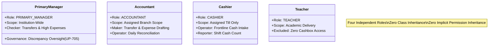

# OX-DIGITAL Education — UI/UX Phase 2 (Batch 5)
# Document 4: Cashbox Roles & Granular Permission Matrix
**Document ID:** `CASHBOX_PERMISSION_MATRIX`  
**Status:** COMPLETE & AUTHORITATIVE — READY FOR PRODUCT OWNER REVIEW  
**Date:** 2026-11-04  
**Workspace:** `D:\OX-DIGITAL\Mathe\OX-DIGITAL-GITHUB`  
**Target Path:** `docs/ui-ux/phase-2/batch-5-cashbox-management/CASHBOX_PERMISSION_MATRIX.md`  
**Classification:** Role-Based Access Control (RBAC), Maker-Checker Separation & Authorization Matrix  

> [!NOTE] Demonstration Data Policy
> All persona names, user IDs, voucher numbers, and financial metrics in this document and accompanying prototypes are **SYNTHETIC DEMONSTRATION DATA (DEMO DATA — NOT REAL)**.

---

## 1. Architectural Role Model

The Cashbox Management Workspace recognizes **exactly four independent accounting-domain roles**. In accordance with Product Owner directives, these roles operate without inheritance hierarchies:



### Authoritative Role Designations:
1. **Primary Manager (المدير الرئيسي):**
   - Holds institution-wide financial and governance authority across all educational centers.
   - Acts as authoritative **Checker** for internal transfer requests, approval-required expense vouchers, and compensating reversals.
   - Conducts administrative oversight of cashbox discrepancy dossiers under neutral policy `UP-705`.
2. **Accountant (المحاسب):**
   - Operates strictly within assigned physical branch scope (`BR-01` or `BR-02`).
   - Acts as authoritative **Maker** for internal transfer requests, expense vouchers, daily reconciliation shift counts, and reversal requests.
   - Cannot self-approve internal transfers or expense vouchers requiring Checker authorization. Cannot perform destructive edits or deletions.
3. **Cashier (الكاشير):**
   - Active, recognized accounting-domain role restricted strictly to assigned frontline cashbox till.
   - Performs physical cash intake from guardians and issues stamped official cash receipt vouchers.
   - Submits physical shift cash counts at the end of the work period.
   - **No Independent UI Shell:** The Cashier operates within embedded till modals/screens; no independent management dashboard is provided.
   - Does **not** inherit Accountant permissions; cannot view consolidated liquidity, internal transfers, operating expenses, or branch-wide audits.
4. **Teacher (المعلم):**
   - Purely academic role. Completely excluded from cashbox operations, till movements, transfers, expenses, and reconciliations.

---

## 2. Granular Capability Matrix

| Operational Capability | Primary Manager — المدير الرئيسي | Accountant — المحاسب | Cashier — الكاشير | Teacher — المعلم | Governance & Enforcement Rule |
| :--- | :---: | :---: | :---: | :---: | :--- |
| **View Consolidated Institutional Liquidity** | **ALLOWED** | **DENIED** | **DENIED** | **DENIED** | Primary Manager views institution-wide cashbox balances (86,400.00 EGP), cash-in-transit (1,500.00 EGP), and total cash position (87,900.00 EGP). |
| **View Cashbox Directory (Assigned Branch)** | **ALLOWED** (All) | **ALLOWED** (Branch) | **DENIED** | **DENIED** | Accountant is restricted to cashboxes in own branch. |
| **View Cashbox Transaction Timeline** | **ALLOWED** (All) | **ALLOWED** (Branch) | **DENIED** | **DENIED** | Immutable ledger view. |
| **Frontline Cash Intake & Receipt Issuance** | **ALLOWED** | **ALLOWED** | **ALLOWED** | **DENIED** | Ingests cash at till, issues official numbered receipt. |
| **Create Internal Transfer Request (Maker)** | **DENIED** | **ALLOWED** | **DENIED** | **DENIED** | Separation of duties: Accountant initiates transfer requests. |
| **Authorize Internal Transfer Request (Checker)**| **ALLOWED** | **DENIED** | **DENIED** | **DENIED** | Primary Manager authorizer; Accountant self-approval blocked. |
| **Dispatch Physical Cash (Source Till)** | **ALLOWED** | **ALLOWED** | **ALLOWED** (Assigned) | **DENIED** | Marks movement `IN_TRANSIT` and debits source cashbox. |
| **Acknowledge Physical Cash Receipt (Dest Till)**| **DENIED** | **DENIED** | **ALLOWED** (Assigned Custodian) | **DENIED** | Confirms banknotes, logs `TRANSFER_IN`, marks `COMPLETED`. Restricted strictly to assigned receiving custodian at destination cashbox (no generic manager override). |
| **Draft Expense Voucher (Maker)** | **DENIED** | **ALLOWED** | **DENIED** | **DENIED** | Accountant drafts expense voucher with supporting evidence. |
| **Authorize Expense Voucher (Checker)** | **ALLOWED** | **DENIED** | **DENIED** | **DENIED** | Primary Manager authorizes when approval is required by policy (Policy decision pending — no threshold configured). |
| **Submit Physical Shift Cash Count** | **ALLOWED** | **ALLOWED** | **ALLOWED** (Assigned) | **DENIED** | Registers counted cash by denomination at shift end. |
| **Sign Reconciled Balanced Dossier** | **ALLOWED** | **ALLOWED** | **DENIED** | **DENIED** | Approves shift closure when difference == 0.00 EGP. |
| **Review Discrepancy Dossier (UP-705)** | **ALLOWED** (Lead) | **ALLOWED** (Investigate)| **DENIED** | **DENIED** | Neutral review; zero write-off or employee salary charging. |
| **Request Compensating Reversal (Maker)** | **DENIED** | **ALLOWED** | **DENIED** | **DENIED** | Drafts append-only reversal request with audit memo. |
| **Authorize Compensating Reversal (Checker)** | **ALLOWED** | **DENIED** | **DENIED** | **DENIED** | Primary Manager approves posting of opposite compensating entry. |
| **Edit / Delete Posted Cash Movements** | **PROHIBITED** | **PROHIBITED** | **PROHIBITED** | **PROHIBITED** | Immutability invariant: Accounting deletion is physically impossible. |
| **Write Off Cash Shortages** | **PROHIBITED** | **PROHIBITED** | **PROHIBITED** | **PROHIBITED** | Blocked under open policy `UP-705`. |
| **Charge Shortages to Cashier Salary** | **PROHIBITED** | **PROHIBITED** | **PROHIBITED** | **PROHIBITED** | Blocked under open policy `UP-705`. |
| **Post Balancing Journal Entries** | **PROHIBITED** | **PROHIBITED** | **PROHIBITED** | **PROHIBITED** | Blocked: No fabricated entries to force balance agreement. |

---

## 3. Maker-Checker Enforcement Matrix

```text
+----------------------------------------------------------------------------------------------------+
| Transaction Category    | Maker Role (Initiator) | Checker Role (Authorizer) | Mandatory Invariant |
+-------------------------+------------------------+---------------------------+---------------------+
| Internal Cash Transfer  | Accountant             | Primary Manager           | Self-approval blocked|
| Expense Voucher         | Accountant (Maker)     | Primary Manager (Checker) | Approval when required by policy; no numeric threshold configured |
| Daily Reconciliation    | Cashier / Accountant   | Accountant / Manager      | Double count signoff|
| Compensating Reversal   | Accountant             | Primary Manager           | Dual justification  |
+----------------------------------------------------------------------------------------------------+
```

---

## 4. Branch Scoping & Multi-Center Isolation Rules

1. **Primary Manager Scope:**
   - Unrestricted access across all branches (`BR-01` Dokki, `BR-02` Nasr City) and all four cashboxes (`CB-01`, `CB-02`, `CB-MAIN`, `CB-03`).
2. **Accountant Scope:**
   - Strict filter applied via session token.
   - An Accountant assigned to `BR-01` can only view, draft, and reconcile `CB-01`, `CB-02`, and `CB-MAIN`.
   - An Accountant assigned to `BR-02` can only view, draft, and reconcile `CB-03`.
   - Inter-branch transfer requests allow selection of a destination cashbox in another branch, but execution requires Primary Manager authorization and destination custodian receipt.
3. **Cashier Scope:**
   - Locked to specific assigned cashbox till (e.g. `CB-01`).
   - Cannot view other cashboxes, branch summary totals, or institutional liquidity.

