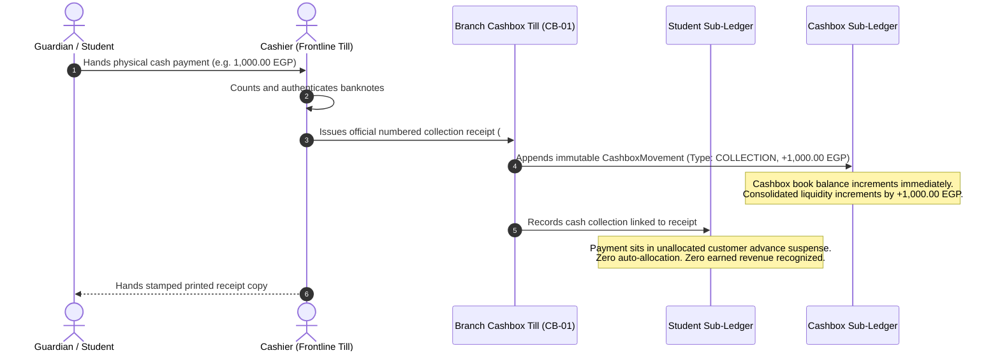
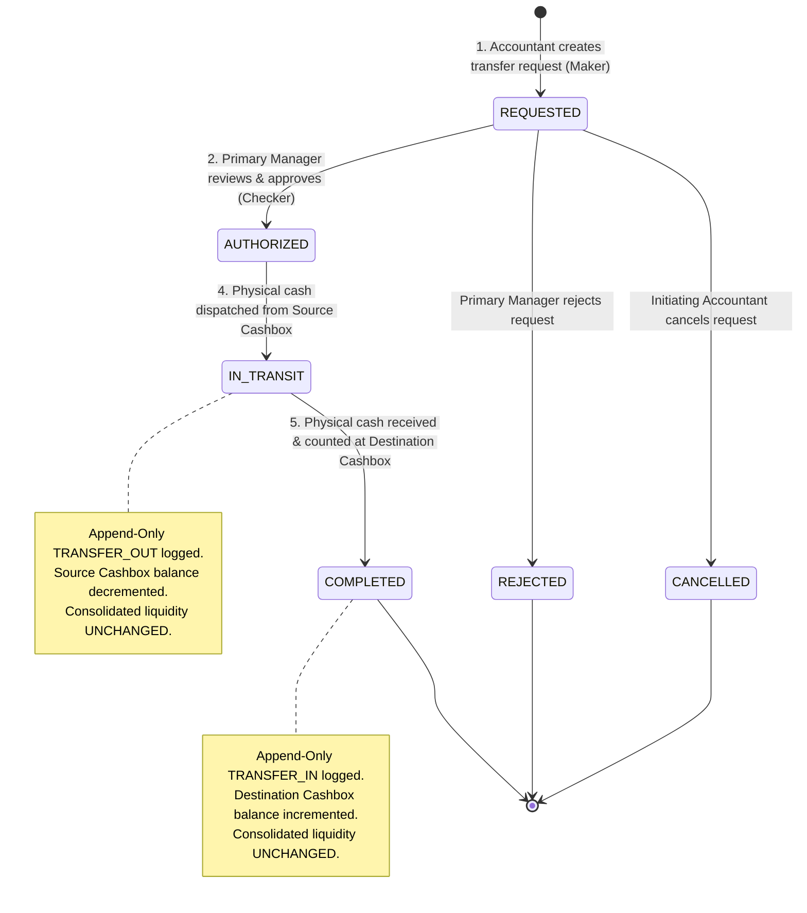
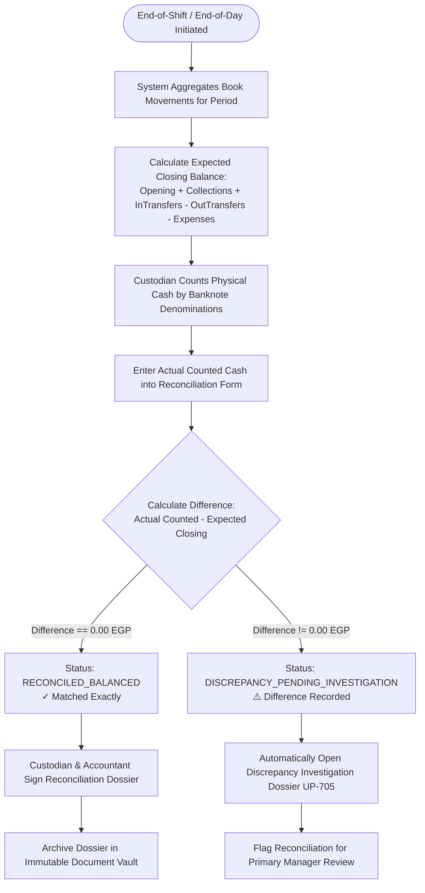
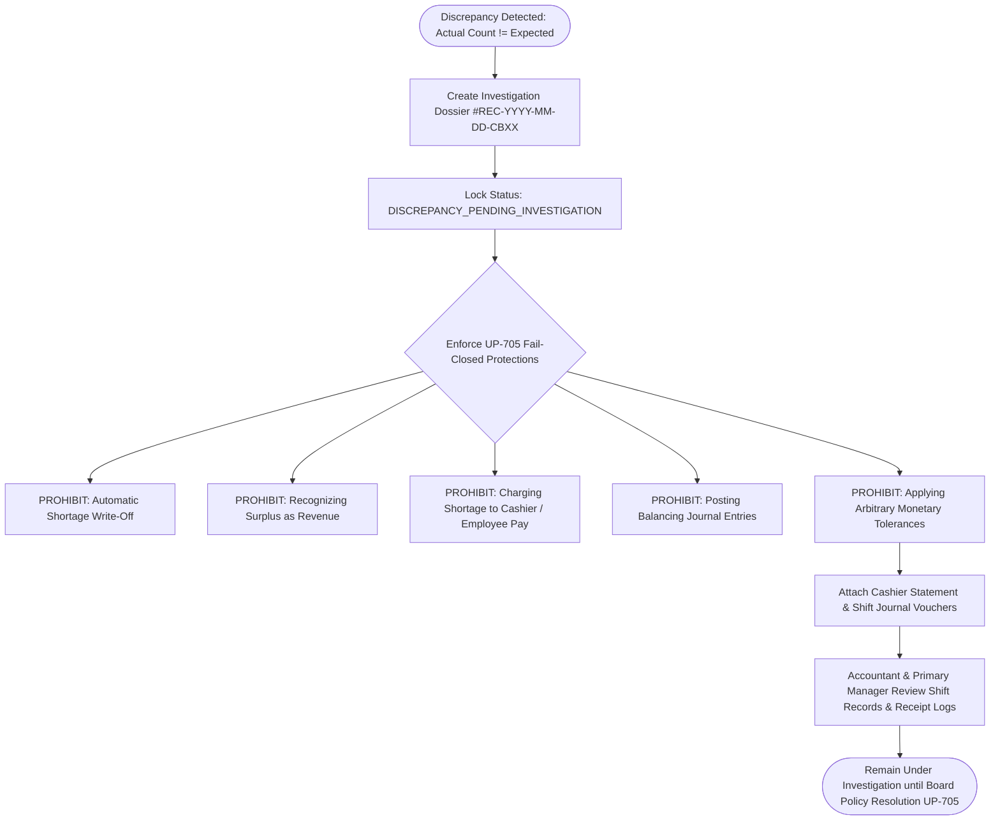
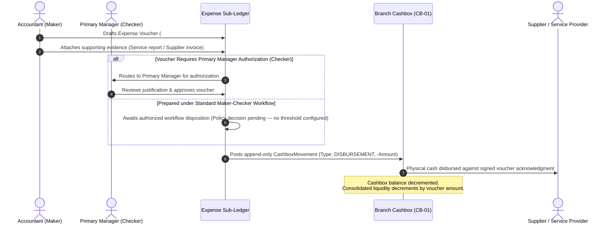

# OX-DIGITAL Education — UI/UX Phase 2 (Batch 5)
# Document 3: Cashbox Operational Workflows & State Machines
**Document ID:** `CASHBOX_WORKFLOWS`  
**Status:** COMPLETE & AUTHORITATIVE — READY FOR PRODUCT OWNER REVIEW  
**Date:** 2026-11-04  
**Workspace:** `D:\OX-DIGITAL\Mathe\OX-DIGITAL-GITHUB`  
**Target Path:** `docs/ui-ux/phase-2/batch-5-cashbox-management/CASHBOX_WORKFLOWS.md`  
**Classification:** Operational State Machines, Event Sequences & Business Process Modeling  

> [!NOTE] Demonstration Data Policy
> All persona names, user IDs, voucher numbers, and financial metrics in this document and accompanying prototypes are **SYNTHETIC DEMONSTRATION DATA (DEMO DATA — NOT REAL)**.

---

## 1. Workflow 1: Cash Intake Ingestion & Physical Till Movement

Governs the frontline ingestion of student tuition collections into the branch cashbox till without conflating physical cash custody with earned revenue or student allocation.



### Invariants for Workflow 1:
- **Receipt to Till Idempotency:** Every cash intake movement references an authoritative `receiptId`. Duplicate processing for the same receipt is blocked.
- **No Secondary Student Collection:** Ingesting cash into the till does not create a duplicate or conflicting collection record in the student profile.
- **Four-Tier Boundary:** Till ingestion does not recognize earned revenue or automatically consume student payment schedule items.

---

## 2. Workflow 2: Five-Stage Internal Transfer Lifecycle

Governs the transfer of cash between physical cashboxes within the institution under strict Maker-Checker governance, ensuring liquidity neutrality and atomicity.



### Detailed Stage Specifications:
1. **Stage 1 — Creation (`REQUESTED`):**
   - **Maker:** Accountant of the initiating branch.
   - **Six Mandatory Eligibility Conditions:**
     1. *Source & Destination Differentiation:* Source and destination must be different physical cashboxes (`sourceId !== destinationId`).
     2. *Active Operational Status:* Both cashboxes must be in an `ACTIVE` status (`source.isActive === true && destination.isActive === true`).
     3. *Physical Till Requirement:* Both cashboxes must be physical cashboxes (`source.isOnline === false && destination.isOnline === false`). Digital accounts or virtual ledgers cannot be transfer endpoints.
     4. *Institutional Boundary Enforcement:* Both cashboxes must belong to the exact same institution (`source.institutionId === destination.institutionId`). Cross-institution transfers are prohibited.
     5. *Positive Amount & Book Balance Conservation:* Transfer amount must be positive ($> 0$) and must not exceed the source cashbox's available book balance ($\text{Amount} \le \text{Source Available Balance}$).
     6. *Mandatory Business Justification:* A non-empty transfer reason/business justification must be provided.
   - **Validation Authority:** Enforced authoritatively by backend API; client-side UI validations provide immediate UX feedback only. Any failed condition results in immediate rejection without state creation.
2. **Stage 2 — Review & Authorization (`AUTHORIZED`):**
   - **Checker:** Primary Manager exclusively. Accountant self-approval is blocked.
   - **Review Points:** Business necessity, branch cash limits, source liquidity.
3. **Stage 3 — Authorization Decision:**
   - Status transitions to `AUTHORIZED` (ready for physical movement), `REJECTED` (with recorded justification), or `CANCELLED`.
   - **Critical Rule:** Authorization alone does **not** generate financial movements or alter cash balances.
4. **Stage 4 — Physical Dispatch (`IN_TRANSIT`):**
   - Source cashbox custodian dispatches physical cash with courier/custodian.
   - System posts append-only `TRANSFER_OUT` on source cashbox:
     $$\text{Balance}_{\text{source}} \leftarrow \text{Balance}_{\text{source}} - \text{Amount}$$
   - Transfer status updates to `IN_TRANSIT`. Funds are recorded as in-transit cash.
   - **Cash-in-Transit Accounting:** Source cashbox balance decreases by transfer amount, and cash-in-transit increases by the exact same amount. Destination cashbox is NOT credited before physical receipt confirmation.
5. **Stage 5 — Physical Receipt (`COMPLETED`):**
   - **Access Restriction:** Receipt confirmation is restricted strictly to the designated receiving custodian at the destination cashbox (e.g. أمين الخزينة المستلم: أ. رأفت توفيق for CB-MAIN). There is no generic manager override or separate Cashier UI shell.
   - Destination cashbox custodian receives, counts, and verifies physical banknotes.
   - Custodian records physical receipt acknowledgment in the system.
   - System posts append-only `TRANSFER_IN` on destination cashbox:
     $$\text{Balance}_{\text{destination}} \leftarrow \text{Balance}_{\text{destination}} + \text{Amount}$$
   - Cash-in-transit decreases by transfer amount, and destination balance increases by the exact same amount.
   - Transfer status updates to `COMPLETED`.
   - **Institutional Total Invariant:**
     $$\text{Institutional Cash Total} = \sum \text{Cashbox Book Balances} + \text{Cash in Transit} = 86,400.00 + 1,500.00 = 87,900.00\text{ EGP}$$
     $$\Delta \text{Institutional Liquidity} = -\text{Amount} + \text{Amount} = 0.00\text{ EGP}$$
     Funds are never destroyed, created, or triple-counted across source, transit, and destination.

---

## 3. Workflow 3: Daily Shift Count & Cashbox Reconciliation

Governs end-of-shift and end-of-day cash counts, expected balance derivation, and reconciliation dossier generation.



### Calculation Rules:
$$\text{Expected Closing Balance} = \text{Opening Balance} + \sum \text{Collections} + \sum \text{TransfersIn} - \sum \text{TransfersOut} - \sum \text{Expenses}$$
$$\text{Difference} = \text{Actual Counted Closing Balance} - \text{Expected Closing Balance}$$

*Compensating Reversals Treatment:* If an erroneous entry is corrected via a compensating reversal, the compensating movement is recorded in the appropriate category (collections, transfers, or expenses) and counted exactly once. No separate ambiguous adjustment term is added to the reconciliation equation.

---

## 4. Workflow 4: Cashbox Discrepancy Handling under `UP-705` (Neutral Status)

Governs the strict, fail-closed handling of physical cash variances without jumping to unauthorized financial write-offs or employee penalties.



### Prohibitions under `UP-705`:
1. **No Employee Liability:** Cash shortages cannot be assigned to an employee or deducted from cashier salary in the system.
2. **No Auto-Write-Off:** Shortages cannot be written off to an operating loss account.
3. **No Surplus Revenue:** Surplus cash cannot be booked as institutional sundry income.
4. **No Balancing Entries:** No adjusting entry may be posted to force the book balance into agreement with counted cash.
5. **No Speculative Thresholds:** No monetary tolerance (e.g. "differences under 50 EGP are ignored") is permitted.

---

## 5. Workflow 5: Petty Cash & Expense Voucher Lifecycle

Governs branch operating expenses and petty cash disbursements under Maker-Checker controls.



### Key Rules for Expenses:
- **Maker-Checker Segregation:** Accountant prepares the voucher (Maker); Primary Manager approves when required under an approved institutional policy (Checker).
- **No Invented Thresholds:** Policy decision pending — no threshold configured. No automatic approval or posting rules.
- **Flexible Evidence Accepted:** Vouchers accept supplier invoices, service receipts, maintenance order slips, or local purchase receipts.
- **Operational Documentation:** Operating disbursements are supported by operational receipts and memos without tax-engine assumptions.

---

## 6. Workflow 6: Append-Only Compensating Reversals (`REVERSAL`)

Governs the correction of erroneous cashbox movements without violating accounting immutability.

```mermaid
flowchart TD
    IdentifyError([Identify Erroneous Cash Movement #MOV-ORIG]) --> PrepareReversal[Accountant Drafts Reversal Request with Supporting Memo]
    PrepareReversal --> ManagerReview[Primary Manager Reviews Justification & Audit Trail]
    ManagerReview --> CheckDecision{Approval Decision}
    
    CheckDecision -->|Rejected| ReversalRejected([Reversal Rejected - Original Record Stands])
    CheckDecision -->|Approved| PostCompensating[Post Append-Only Compensating Movement #MOV-REV]
    
    PostCompensating --> ApplyEqualOpposite[Apply Opposite Financial Effect:<br/>If Original was COLLECTION (+X), Reversal is (-X)<br/>If Original was DISBURSEMENT (-Y), Reversal is (+Y)]
    ApplyEqualOpposite --> CrossReference[Link #MOV-REV.reversalOf = #MOV-ORIG<br/>Mark #MOV-ORIG.isReversed = true]
    CrossReference --> UpdateAudit[Append Event to Immutable Audit Trail]
    UpdateAudit --> PreservedHistory([Audit Trail Preserved - Zero Records Deleted])
```

