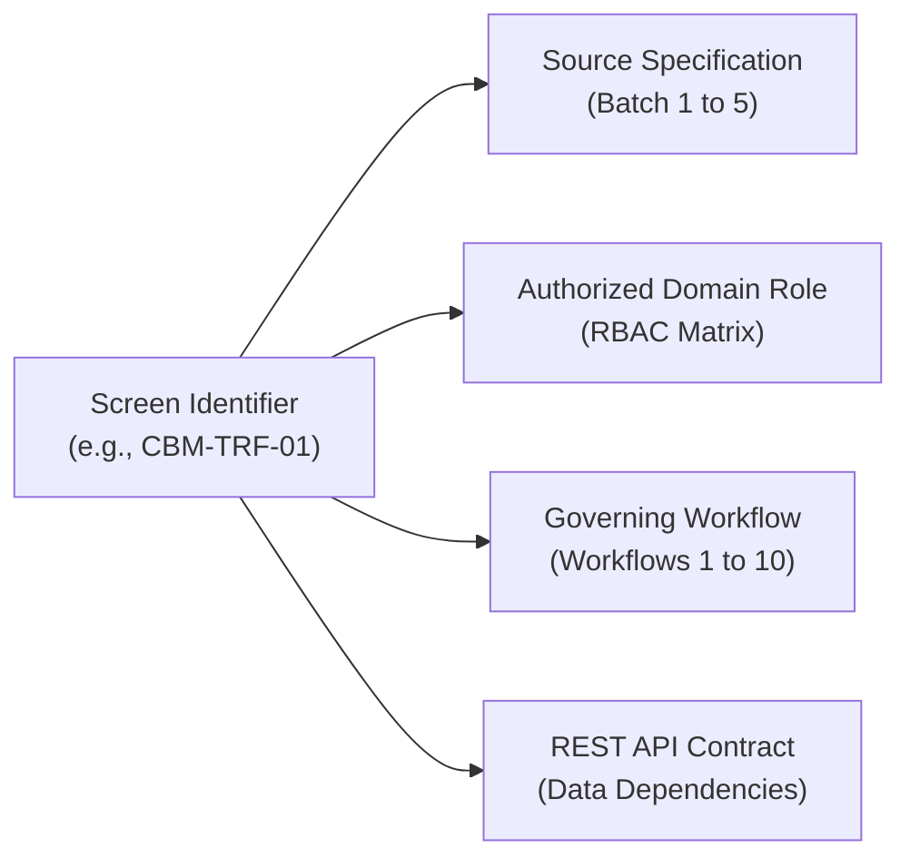

# OX-DIGITAL Education — Phase 2 UI/UX Design Baseline
# Cross-Batch Screen Traceability & API Mapping

**Workspace:** `D:\OX-DIGITAL\Mathe\OX-DIGITAL-GITHUB`  
**Target:** `docs/ui-ux/phase-2/batch-6-final-integration/`  
**Execution Mode:** STRICTLY DESIGN-ONLY

---

## 1. Traceability Architecture

This document establishes the bidirectional traceability matrix mapping every screen identifier across Phase 2 (Batches 1 through 5) to its authoritative source specification, active user roles, underlying workflows, and target domain models / REST API contracts.

---

## 2. Master Screen Traceability Register

| Screen ID | Screen Title (Arabic & English) | Source Specification Document | Active Role(s) | Governing Workflow | Target REST API Endpoint | Domain Model |
| :--- | :--- | :--- | :--- | :--- | :--- | :--- |
| **`PM-DASH-01`**| لوحة التحكم التنفيذية (Executive Overview Dashboard) | `docs/ui-ux/phase-2/batch-2-primary-manager/` | `PRIMARY_MANAGER` | Institutional Oversight | `GET /api/v1/executive/overview` | `ExecutiveKPIAggregate` |
| **`PM-APPR-01`**| مركز الاعتمادات والقرارات (Decision Center) | `docs/ui-ux/phase-2/batch-2-primary-manager/` | `PRIMARY_MANAGER` | Workflow 5 & 8 (Checker) | `GET /api/v1/executive/approvals` | `ApprovalQueue` |
| **`PM-BR-01`**  | حوكمة الفروع والمراكز (Branch Governance) | `docs/ui-ux/phase-2/batch-2-primary-manager/` | `PRIMARY_MANAGER` | Multi-Branch Monitoring | `GET /api/v1/executive/branches` | `Branch` |
| **`PM-COLL-01`**| سجل التحصيلات المجمع (Institutional Collections) | `docs/ui-ux/phase-2/batch-2-primary-manager/` | `PRIMARY_MANAGER` | Workflow 2 (Audit) | `GET /api/v1/accounting/collections` | `CollectionReceipt` |
| **`PM-EXP-01`** | سجل أذونات الصرف المعتمدة (Expense Oversight) | `docs/ui-ux/phase-2/batch-2-primary-manager/` | `PRIMARY_MANAGER` | Workflow 8 (Oversight) | `GET /api/v1/accounting/expenses` | `ExpenseVoucher` |
| **`PM-REC-01`** | ملفات المطابقة والتحقيق (Reconciliation Review)| `docs/ui-ux/phase-2/batch-2-primary-manager/` | `PRIMARY_MANAGER` | Workflow 6 & 7 (Review) | `GET /api/v1/accounting/reconciliations`| `DailyReconciliation` |
| **`PM-RPT-01`** | التقارير المالية التنفيذية (Executive Reports) | `docs/ui-ux/phase-2/batch-2-primary-manager/` | `PRIMARY_MANAGER` | Financial Reporting | `GET /api/v1/executive/reports` | `FinancialReportDigest`|
| **`PM-STU-01`** | سجل الطلاب المالي المجمع (Student Sub-Ledger Directory) | `docs/ui-ux/phase-2/batch-2-primary-manager/` | `PRIMARY_MANAGER` | Student Audit | `GET /api/v1/accounting/students` | `StudentAgreement` |
| **`PM-TCH-01`** | اعتماد مستحقات المعلمين (Teacher Dues Approval)| `docs/ui-ux/phase-2/batch-2-primary-manager/` | `PRIMARY_MANAGER` | Workflow 10 (Checker) | `GET /api/v1/accounting/teachers/dues`| `TeacherCompensation` |
| **`ACC-DASH-01`**| مساحة العمل المحاسبية (Accountant Workspace) | `docs/ui-ux/phase-2/batch-3-accountant/` | `ACCOUNTANT` | Daily Operations | `GET /api/v1/accounting/workspace` | `AccountantSummary` |
| **`ACC-COLL-01`**| مراجعة تحصيلات الخزائن (Collections Audit) | `docs/ui-ux/phase-2/batch-3-accountant/` | `ACCOUNTANT` | Workflow 2 (Audit) | `GET /api/v1/accounting/collections` | `CollectionReceipt` |
| **`ACC-EXP-01`** | تحرير أذونات الصرف (Expense Voucher Drafting) | `docs/ui-ux/phase-2/batch-3-accountant/` | `ACCOUNTANT` | Workflow 8 (Maker) | `POST /api/v1/accounting/expenses` | `ExpenseVoucher` |
| **`ACC-GL-01`**  | قيود اليومية التشغيلية (Operational GL Bridge)| `docs/ui-ux/phase-2/batch-3-accountant/` | `ACCOUNTANT` | General Ledger Sync | `GET /api/v1/accounting/gl-movements` | `GLJournalEntry` |
| **`ACC-REC-01`** | مطابقة ورديات الفروع (Shift Reconciliation) | `docs/ui-ux/phase-2/batch-3-accountant/` | `ACCOUNTANT` | Workflow 6 (Review) | `GET /api/v1/accounting/reconciliations`| `DailyReconciliation` |
| **`ACC-RECON-01`**| مقارنة رصيد الدفتر بالعد (Count Comparison) | `docs/ui-ux/phase-2/batch-3-accountant/` | `ACCOUNTANT` | Workflow 6 (Comparison) | `POST /api/v1/accounting/reconcile` | `ShiftCountAudit` |
| **`ACC-REV-01`** | مراقبة الإيرادات المستحقة (Revenue Monitor) | `docs/ui-ux/phase-2/batch-3-accountant/` | `ACCOUNTANT` | Workflow 4 (Recognition) | `GET /api/v1/accounting/earned-revenue`| `RevenueRecognitionEntry`|
| **`ACC-RPT-01`** | تقارير الإغلاق اليومي (Daily Closing Reports) | `docs/ui-ux/phase-2/batch-3-accountant/` | `ACCOUNTANT` | Operational Reporting | `GET /api/v1/accounting/reports/daily` | `DailyShiftSummary` |
| **`ACC-STU-01`** | دليل حسابات الطلاب الفرعية (Student Directory)| `docs/ui-ux/phase-2/batch-3-accountant/` | `ACCOUNTANT` | Sub-Ledger Operations | `GET /api/v1/accounting/students` | `StudentSubLedger` |
| **`ACC-TCH-01`** | تدقيق إثبات حصص المعلمين (Teacher Audit) | `docs/ui-ux/phase-2/batch-3-accountant/` | `ACCOUNTANT` | Workflow 10 (Audit) | `GET /api/v1/accounting/teacher-audit`| `LessonDeliveryEvidence`|
| **`SFP-AGREE-01`**| تفاصيل الاتفاق الدراسي (Agreement Terms) | `docs/ui-ux/phase-2/batch-4-student-financial-profile/` | `PRIMARY_MANAGER`, `ACCOUNTANT` | Workflow 1 (Terms) | `GET /api/v1/students/:id/agreements` | `StudentAgreement` |
| **`SFP-DUES-01`** | جدول السداد والمستحقات (Payment Schedule Matrix) | `docs/ui-ux/phase-2/batch-4-student-financial-profile/` | `PRIMARY_MANAGER`, `ACCOUNTANT` | Workflow 1 (Schedule) | `GET /api/v1/students/:id/schedule` | `PaymentScheduleItem` |
| **`SFP-COLL-01`** | إيصالات التحصيل الميداني (Receipts Ledger) | `docs/ui-ux/phase-2/batch-4-student-financial-profile/` | `PRIMARY_MANAGER`, `ACCOUNTANT` | Workflow 2 (Sub-Ledger) | `GET /api/v1/students/:id/receipts` | `CollectionReceipt` |
| **`SFP-ALLOC-01`**| سجل تخصيص الدفعات (Allocation Ledger) | `docs/ui-ux/phase-2/batch-4-student-financial-profile/` | `PRIMARY_MANAGER`, `ACCOUNTANT` | Workflow 3 (Allocation) | `GET /api/v1/students/:id/allocations` | `PaymentAllocation` |
| **`SFP-REV-01`**  | سجل الإيرادات المكتسبة (Earned Revenue Audit) | `docs/ui-ux/phase-2/batch-4-student-financial-profile/` | `PRIMARY_MANAGER`, `ACCOUNTANT` | Workflow 4 (Recognition) | `GET /api/v1/students/:id/revenue-records` | `RevenueRecognitionEntry`|
| **`SFP-ADJ-01`**  | سجل التسويات العكسية (Compensating Reversals)| `docs/ui-ux/phase-2/batch-4-student-financial-profile/` | `PRIMARY_MANAGER`, `ACCOUNTANT` | Workflow 9 (Reversals) | `GET /api/v1/students/:id/adjustments` | `StudentLedgerAdjustment`|
| **`SFP-DOC-01`**  | مستودع المستندات المؤيدة (Document Archive) | `docs/ui-ux/phase-2/batch-4-student-financial-profile/` | `PRIMARY_MANAGER`, `ACCOUNTANT` | Supporting Documents | `GET /api/v1/students/:id/documents` | `SupportingDocument` |
| **`SFP-HIST-01`** | السجل المالي التراكمي الشامل (Complete Timeline) | `docs/ui-ux/phase-2/batch-4-student-financial-profile/` | `PRIMARY_MANAGER`, `ACCOUNTANT` | Sub-Ledger Immutability | `GET /api/v1/students/:id/timeline` | `StudentFinancialProfile`|
| **`CBM-OVR-01`** | دليل الخزائن المعتمدة (Cashbox Directory) | `docs/ui-ux/phase-2/batch-5-cashbox-management/` | `PRIMARY_MANAGER`, `ACCOUNTANT` | Cashbox Inventory | `GET /api/v1/accounting/cashboxes/overview` | `Cashbox` |
| **`CBM-DET-01`** | سجل حركات الخزينة التفصيلي (Cash Movements) | `docs/ui-ux/phase-2/batch-5-cashbox-management/` | `PRIMARY_MANAGER`, `ACCOUNTANT` | Till Ledger Immutability | `GET /api/v1/accounting/cashboxes/:id/movements` | `CashboxMovement` |
| **`CBM-TRF-01`** | التحويلات الداخلية بين الخزائن (Transfers Workspace) | `docs/ui-ux/phase-2/batch-5-cashbox-management/` | `PRIMARY_MANAGER`, `ACCOUNTANT` | Workflow 5 (5 Stages) | `GET /api/v1/accounting/cashboxes/transfers` | `CashboxTransferRequest`|
| **`CBM-REC-01`** | مطابقة الخزائن اليومية (Daily Reconciliation Ledger) | `docs/ui-ux/phase-2/batch-5-cashbox-management/` | `PRIMARY_MANAGER`, `ACCOUNTANT` | Workflow 6 (Shift Count) | `GET /api/v1/accounting/cashboxes/:id/reconciliations` | `DailyCashboxReconciliation` |
| **`CBM-COLL-01`**| استلام نقد بالخزينة وإصدار إيصال (Till Ingestion)| `docs/ui-ux/phase-2/batch-5-cashbox-management/` | `ACCOUNTANT`, `CASHIER` | Workflow 2 (Till Intake) | `POST /api/v1/accounting/cashboxes/:id/intake` | `CashboxMovement` |
| **`CBM-EXP-01`** | سجل أذونات الصرف التشغيلية (Expense Register) | `docs/ui-ux/phase-2/batch-5-cashbox-management/` | `ACCOUNTANT`, `PRIMARY_MANAGER` | Workflow 8 (Disbursement) | `GET /api/v1/accounting/cashboxes/expenses` | `ExpenseVoucher` |
| **`CBM-DISC-01`**| ملف التحقيق في فارق الخزينة (UP-705 Dossier) | `docs/ui-ux/phase-2/batch-5-cashbox-management/` | `PRIMARY_MANAGER`, `ACCOUNTANT` | Workflow 7 (UP-705 Neutral) | `GET /api/v1/accounting/reconciliations/:id/dossier` | `DiscrepancyInvestigationDossier` |
| **`CBM-AUD-01`** | سجل المراجعة والتدقيق والوثائق (Audit Vault) | `docs/ui-ux/phase-2/batch-5-cashbox-management/` | `PRIMARY_MANAGER`, `ACCOUNTANT` | Workflow 9 (Audit Vault) | `GET /api/v1/accounting/cashboxes/:id/audit-trail` | `AuditLog` |
| **`TCH-DASH-01`**| بوابة المعلم الرئيسية (Teacher Overview) | `docs/ui-ux/phase-2/batch-1-app-shell/` | `TEACHER` | Academic Portal | `GET /api/v1/teacher/overview` | `TeacherSession` |
| **`TCH-EVID-01`**| إثبات تقديم الحصص التعليمية (Lesson Evidence) | `docs/ui-ux/phase-2/batch-1-app-shell/` | `TEACHER` | Workflow 4 & 10 (Evidence) | `POST /api/v1/teacher/evidence` | `LessonDeliveryEvidence`|
| **`TCH-DUES-01`**| كشف مستحقات المعلم المعتمدة (Teacher Dues) | `docs/ui-ux/phase-2/batch-1-app-shell/` | `TEACHER` | Workflow 10 (Dues View) | `GET /api/v1/teacher/dues` | `TeacherCompensation` |

---

## 3. Alias Harmonization & Cross-Batch Screen Evolution

During the multi-batch design progression, early preliminary wireframe codes were refined into high-fidelity functional IDs:
1. **Cashbox Management:** Early Batch 1 placeholder `CB-LIST-01` and Batch 2 screen `CB-MGT-01` evolved into `CBM-OVR-01` (Cashbox Directory) and `CBM-DET-01` (Movement Timeline) in Batch 5.
2. **Reconciliation:** Early Batch 1 `CB-RECON-01` and Batch 3 `ACC-RECON-01` evolved into `CBM-REC-01` (Authoritative 4-Cashbox Reconciliation Table).
3. **Internal Transfers:** Early Batch 1 `CB-XFER-01` evolved into `CBM-TRF-01` (5-Stage Internal Cashbox Transfer Workspace).
4. **Discrepancy Dossiers:** Early `CB-DISC-01` evolved into `CBM-DISC-01` (UP-705 Neutral Discrepancy Investigation Dossier).
5. **Student Sub-Ledger:** Early `STU-FIN-01` in Batch 1 evolved into the comprehensive 8-area sub-ledger experience (`SFP-AGREE-01` through `SFP-HIST-01`) in Batch 4.

*All mappings are 100% accounted for without gaps, orphaned screens, or invented capabilities.*

