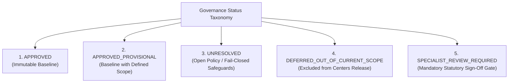
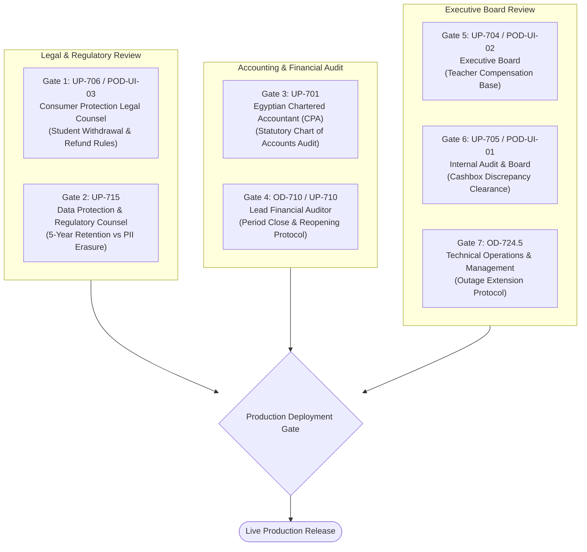

# OX-DIGITAL Education — Phase 2 UI/UX Design Baseline
# Master Register of Governance Decisions, Unresolved Policies & Specialist Gates

**Workspace:** `D:\OX-DIGITAL\Mathe\OX-DIGITAL-GITHUB`  
**Target:** `docs/ui-ux/phase-2/batch-6-final-integration/`  
**Execution Mode:** STRICTLY DESIGN-ONLY (Zero code, zero backend, zero database, zero migrations, zero Git mutations)  
**Status:** COMPLETE & AUTHORITATIVELY RECONCILED

---

## 1. Architectural Governance Framework & Status Taxonomy

To guarantee absolute transparency and avoid speculative assumptions, every architectural policy, operational decision (`OD`), unresolved policy (`UP`), and Product Owner UI decision (`POD-UI`) is authoritatively classified into one of five formal governance statuses:

### Definitions:
1. **`APPROVED`:** Formally approved by the Product Owner and locked as immutable architectural baseline.
2. **`APPROVED_PROVISIONAL`:** Approved for the current release under explicit operational constraints and provisional assumptions.
3. **`UNRESOLVED`:** Open business, financial, or operational policy requiring Product Owner determination. Handled with strict fail-closed mechanisms in UI/UX without default assumptions.
4. **`DEFERRED_OUT_OF_CURRENT_SCOPE`:** Explicitly excluded from the current physical-centers release (e.g. tax engine, online gateways).
5. **`SPECIALIST_REVIEW_REQUIRED`:** Mandatory pre-production review gate requiring formal sign-off by qualified legal, accounting, tax, or regulatory specialists.

---

## 2. Complete Register of Unresolved Policies (`UP-701` through `UP-715`)

| Policy ID | Policy Title & Domain | Formal Status | Detailed Scope & Authoritative Design Treatment | Governing Authority / Specialist |
| :--- | :--- | :---: | :--- | :--- |
| **`UP-701`** | **Statutory Chart of Accounts (COA) Structure & Posting Templates** | **`SPECIALIST_REVIEW_REQUIRED`** | **Mandatory Specialist Review before Task 7.5:** The 4-digit standardized Chart of Accounts must be audited against the Egyptian Uniform Accounting System (نظام المحاسبة الموحد) and Egyptian Accounting Standards (EAS). In the UI/UX baseline, operational expense categories (`نثريات تشغيلية`, `مطبوعات`, `صيانة`, `ضيافة`) are used; statutory account codes are deferred. | Egyptian Certified Public Accountant (Chartered Accountant / محاسب قانوني) |
| **`UP-702`** | **Educational VAT & ETA Electronic Invoicing Treatment** | **`DEFERRED_OUT_OF_CURRENT_SCOPE`** | **Explicitly Deferred:** The Product Owner confirmed that no tax system is required in the current release. Physical center operations are designed completely tax-free: zero VAT (14%), zero withholding tax (`خصم وتحصيل`), zero electronic tax invoices (`فاتورة ضريبية`), and zero tax policy cards. | Egyptian Tax Legal Counsel / Tax Compliance Specialist |
| **`UP-703`** | **Online Payment Gateway Settlement & Merchant Routing** | **`DEFERRED_OUT_OF_CURRENT_SCOPE`** | **Explicitly Deferred:** Gateway settlement (Fawry, Paymob, Vodafone Cash, credit card clearing, school merchant accounts) is outside current scope. Operations focus 100% on physical cash collections at center reception tills (`CB-01` to `CB-03`). | Product Owner + Commercial Strategy |
| **`UP-704`** | **Teacher Percentage Revenue-Share Base & Student Qualification** | **`UNRESOLVED`** | **Strictly Unresolved — Zero Default Selected:** The revenue base for variable teacher compensation (gross catalog tuition vs net agreed tuition vs recognized earned revenue vs collected cash) remains open. In the UI, the system logs certified lesson delivery evidence (`LessonDeliveryEvidence`) and attendee counts, but strictly blocks automatic percentage calculation or deduction from student cash receipts. | Product Owner + Financial Operations |
| **`UP-705`** | **Cashbox Discrepancy Tolerance Limits & Shortage/Overage Policy** | **`UNRESOLVED`** | **Strictly Unresolved — Zero Speculative Thresholds:** Variance handling policy remains open. In the UI, any difference (e.g. `CB-03` difference of `-150.00 EGP`) is strictly locked in neutral status `DISCREPANCY_PENDING_INVESTIGATION`. The design strictly prohibits: (1) automatic write-offs, (2) charging shortages to cashier/employee salary, (3) recognizing surplus as income, (4) posting balancing journal entries, and (5) applying arbitrary monetary tolerances. Zero CCTV or biometric assumptions. | Product Owner + Internal Audit |
| **`UP-706`** | **Student Refund Administrative Fees & Withdrawal Deadlines** | **`SPECIALIST_REVIEW_REQUIRED`** | **Mandatory Specialist Legal Review:** Formal review of student withdrawal rules, administrative deduction percentages, and cancellation policies against Egyptian Consumer Protection Law (Law No. 181/2018). In the UI, refund requests require authorized legal dossiers; zero automated cashbox refunds. | Egyptian Consumer Protection Legal Counsel + Product Owner |
| **`UP-707`** | **Institutional Fiscal Year Parameterization** | **`APPROVED`** | **Approved Policy Baseline:** The institutional fiscal year is parameterized per institution via `Institution.fiscalYearStartMonth` (1 to 12). Supports both Egyptian academic year reporting (July–June / Sep–Aug) and international calendar year (Jan–Dec) without hardcoding. The fiscal-year configuration itself is fully approved and not unresolved. | Product Owner Approval |
| **`UP-708`** | **Foreign Exchange (FX) Rate Source Provenance** | **`UNRESOLVED`** | **Strictly Unresolved:** EGP is the approved launch functional currency under `OD-725` (`EGP_LAUNCH_WITH_SCHEMA_EXTENSIBILITY`) and `OD-702`, with schemas maintaining ISO-4217 code extensibility. However, the authoritative foreign exchange rate source (e.g. Central Bank of Egypt feed vs commercial bank rate table vs manual snapshot) for multi-currency transactions remains unresolved; multi-currency operations remain disabled pending future formal approval. *(Note: Launch currency policy `OD-725` is distinct from FX rate provenance `UP-708`; `UP-712` governs student absence package consumption, not currency).* | Product Owner + Financial Operations |
| **`UP-709`** | **Staff Operational Roles & Financial Delegation Limits (Maker-Checker)** | **`APPROVED_PROVISIONAL`** | **Reconciled Approved Boundaries:** (1) Primary Manager dual approval required for student discounts > 10%; (2) Primary Manager dual approval required for balance adjustments > 500.00 EGP; (3) Frontline Cashier role remains collection-only (zero adjustment, discount, or ledger mutation authority); (4) Anti-splitting controls enforce a 24-hour rolling window and billing-cycle aggregation to prevent threshold evasion; (5) The 500.00 EGP adjustment threshold applies strictly to student balance adjustments and must **never** be applied to operating expense vouchers (*"Policy decision pending — no threshold configured"* for expenses). | Product Owner Approval |
| **`UP-710`** | **Financial Period Closing Locking & Reopening Protocol** | **`UNRESOLVED`** | **Tied to `OD-710` (Open):** Determination whether monthly period closure is permanent or may be reopened under Primary Manager override. Daily shift counts and end-of-day reconciliations are recorded without irreversible ledger locking. | Internal Audit + Product Owner |
| **`UP-711`** | **Opening Balances Migration & Cutover Reconciliation Rules** | **`UNRESOLVED`** | **Open Migration Policy:** Pre-existing student balances, historical debts, and initial cashbox balances ($18,500$ CB-01, $10,000$ CB-02, $28,800$ CB-MAIN, $15,200$ CB-03) serve as baseline fixtures subject to final pre-production audit reconciliation. | Accounting Advice + Product Owner |
| **`UP-712`** | **Student Absence Session Package Consumption Policy** | **`UNRESOLVED`** | **Open Policy under `OD-706`:** Absence does not automatically consume a prepaid session. A formal policy governing unexcused absences, makeup sessions, and expiration of package terms remains to be finalized. | Academic Operations + Product Owner |
| **`UP-713`** | **Institutional Legal Entity Structure & Campus Licensing** | **`UNRESOLVED`** | **Strictly Unresolved:** While `OD-703` establishes one institutional ledger with branch dimensions, the external legal entity formation (single commercial legal entity vs multi-entity corporate holding vs licensed training center vs Ministry of Education registered entity) remains unresolved and subject to corporate legal counsel. `OD-703` does not resolve `UP-713`. | Corporate Legal Advisor + Product Owner |
| **`UP-714`** | **Hybrid Package Allocation (Campus Tuition vs Digital LMS Access)** | **`APPROVED`** | **Approved Policy Baseline:** Formally approved Product Owner decision. Enrollment agreements unbundle and itemize discrete physical classroom fees (attributed to physical campus) and digital LMS platform access fees (separately itemized and attributed to online branch). Separate revenue recognition schedules (attendance-based delivery vs time-based access) operate within the single institutional general ledger (`OD-702`, `OD-703`). *(Note: Equal session accounting valuation is cataloged separately under `OD-722.4`).* | Product Owner Approval (Authoritative Register) |
| **`UP-715`** | **Statutory Data Retention & PII Scrubbing Policy** | **`SPECIALIST_REVIEW_REQUIRED`** | **Mandatory Specialist Review Gate:** Reconciling the mandatory 5-year commercial and tax record retention requirements under the Egyptian Commercial Code (Law No. 17/1999) with student right-to-be-forgotten / PII erasure rights under the Egyptian Personal Data Protection Law (Law No. 151/2020). Historical financial transaction records must remain immutable and undeletable. | Data Protection Officer & Financial Regulatory Counsel |

---

## 3. Operational Decisions Register (`OD` Baseline & Unresolved Sub-Decisions)

| Decision ID | Canonical Decision Title | Formal Status | Operational Summary & Impact on Design Baseline |
| :--- | :--- | :---: | :--- |
| **`OD-701`** | **Multi-Tenant Root Boundary** | **`APPROVED`** | All data, ledgers, and transactions strictly isolated by `institutionId`. Zero cross-tenant data leakage. |
| **`OD-702`** | **Base Functional Currency (EGP)** | **`APPROVED`** | Primary operational and reporting currency is the Egyptian Pound (`EGP` / `ج.م`). |
| **`OD-703`** | **Branch Dimensional Container** | **`APPROVED`** | Campuses modeled as reporting dimensions under a single institutional GL. **Explicitly decoupled from `UP-713`:** establishing branch reporting dimensions in accounting does NOT determine or resolve the institution's external corporate legal entity structure. |
| **`OD-710`** | **Financial Period Close & Reopen Policy** | **`UNRESOLVED`** | May a closed accounting period ever be reopened, or is closure permanent? What grace period applies? Affects hard ledger sealing; does **not** block daily shift operations. |
| **`OD-718`** | **Primary Manager Exclusive Authority** | **`APPROVED`** | Primary Manager holds sole executive authority over fiscal policies, published pricing, and Maker-Checker approvals. |
| **`OD-719`** | **Campus Multiplicity Scope** | **`APPROVED`** | Supports physical campuses (`BR-01`, `BR-02`) and structural virtual branch (`BR-ONLINE`). Till operations restricted to physical centers. |
| **`OD-722.4`** | **Session Accounting Valuation** | **`APPROVED_PROVISIONAL`** | Net package consideration divided equally across sessions; minor-unit residual allocated deterministically. Straight-line revenue recognition per completed session. Distinct from hybrid package allocation (`UP-714`). |
| **`OD-723`** | **Pure Append-Only Ledger Immutability** | **`APPROVED`** | Financial transactions and cash movements are strictly immutable. Corrections execute via compensating reversals (`REVERSAL`). Zero record deletion. |
| **`OD-724.1-4`**| **Legacy Transition Baseline** | **`APPROVED`** | 60-day transition grace period (`OD-724.1`), migration-date anchor (`OD-724.2`), automatic hard cutoff (`OD-724.3`), and cold archive for unmapped records (`OD-724.4`). |
| **`OD-724.5`** | **Outage Extension Governance** | **`UNRESOLVED`** | Qualifying platform outage definition, evidence standard (Datadog/CloudWatch), calculation formula (day-for-day vs minute-for-minute), and Primary Manager audit approval workflow remain strictly unresolved. |
| **`OD-725`** | **Physical Center-First Implementation Rollout** | **`APPROVED`** | Prioritizes physical center classroom and cash till operations over online subscriptions and payment gateways. |
| **`OD-726.1-3`**| **Subscription Renewal Model** | **`APPROVED`** | Explicit opt-in checkbox (`OD-726.1`), current catalog pricing (`OD-726.2`), contiguous date extension (`OD-726.3`). |

---

## 4. Product Owner UI/UX Decisions Register (`POD-UI`)

| Decision ID | UI/UX Decision Title | Formal Status | Governing Policy | UI/UX Baseline Boundary & Treatment |
| :--- | :--- | :---: | :---: | :--- |
| **`POD-UI-01`** | **Cashbox Discrepancy Resolution Workflow** | **`UNRESOLVED`** | `UP-705` | UI implements neutral review status `DISCREPANCY_PENDING_INVESTIGATION`. Zero automated write-offs, employee salary deductions, surplus income booking, or arbitrary tolerances. |
| **`POD-UI-02`** | **Teacher Variable Compensation Calculation Base** | **`UNRESOLVED`** | `UP-704` | UI logs verified lesson delivery evidence and attendee counts; strictly blocks automatic calculation or deduction of teacher shares from student cash receipts. |
| **`POD-UI-03`** | **Student Withdrawal & Refund Settlement Policy** | **`SPECIALIST_REVIEW_REQUIRED`** | `UP-706` | UI requires formal administrative dossier; zero automated cashbox refunds or self-service cancellations. |
| **`POD-UI-04`** | **Collection & Access on Financially Suspended Students** | **`UNRESOLVED`** | Operational Policy | Fee collection permitted with advisory banner (`طالب موقوف مالياً`); receipt issuance logs cash but keeps suspension active pending explicit manager reactivation review. |
| **`POD-UI-05`** | **Receipt Output Format & Hardware Specification** | **`APPROVED_PROVISIONAL`** | Operational Standard | UI supports both 80mm thermal roll layout and standard A4 voucher PDF layouts; ESC/POS hardware printer integration deferred to deployment stage. |

---

## 5. Master Specialist Approval Gates Matrix (Pre-Production Prerequisites)

Prior to promoting engineering code from design/staging to production, the following five specialist approval gates must be formally cleared and signed off:

| Gate # | Governing Policy ID | Specialist Authority | Mandatory Formal Deliverable Required Prior to Production |
| :---: | :--- | :--- | :--- |
| **Gate 1** | `UP-701` | Egyptian Certified Public Accountant (محاسب قانوني) | Signed Chart of Accounts Audit Certification Report verifying compliance with Egyptian Accounting Standards (EAS). |
| **Gate 2** | `UP-706` / `POD-UI-03`| Egyptian Consumer Protection Legal Counsel | Formal Legal Opinion on Student Enrollment Contracts, Withdrawal Timeframes, and Fee Forfeiture Legality (Law 181/2018). |
| **Gate 3** | `UP-715` | Data Protection Officer & Regulatory Legal Counsel | Written Privacy & Financial Retention Specification reconciling 5-year commercial retention (Law 17/1999) with student PII erasure rights (Law 151/2020). |
| **Gate 4** | `UP-704` / `POD-UI-02`| Executive Board & Financial Operations | Formally Approved Teacher Compensation Policy defining the qualifying revenue base (accrual vs cash) and attendance qualification criteria. |
| **Gate 5** | `UP-705` / `POD-UI-01`| Internal Audit Committee & Board of Directors | Formally Approved Cashbox Variance Resolution Standard defining formal investigation protocols and loss write-off authorization thresholds. |
| **Gate 6** | `OD-710` / `UP-710` | Lead Financial Controller & Auditor | Signed Protocol on Financial Period Closing, Grace Periods, and Primary Manager Ledger Reopening Controls. |
| **Gate 7** | `OD-724.5` | Technical Operations Lead & Legal Counsel | Signed Operational Standard on Qualifying Platform Outages, SLA Metrics Evidence Standard, and Day-for-Day Extension Calculations. |

---

*Register authoritatively reconciled across Phase 7 decisions, Phase 2.0A registers, and Phase 2 design deliverables. Zero unapproved business policies were selected or assumed.*
