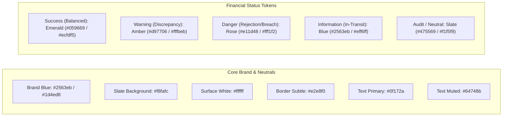

# OX-DIGITAL Education — Phase 2 UI/UX Design Baseline
# Unified Design System & Visual Specification

**Workspace:** `D:\OX-DIGITAL\Mathe\OX-DIGITAL-GITHUB`  
**Target:** `docs/ui-ux/phase-2/batch-6-final-integration/`  
**Execution Mode:** STRICTLY DESIGN-ONLY

---

## 1. Design System Foundations & Principles

The OX-DIGITAL Education Design System provides an institutional, high-trust visual language tailored to financial administration and frontline physical educational operations in Egypt.
- **RTL-First Architecture:** Native Arabic layout flow (`dir="rtl"`) with logical margin and padding properties.
- **High-Density Data Clarity:** Scannable typography, dedicated monospaced numerals, and consistent visual status badges.
- **Fail-Closed Affirmative Feedback:** High-contrast alerts for financial warnings, discrepancies, and policy blocks.
- **Brand Continuity:** Preserves the core OX-DIGITAL brand tokens established in Phase 1 and Batch 1.

---

## 2. Color Palette & Functional Tokens



### 2.1 Color Tokens Table

| Token Name | Hex Code | Tailwind Class | Functional Role |
| :--- | :--- | :--- | :--- |
| `color-brand-primary` | `#2563eb` | `bg-brand-600` / `text-brand-600` | Primary actions, navigation selection, brand identity. |
| `color-brand-dark` | `#1d4ed8` | `bg-brand-700` | Primary hover states, active tab highlights. |
| `color-brand-light` | `#eff6ff` | `bg-brand-50` / `text-brand-700` | Subtle active badges, selected row highlights. |
| `color-surface-base` | `#f8fafc` | `bg-slate-50` | Main application canvas background. |
| `color-surface-card` | `#ffffff` | `bg-white` | Cards, modals, tables, dropdown containers. |
| `color-surface-subtle`| `#f1f5f9` | `bg-slate-100` | Table headers, neutral badges, input disabled state. |
| `color-border-default`| `#e2e8f0` | `border-slate-200` | Dividers, card boundaries, grid borders. |
| `color-text-main` | `#0f172a` | `text-slate-900` | Main headings, financial figures, primary labels. |
| `color-text-muted` | `#64748b` | `text-slate-500` | Secondary descriptions, timestamps, metadata. |
| `color-status-success`| `#059669` | `text-emerald-700` / `bg-emerald-50` | Balanced reconciliations, completed transfers. |
| `color-status-warning`| `#d97706` | `text-amber-700` / `bg-amber-50` | Discrepancies under investigation (UP-705), overdue items. |
| `color-status-danger` | `#e11d48` | `text-rose-700` / `bg-rose-50` | Rejections, validation failures, prohibited operations. |
| `color-status-info` | `#0284c7` | `text-sky-700` / `bg-sky-50` | In-transit funds (#TRF-104), pending reviews. |

---

## 3. Typography & Numerical Representation

- **Arabic Typeface:** `Cairo, 'Segoe UI', Tahoma, sans-serif`. High legibility across RTL text blocks and UI labels.
- **Monospaced Figures:** `font-mono font-mono-numbers`. All financial amounts, currency indicators (`ج.م`), and codes use tabular monospaced numbers to prevent visual jitter:
  ```css
  .font-mono-numbers {
    font-family: ui-monospace, SFMono-Regular, Menlo, Monaco, Consolas, monospace;
    font-variant-numeric: tabular-nums;
    direction: ltr;
    display: inline-block;
  }
  ```
- **Scale:**
  - Micro / Badges: `text-[10px]` - `text-[11px]` (font-bold)
  - Secondary Caption: `text-xs` (12px)
  - Body Text: `text-sm` (14px)
  - Card Titles / Sub-headings: `text-base` (16px, font-bold)
  - Section Headers: `text-lg` - `text-xl` (18px - 20px, font-extrabold)
  - Primary KPI Displays: `text-2xl` - `text-3xl` (24px - 30px, font-black)

---

## 4. Layout, RTL Behavior & Responsive Breakpoints

1. **RTL Flow:**
   - Root document: `<html lang="ar" dir="rtl">`.
   - Sidebars pin to the right edge (`right-0`), content scrolls from right to left.
   - Text alignment defaults to right (`text-right`); numbers and English IDs align left or inline-block.
2. **Breakpoints:**
   - Mobile (`< 768px`): Sidebar collapses into an overlay drawer; KPI bars stack vertically into single columns; tables gain horizontal scroll wrappers.
   - Tablet (`768px - 1024px`): Sidebar collapses to icon rail or overlay; 2-column KPI grids.
   - Desktop (`1024px - 1280px`): Persistent sidebar (260px width); 3-4 column KPI grids.
   - Wide Desktop (`> 1280px`): Full expanded layout with sticky overview panels and dual data tables.

---

## 5. UI Component Specifications

### 5.1 Financial KPI Summary Cards
- White background, `rounded-2xl`, subtle border (`border-slate-200/90`), subtle elevation (`shadow-xs`).
- Metric title in `text-xs font-bold text-slate-500`.
- Large monospaced value in `text-2xl font-black text-slate-900`.
- Bottom status pill indicating operational state (e.g. `4 خزائن معتمدة`, `تحويل قيد النقل`).

### 5.2 Status Badges (Pills)
- Compact, pill-shaped (`rounded-full px-2.5 py-0.5 text-xs font-bold`).
- Includes leading status icon (`✓`, `⚠️`, `⏱️`, `✕`).
- Strict color-coding:
  - `[✓ متطابقة تماماً]` -> `bg-emerald-50 text-emerald-700 border border-emerald-200`
  - `[⚠️ فارق قيد التحقيق]` -> `bg-amber-50 text-amber-700 border border-amber-200`
  - `[⏱️ قيد النقل (ترانزيت)]` -> `bg-sky-50 text-sky-700 border border-sky-200`
  - `[✕ مرفوض]` -> `bg-rose-50 text-rose-700 border border-rose-200`

### 5.3 High-Frequency Data Tables
- Row height: 48px - 56px for optimal scanning and touch targets.
- Alternating subtle hover states (`hover:bg-slate-50/80`).
- Sticky header with `bg-slate-50 text-slate-700 text-xs font-bold border-b border-slate-200`.

### 5.4 Modal Drawers & Dialogs
- Backdrop overlay: `bg-slate-900/60 backdrop-blur-xs`.
- Container: `bg-white rounded-2xl shadow-2xl max-w-lg border border-slate-200 p-6`.
- In-modal validation error banner (`bg-rose-50 border border-rose-200 text-rose-800 rounded-xl p-3 text-xs font-bold`).

---

## 6. Authoritative Terminology Dictionary

| Approved Standard Term (Arabic) | Approved Term (English) | Strictly Prohibited / Obsolete Term | Architectural Rationale |
| :--- | :--- | :--- | :--- |
| **جدول السداد** | Payment Schedule | قسط / أقساط / Installments | Compliance with Egyptian consumer finance laws and educational center norms. |
| **المبالغ المستحقة** | Due Obligations | ديون / متأخرات تمويلية | Educational service fee structure. |
| **المبالغ المحصلة** | Collected Cash Advances | إيرادات محصلة / إيراد فوري | Cash intake is not earned revenue until service delivery. |
| **المتبقي للسداد** | Remaining Due Amount | متبقي الأقساط | Prevents installment-credit terminology. |
| **سجل التدقيق والمراجعة** | Audit & Verification Log | التدقيق الجنائي / Forensic Audit | Neutral, non-prejudicial administrative audit terminology. |
| **فارق قيد التحقيق** | Discrepancy Pending Investigation | عجز كاشير / خسارة تشغيلية | Fail-closed neutral status under UP-705 without employee fault. |
| **إذن صرف نثريات** | Operating Expense Voucher | فاتورة ضريبية / إذن صرف ضريبي | 100% tax-free operational expense disbursement. |
| **أمين الخزينة المستلم** | Receiving Till Custodian | المسؤول المالي / مدير الفرع | Exact physical custodian title for transfer receipt confirmation. |
| **إثبات تقديم الحصص** | Lesson Delivery Evidence | كشف حضور المعلم منفرد | Revenue recognition requires delivery evidence + allocation plan. |

