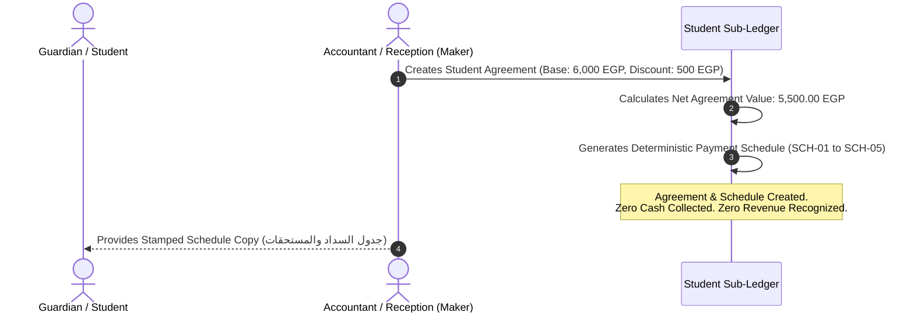
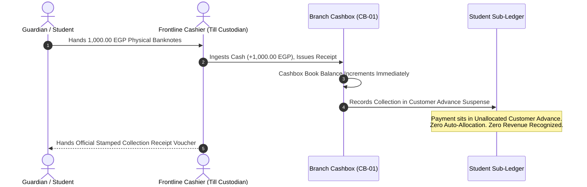
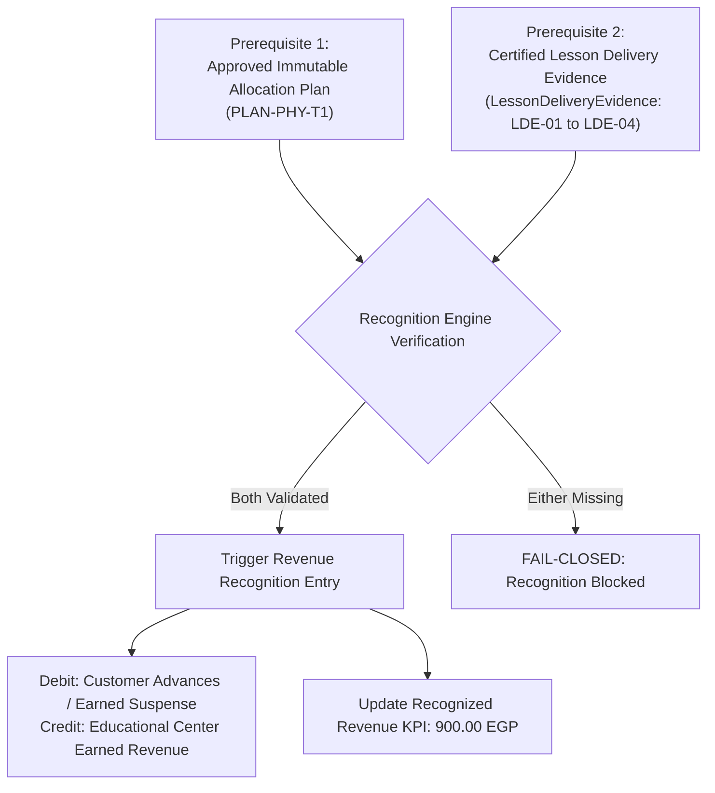
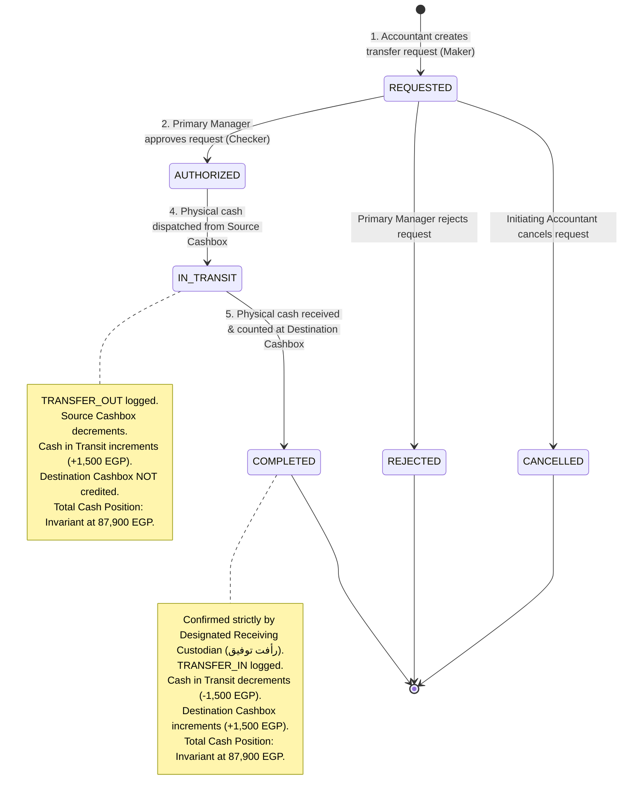
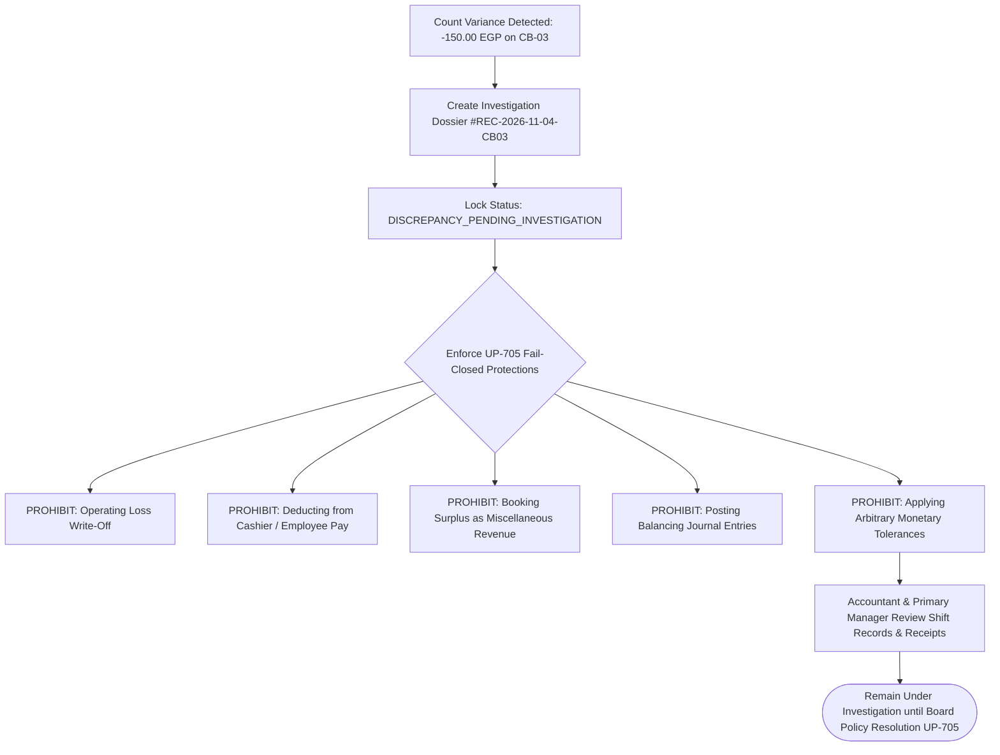

# OX-DIGITAL Education — Phase 2 UI/UX Design Baseline
# Unified Financial Workflows & Accounting Invariants

**Workspace:** `D:\OX-DIGITAL\Mathe\OX-DIGITAL-GITHUB`  
**Target:** `docs/ui-ux/phase-2/batch-6-final-integration/`  
**Execution Mode:** STRICTLY DESIGN-ONLY

---

## 1. Architectural Foundations of Financial Integrity

All operational workflows in the OX-DIGITAL Education system are governed by three non-negotiable accounting tenets:
1. **Four-Tier Financial Separation:**
   $$\text{Agreement} \neq \text{Due Obligation} \neq \text{Cash Collection} \neq \text{Earned Revenue}$$
2. **Strict Immutability & Zero Record Deletion:** Financial ledger entries and cashbox movements are append-only. Corrections execute exclusively through append-only compensating entries (`REVERSAL`).
3. **Conservation Invariants:** Funds and obligations are conserved across sub-ledgers, physical cashboxes, and transfer stages.

---

## 2. Core End-to-End Financial Workflows

### 2.1 Workflow 1: Student Agreement, Schedule & Due Obligations
Governs the creation of student enrollment agreements, approved discounts, and the deterministic generation of payment schedules:

- **Approved Terminology:** Copy strictly uses `جدول السداد`, `المبالغ المستحقة`, `المبالغ المحصلة`, `المتبقي للسداد`. Prohibits `قسط` or `installment`.
- **Conservation Rule:** $\sum \text{Schedule Items} = \text{Net Agreement Value} = 5,500.00\text{ EGP}$.

---

### 2.2 Workflow 2: Frontline Cash Intake & Collection Receipting
Governs the physical ingestion of cash at center reception tills:

- **Till Invariance:** Cashbook increments immediately; institutional liquidity increases by the exact collected amount.
- **Advance Suspense:** All payments land in customer advances until consumed by an approved allocation plan.

---

### 2.3 Workflow 3: Payment Allocation & Unallocated Advance Management
Governs the systematic allocation of collected advances to mature payment schedule items:

$$\text{Total Allocated} + \text{Total Remaining Due} = \text{Total Net Agreement Obligations}$$
$$1,750.00\text{ EGP} + 3,750.00\text{ EGP} = 5,500.00\text{ EGP}$$
- Total collected: $2,000.00\text{ EGP}$ (Receipts `#REC-9912` for $1,000$ and `#REC-9844` for $1,000$).
- Total allocated: $1,750.00\text{ EGP}$ (Covers item `SCH-01` for $1,000.00$ and partial item `SCH-02` for $750.00$).
- Unallocated advance: $250.00\text{ EGP}$ sits in customer liability suspense, ready to allocate to the next due item.
- Remaining due: $3,750.00\text{ EGP}$ ($5,500.00 - 1,750.00$).

---

### 2.4 Workflow 4: Earned Revenue Recognition (Dual Prerequisite Rule)
Revenue is **never** recognized from agreements, collections, or attendance alone. It requires **both** prerequisites:

---

### 2.5 Workflow 5: Five-Stage Internal Cashbox Transfer Lifecycle
Governs liquidity movements between physical cashboxes within the institution:

#### Transfer Eligibility Validation (6 Mandatory Conditions):
1. Source and destination are different cashboxes (`sourceId !== destinationId`).
2. Both cashboxes are ACTIVE (`source.isActive === true && dest.isActive === true`).
3. Both cashboxes are physical cashboxes (`source.isOnline === false && dest.isOnline === false`).
4. Both cashboxes belong to the same institution (`source.institutionId === dest.institutionId`).
5. Transfer amount is positive and $\le$ source available book balance ($0 < \text{Amount} \le \text{Source Balance}$).
6. Non-empty business justification is provided.
*Validation Authority: Backend/API enforces these conditions authoritatively and fail-closed upon submission; UI validations provide immediate feedback.*

---

### 2.6 Workflow 6: Daily Shift Cash Count & Cashbox Reconciliation
Governs shift close and end-of-day physical cash verification:

$$\text{Expected Closing Balance} = \text{Opening} + \text{Collections} + \text{InTransfers} - \text{OutTransfers} - \text{Expenses}$$
$$\text{Difference} = \text{Actual Counted Cash} - \text{Expected Closing Balance}$$

- **`CB-01` (Dokki):** $18,500 + 7,500 + 0 - 1,500 - 0 = 24,500.00\text{ EGP}$. Count: $24,500.00\text{ EGP}$ (Balanced ✓).
- **`CB-02` (Dokki):** $10,000 + 3,900 + 0 - 0 - 0 = 13,900.00\text{ EGP}$. Count: $13,900.00\text{ EGP}$ (Balanced ✓).
- **`CB-MAIN` (Central Vault):** $28,800 + 0 + 1,200 - 0 - 0 = 30,000.00\text{ EGP}$. Count: $30,000.00\text{ EGP}$ (Balanced ✓).
- **`CB-03` (Nasr City):** $15,200 + 4,500 + 0 - 1,200 - 500 = 18,000.00\text{ EGP}$. Count: $17,850.00\text{ EGP}$ (Difference: $-150.00\text{ EGP}$).

---

### 2.7 Workflow 7: Discrepancy Investigation under `UP-705` (Neutral Status)
When count differs from expected, the difference is locked in neutral review:

---

### 2.8 Workflow 8: Operating Expense Voucher Lifecycle & Flexible Evidence
Governs branch operating expenses under Maker-Checker controls:
1. **Preparation (Maker):** Accountant prepares draft voucher specifying operational category, description, and amount.
2. **Flexible Evidence Attached:** Vouchers accept vendor invoices, handwritten service receipts, or internal purchase slips. Tax invoices (`فاتورة ضريبية`), VAT, and withholding taxes are 100% excluded.
3. **Authorization (Checker):** Primary Manager approves when required by approved policy (Policy decision pending — no threshold configured).
4. **Physical Disbursement:** Till custodian pays cash from authorized till against signed physical acknowledgment.

---

### 2.9 Workflow 9: Non-Destructive Compensating Ledger Reversals (`REVERSAL`)
Corrections execute strictly without deleting historical records:
1. Accountant drafts reversal memo identifying original movement (`#MOV-ORIG`).
2. Primary Manager reviews justification and approves reversal.
3. System posts append-only compensating movement (`#MOV-REV`) with exact opposite financial impact.
4. System links `#MOV-REV.reversalOf = #MOV-ORIG` and marks `#MOV-ORIG.isReversed = true`.
5. Audit trail is completely preserved with zero mutations.

---

### 2.10 Workflow 10: Teacher Evidence Logging & Dues Verification (`UP-704`)
Governs teacher service delivery verification:
1. Teacher logs certified lesson delivery evidence (`LDE-PHY-01` to `LDE-PHY-04`) containing delivered topics and verified student attendees.
2. Accountant verifies evidence against center attendance sheets.
3. System prepares monthly compensation dues statement.
4. Under unresolved policy `UP-704`, dues are calculated strictly based on verified delivery evidence; zero automatic percentage deduction from student cash receipts.

