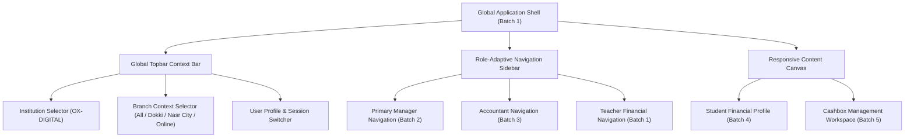

# OX-DIGITAL Education — Phase 2 UI/UX Design Baseline
# Unified Information Architecture & Screen Hierarchy

**Workspace:** `D:\OX-DIGITAL\Mathe\OX-DIGITAL-GITHUB`  
**Target:** `docs/ui-ux/phase-2/batch-6-final-integration/`  
**Execution Mode:** STRICTLY DESIGN-ONLY

---

## 1. Information Architecture Overview

The OX-DIGITAL Education Financial Operations System utilizes a unified, role-aware, multi-tenant information architecture. The architecture guarantees:
1. **Multi-Tenant Isolation:** All screens operate strictly within the context of the active educational institution (`OX-DIGITAL Education`) and selected branch.
2. **Role-Tailored Visibility:** Navigation sidebars and action toolbars adapt deterministically to the user's active domain role without leaking capabilities.
3. **No Independent Cashier Shell:** Frontline cashiers execute cash intake and shift count procedures through contextual drawers and modals launched from operational till endpoints, preserving frontline speed without bloating the navigation taxonomy.
4. **Physical-Centers-First Scope:** Center workflows (`BR-01` Dokki Center and `BR-02` Nasr City Center) form the primary operational hierarchy.



---

## 2. Global Chrome & Contextual Controls

### 2.1 Topbar Contextual Elements
- **Institution Context:** Displays current institutional tenant (default: `مؤسسة أوكس التعليمية — OX-DIGITAL Education`).
- **Branch Context Selector:**
  - `جميع الفروع (All Physical Branches)` — Consolidated institutional overview (Primary Manager only).
  - `فرع الدقي (BR-01 — Dokki Center)` — Physical center operations.
  - `فرع مدينة نصر (BR-02 — Nasr City Center)` — Physical center operations.
  - `الفرع الإلكتروني (BR-ONLINE — Online Center)` — Architectural placeholder; online subscriptions, gateways, and billing deferred.
- **Role Switcher & User Profile:** Displays authenticated user name, domain role badge, and session controls.
- **Pending Approvals Notification Pill:** Real-time badge alerting Primary Manager to pending transfer authorizations and expense approvals.

---

## 3. Role-Based Navigation Trees & Screen Layouts

### 3.1 Primary Manager Navigation Tree (`PRIMARY_MANAGER`)
Designed for institutional executive oversight, liquidity management, policy enforcement, and Checker authorizations:

| Nav Item | Screen ID | Route / URL Target | Purpose & Capabilities |
| :--- | :--- | :--- | :--- |
| **لوحة التحكم التنفيذية** | `PM-DASH-01` | `/executive/overview` | High-level KPIs: 86,400 EGP liquidity, 110,500 collections, 39,700 overdue, 93,000 recognized revenue. |
| **مركز الاعتمادات والقرارات** | `PM-APPR-01` | `/executive/approvals` | Checker authorization for internal cashbox transfers and policy-gated expense vouchers. |
| **حوكمة الفروع والمراكز** | `PM-BR-01` | `/executive/branches` | Branch comparison, center capacity, branch-level liquidity monitoring. |
| **إدارة الخزائن المركزية** | `CB-MGT-01` / `CBM-OVR-01` | `/accounting/cashboxes` | Consolidated cashbox directory, in-transit monitoring (87,900 EGP total cash position), UP-705 dossier oversight. |
| **سجل الطلاب المالي المجمع** | `PM-STU-01` | `/executive/students` | Search and audit student financial profiles across branches; review payment schedules and collections. |
| **مستحقات المعلمين والاعتماد**| `PM-TCH-01` | `/executive/teachers` | Review verified teacher lesson delivery evidence; lock monthly compensation under board policies. |
| **سجل المراجعة والتدقيق** | `CBM-AUD-01` | `/executive/audit-vault` | Immutable log of cashbox movements, compensating reversals, and signed reconciliation dossiers. |

---

### 3.2 Accountant Navigation Tree (`ACCOUNTANT`)
Designed for daily operational accounting, Maker workflows, sub-ledger maintenance, and frontline till reconciliation:

| Nav Item | Screen ID | Route / URL Target | Purpose & Capabilities |
| :--- | :--- | :--- | :--- |
| **مساحة العمل المحاسبية** | `ACC-DASH-01` | `/accounting/workspace` | Daily operational summary: shift count statuses, open transfers, pending expense drafts, branch collections. |
| **سجل التحصيلات النقدية** | `ACC-COLL-01` | `/accounting/collections` | Audit cashier receipt vouchers, verify till intake records, link unallocated customer advances. |
| **إدارة الخزائن والتحويلات** | `CBM-TRF-01` | `/accounting/transfers` | Draft internal cashbox transfer requests (Maker); track 5-stage lifecycle; monitor cash in transit. |
| **مطابقة الخزائن والورديات** | `CBM-REC-01` | `/accounting/reconciliation`| Review 4-cashbox reconciliation table; verify actual cash counts; open UP-705 discrepancy dossiers. |
| **الملف المالي للطلاب** | `SFP-HIST-01` / `ACC-STU-01`| `/students/:id/finance` | Access complete student financial profiles; review agreement obligations, payment schedules, and allocation plans. |
| **أذونات صرف النثريات** | `ACC-EXP-01` / `CBM-EXP-01`| `/accounting/expenses` | Draft expense vouchers with supporting receipts (Maker); disburse cash from assigned tills upon approval. |
| **تدقيق إثبات حصص المعلمين** | `ACC-TCH-01` | `/accounting/teacher-audit` | Verify teacher attendance sheets against certified `LessonDeliveryEvidence` prior to dues calculation. |
| **التقارير المالية والورديات**| `ACC-RPT-01` | `/accounting/reports` | Generate daily closing summaries, branch collection digests, and unallocated advance liability aging. |

---

### 3.3 Cashier Interaction Architecture (`CASHIER`)
In accordance with approved Product Owner decisions, **Cashier has no independent navigation tree or standalone dashboard shell**. Instead, frontline till staff operate through contextual, rapid-action modals and forms:

| Action / Workflow | Modal / Drawer ID | Embedded Context | Capability & Boundary |
| :--- | :--- | :--- | :--- |
| **تحصيل نقدي وإصدار إيصال** | `modal-till-collection` | Frontline Desk Terminal | Records cash collection (+Amount), generates official numbered receipt voucher, locks in unallocated advance. |
| **تسجيل عد الوردية الفعلي** | `modal-shift-count` | Till End-of-Shift | Submits counted banknotes by denomination (e.g. 50×200, 60×100, etc.); system derives expected closing balance. |
| **إرسال نقد محول (ديسباتش)** | `modal-transfer-dispatch`| Assigned Physical Till | Signs dispatch memo, hands cash to authorized courier, marks movement `IN_TRANSIT` (source debited). |
| **تأكيد استلام نقد بالخزينة**| `modal-transfer-receipt` | Destination Physical Till | Receiving custodian counts notes, signs receipt voucher, marks `COMPLETED` (transit debited, till credited). |

---

### 3.4 Teacher Portal Navigation (`TEACHER`)
Extends existing academic workflows with certified evidence logging and transparent compensation tracking:

| Nav Item | Screen ID | Route / URL Target | Purpose & Capabilities |
| :--- | :--- | :--- | :--- |
| **بوابة المعلم الرئيسية** | `TCH-DASH-01` | `/teacher/overview` | Active classes, student count, upcoming schedule. |
| **إثبات تقديم الحصص التعليمية**| `TCH-EVID-01` | `/teacher/evidence` | Submits certified `LessonDeliveryEvidence` with delivered lesson topics, date/time, and certified student list. |
| **كشف المستحقات المالية** | `TCH-DUES-01` | `/teacher/dues` | View delivered lesson sessions, verified student counts, and calculated dues status (UP-704 compliant). |

---

## 4. Cross-Batch Screen Hierarchy Matrix

The following unified matrix organizes the 70 screen states across Batches 1 through 5 into their authoritative architectural domains:

```text
OX-DIGITAL Financial Operations Hierarchy
├── [PM] Primary Manager Executive Domain
│   ├── PM-DASH-01: Executive Overview Dashboard
│   ├── PM-APPR-01: Authorization & Decision Center
│   ├── PM-BR-01: Multi-Branch Performance & Hierarchy
│   ├── PM-COLL-01: Institutional Collections Overview
│   ├── PM-EXP-01: Operating Expense Oversight Register
│   ├── PM-REC-01: Reconciliation Dossier Executive Review
│   ├── PM-RPT-01: Institutional Financial Reporting
│   ├── PM-STU-01: Institution-Wide Student Sub-Ledger Directory
│   └── PM-TCH-01: Teacher Compensation Approval & Review
│
├── [ACC] Accountant Operational Domain
│   ├── ACC-DASH-01: Financial Operations Workspace
│   ├── ACC-CB-01: Cashbox Operational Management
│   ├── ACC-COLL-01: Cash Intake & Collection Receipt Audit
│   ├── ACC-EXP-01: Operating Expense Voucher Management
│   ├── ACC-GL-01: General Ledger Operational Bridge
│   ├── ACC-REC-01: Daily Cashbox Reconciliation Workspace
│   ├── ACC-RECON-01: Shift Count Comparison & Balancing
│   ├── ACC-REV-01: Earned Revenue Recognition Monitor
│   ├── ACC-RPT-01: Daily Financial & Closing Reports
│   ├── ACC-STU-01: Student Sub-Ledger Operations Directory
│   └── ACC-TCH-01: Teacher Evidence Audit & Verification
│
├── [SFP] Student Financial Profile Domain
│   ├── SFP-AGREE-01: Agreement Terms, Discounts & Net Commitments
│   ├── SFP-DUES-01: Payment Schedule & Due Obligations Matrix
│   ├── SFP-COLL-01: Collection Receipts & Till Movement Cross-Reference
│   ├── SFP-ALLOC-01: Payment Allocation Ledger & Advance Suspense
│   ├── SFP-REV-01: Earned Revenue Recognition & Delivery Evidence Audit
│   ├── SFP-ADJ-01: Compensating Reversals & Adjustments Vault
│   ├── SFP-DOC-01: Supporting Document Repository & Archive
│   └── SFP-HIST-01: Complete Immutable Sub-Ledger Audit Trail
│
├── [CBM] Cashbox Management & Reconciliation Domain
│   ├── CBM-OVR-01: Physical Cashboxes Directory & Consolidated Liquidity
│   ├── CBM-DET-01: Immutable Cashbox Transaction Movement Timeline
│   ├── CBM-TRF-01: Internal Cashbox Transfers Workspace (5 Stages)
│   ├── CBM-REC-01: Daily Cashbox Reconciliation & Shift Count Ledger
│   ├── CBM-COLL-01: Frontline Cash Intake & Till Ingestion
│   ├── CBM-EXP-01: Branch Operating Expense Voucher Drawer
│   ├── CBM-DISC-01: Discrepancy Investigation Dossier (UP-705 Neutrality)
│   └── CBM-AUD-01: Audit Trail, Verification Vault & Reversal Records
│
└── [TCH] Teacher Academic & Evidence Domain
    ├── TCH-DASH-01: Teacher Academic Overview
    ├── TCH-EVID-01: Certified Lesson Delivery Evidence Submission
    └── TCH-DUES-01: Verified Compensation Dues Statement
```

---

## 5. Architectural Context Propagation & Multi-Tenancy Rules

1. **Tenant Isolation (`institutionId`):** Every API request and UI screen context binds strictly to the active educational tenant (`INST-01`). No cross-institution transfers, collections, or allocations can occur.
2. **Branch Scoping (`branchId`):**
   - Primary Manager can select `ALL` to view consolidated metrics ($86,400.00\text{ EGP}$ cashbox balances, $87,900.00\text{ EGP}$ total cash position) or filter to `BR-01` or `BR-02`.
   - Accountant is scoped to assigned physical branch.
   - Cashier operates strictly on the assigned physical till.
3. **Session Persistence:** Switching branch context preserves the current operational tab and reapplies filtering deterministically.

