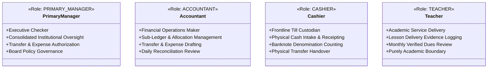

# OX-DIGITAL Education — Phase 2 UI/UX Design Baseline
# Unified Role & Permission Matrix (RBAC Governance)

**Workspace:** `D:\OX-DIGITAL\Mathe\OX-DIGITAL-GITHUB`  
**Target:** `docs/ui-ux/phase-2/batch-6-final-integration/`  
**Execution Mode:** STRICTLY DESIGN-ONLY

---

## 1. Core Role Independence & Architectural Governance

The OX-DIGITAL Education financial system enforces a strict, independent Role-Based Access Control (RBAC) architecture. In full compliance with approved Product Owner decisions (`POD-B2-02`, `POD-B3-01`, `D-41`), exactly four independent accounting-domain roles exist:

### Mandatory Security Principles:
1. **Zero Role Inheritance (`<|--` Strictly Prohibited):** No role inherits capabilities from another. Each role possesses an explicit, closed set of operational capabilities.
2. **Accountant Does Not Inherit Cashier:** An Accountant cannot execute frontline cash intake at the till without being explicitly assigned as a till custodian.
3. **Cashier Has No Independent Shell:** Cashiers operate strictly through contextual till modals; they have zero access to the general ledger, multi-branch summaries, or consolidated institutional liquidity.
4. **Prohibition of Synthetic Roles:** Speculative roles such as `Branch Manager`, `Financial Manager`, or `General Cashier` are completely rejected.
5. **Maker-Checker Segregation:** Self-approval is architecturally blocked across all financial operations. The creator of a request cannot authorize it.

---

## 2. Comprehensive Cross-Batch Capability Matrix

The following unified matrix defines operational permissions across all functional areas established in Batches 1 through 5:

| Functional Area / Action | Primary Manager — المدير الرئيسي | Accountant — المحاسب | Cashier — الكاشير | Teacher — المعلم | Architectural Rule & Boundary |
| :--- | :---: | :---: | :---: | :---: | :--- |
| **Consolidated Liquidity & Executive KPIs** | **ALLOWED** | **DENIED** | **DENIED** | **DENIED** | Primary Manager views institutional $86,400.00\text{ EGP}$ liquidity and $87,900.00\text{ EGP}$ total cash position. |
| **Branch Scoped Overview Dashboard** | **ALLOWED** (All) | **ALLOWED** (Assigned) | **DENIED** | **DENIED** | Accountant is restricted to assigned physical branch. |
| **Frontline Cash Intake & Receipt Stamping** | **ALLOWED** | **ALLOWED** (Assigned) | **ALLOWED** (Assigned) | **DENIED** | Generates official numbered collection receipt; logs till intake. |
| **Student Agreement & Terms Configuration** | **ALLOWED** | **ALLOWED** | **DENIED** | **DENIED** | Sets payment schedules, course fees, and approved discounts. |
| **Execute Payment Allocation (Plan-Based)** | **DENIED** | **ALLOWED** (Maker) | **DENIED** | **DENIED** | Allocates collected advances to due schedule items based on approved immutable plan. |
| **Draft Internal Transfer Request (Maker)** | **DENIED** | **ALLOWED** (Maker) | **DENIED** | **DENIED** | Initiates 5-stage transfer request; self-approval blocked. |
| **Authorize Internal Transfer (Checker)** | **ALLOWED** (Checker)| **DENIED** | **DENIED** | **DENIED** | Primary Manager authorizer; reviews source balance and approves. |
| **Dispatch Physical Cash (Source Till)** | **ALLOWED** | **ALLOWED** | **ALLOWED** (Assigned) | **DENIED** | Marks movement `IN_TRANSIT`; source book balance debited. |
| **Confirm Physical Cash Receipt (Dest Till)** | **DENIED** | **DENIED** | **ALLOWED** (Assigned) | **DENIED** | **Strictly restricted to designated receiving custodian** at destination cashbox (e.g. `أ. رأفت توفيق` for `CB-MAIN`). |
| **Submit Daily Shift Count (Denominations)**| **ALLOWED** | **ALLOWED** | **ALLOWED** (Assigned) | **DENIED** | Submits physical banknote count (e.g. 50×200, 60×100). |
| **Sign Reconciled Balanced Dossier** | **ALLOWED** | **ALLOWED** | **DENIED** | **DENIED** | Approves shift closure when $\text{Difference} = 0.00\text{ EGP}$. |
| **Investigate Discrepancy Dossier (UP-705)**| **ALLOWED** (Executive)| **ALLOWED** (Audit) | **DENIED** | **DENIED** | Fail-closed neutral review; zero write-offs or salary deductions. |
| **Draft Operating Expense Voucher (Maker)** | **DENIED** | **ALLOWED** (Maker) | **DENIED** | **DENIED** | Drafts voucher with attached supplier invoice/receipt. |
| **Authorize Operating Expense (Checker)** | **ALLOWED** (Checker)| **DENIED** | **DENIED** | **DENIED** | Authorizes voucher when required by policy (no threshold configured). |
| **Disburse Physical Cash for Expense** | **ALLOWED** | **ALLOWED** | **ALLOWED** (Assigned) | **DENIED** | Pays cash against signed voucher copy from authorized till. |
| **Draft Compensating Reversal (Maker)** | **DENIED** | **ALLOWED** (Maker) | **DENIED** | **DENIED** | Drafts append-only reversal (`REVERSAL`) linking to original movement. |
| **Authorize Compensating Reversal (Checker)**| **ALLOWED** (Checker)| **DENIED** | **DENIED** | **DENIED** | Authorizes compensating entry; zero deletion of history. |
| **Log Lesson Delivery Evidence (`LDE`)** | **DENIED** | **DENIED** | **DENIED** | **ALLOWED** | Submits certified evidence with delivered lessons & student list. |
| **Verify Lesson Delivery Evidence** | **ALLOWED** | **ALLOWED** (Audit) | **DENIED** | **DENIED** | Verifies delivered lessons against student attendance records. |
| **Trigger Earned Revenue Recognition** | **ALLOWED** (System/Lead)| **ALLOWED** (Operational)| **DENIED** | **DENIED** | Requires **both** approved allocation plan + certified delivery evidence. |
| **View Teacher Dues Statement** | **ALLOWED** (All) | **ALLOWED** (Branch) | **DENIED** | **ALLOWED** (Self) | Displays verified lesson delivery dues under UP-704 fail-closed rules. |

---

## 3. Explicit Maker-Checker Authorization Boundaries

The unified baseline establishes non-bypassable Maker-Checker enforcement across four critical financial transactions:

```mermaid
flowchart TD
    subgraph Transfer_Lifecycle [1. Internal Cashbox Transfers]
        T_Maker[Accountant: Drafts Transfer Request] --> T_Check{Primary Manager<br/>Checker Decision}
        T_Check -->|Rejected| T_Reject[Transfer Cancelled]
        T_Check -->|Approved| T_Dispatch[Source Custodian: Dispatches Cash]
        T_Dispatch --> T_Receive[Destination Custodian: Confirms Physical Banknotes]
    end

    subgraph Expense_Lifecycle [2. Operating Expense Vouchers]
        E_Maker[Accountant: Drafts Expense Voucher + Evidence] --> E_Check{Primary Manager<br/>Checker Authorization}
        E_Check -->|Rejected| E_Cancel[Voucher Cancelled]
        E_Check -->|Approved| E_Disburse[Till Custodian: Disburses Cash against Signed Voucher]
    end

    subgraph Reversal_Lifecycle [3. Compensating Ledger Reversals]
        R_Maker[Accountant: Drafts Reversal Memo] --> R_Check{Primary Manager<br/>Checker Decision}
        R_Check -->|Rejected| R_Original[Original Movement Stands]
        R_Check -->|Approved| R_Post[Post Append-Only Equal & Opposite Movement]
    end
```

### Maker-Checker Rules:
1. **Self-Approval Block:** The authenticated `userId` of the Checker must not match the `makerId`.
2. **Designated Custodian Receipt:** For internal cashbox transfers, receipt confirmation cannot be executed by the Primary Manager as a generic override; it is strictly locked to the designated receiving custodian of the destination cashbox.
3. **No Automatic Authorization:** Transfers and approval-required expense vouchers never transition to authorized status based on timers or default rules.

