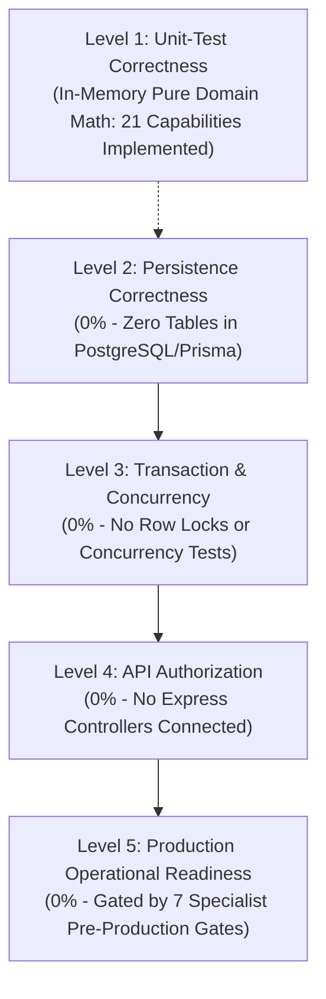

# OX-DIGITAL Education — Phase 3 Readiness Assessment
# Shared Accounting Domain Reuse Assessment

**Workspace:** `D:\OX-DIGITAL\Mathe\OX-DIGITAL-GITHUB`  
**Target:** `docs/ui-ux/phase-3-readiness/ACCOUNTING_DOMAIN_REUSE_ASSESSMENT.md`  
**Execution Mode:** STRICTLY READ-ONLY TECHNICAL ASSESSMENT  
**Baseline References:** `packages/shared/src/accounting/center/`, Domain Unit Tests (`tests/accounting/`), Phase 2.0B Increment Verification Reports

---

## 1. Executive Evaluation & Capability-Level Reusability Matrix

The core accounting logic of OX-DIGITAL Education is located in `packages/shared/src/accounting/center/`. Built across four development increments, this domain engine implements critical double-entry and sub-ledger invariants.

In accordance with strict technical audit standards, **all synthetic or aggregated percentage claims (such as 92% or 84.6%) have been formally removed.** Evaluating software maturity via aggregate percentages can obscure structural gaps.

Instead, every domain capability is evaluated across an explicit **Capability-Level Matrix** detailing its exact class/function implementation, unit-test verification evidence, persistence/API integration requirements, transaction/concurrency readiness, and governing policy gates.

### 1.1 Capability-Level Engineering Matrix

| # | Capability Domain & Specification | Governing Policy / Invariant | Implementing Class & Function (`packages/shared/src/accounting/`) | Test File & Verification Evidence (`tests/accounting/`) | Implementation Status | Integration & Verification Requirements |
| :-: | :--- | :--- | :--- | :--- | :--- | :--- |
| **1** | Value Object Currency Math | Integer minor units (piasters), 2-decimal rounding | `Money`, `DecimalValue` in `money.ts` | `money.test.ts` (Phase 1 master runner: 28 assertions) | `IMPLEMENTED_AND_UNIT_TESTED` | Pure in-memory math; requires mapping to Prisma `Decimal(12, 2)`. |
| **2** | Role Hierarchy & Boundaries | 4 independent roles (`PM`, `ACC`, `CASHIER`, `TEACHER`) | `RoleGuards.assertAuthorized()` in `center/roles.ts` | `center_integration_boundary.test.ts` (61 assertions) | `IMPLEMENTED_AND_UNIT_TESTED` | Requires Express route guard integration in Workstream B. |
| **3** | Super-Admin Operational Quarantine | `admin@edu.com` excluded from institutional finance | `RoleGuards.assertNotSuperAdmin()` in `center/roles.ts` | `center_integration_boundary.test.ts` | `IMPLEMENTED_AND_UNIT_TESTED` | Requires middleware header enforcement in Workstream B. |
| **4** | Cashbox Balance Tracking | Till balance cannot drop below 0.00 EGP | `Cashbox.recordCollection()`, `recordExpense()` in `center/cashbox.ts` | `cashbox_operations.test.ts` (69 test cases) | `IMPLEMENTED_AND_UNIT_TESTED` | Requires persistence integration & DB row-locking (`SELECT FOR UPDATE`). |
| **5** | 5-Stage Internal Transfers | `DRAFT` $\to$ `PENDING` $\to$ `APPROVED` $\to$ `IN_TRANSIT` $\to$ `COMPLETED` | `CashboxTransferEngine.executeTransfer()` in `center/cashbox.ts` | `cashbox_operations.test.ts` | `IMPLEMENTED_AND_UNIT_TESTED` | Requires persistence split into `CashboxTransferRequest` + transactional commit. |
| **6** | In-Transit Liquidity Conservation | $\sum \text{Cashboxes} + \sum \text{In-Transit} \equiv \text{Total Cash}$ ($87.9\text{k}$) | `CashboxTransferEngine.getInstitutionalLiquidity()` in `center/cashbox.ts` | `cashbox_operations.test.ts` | `IMPLEMENTED_AND_UNIT_TESTED` | Requires backend aggregation query controller in Workstream B. |
| **7** | Daily Reconciliation Formula | $\text{Expected} = \text{Opening} + \text{Inflows} - \text{Outflows}$ | `Cashbox.reconcileDailyShift()` in `center/cashbox.ts` | `cashbox_operations.test.ts` | `IMPLEMENTED_AND_UNIT_TESTED` | Requires daily shift persistence in `DailyCashboxReconciliation`. |
| **8** | Cashbox Discrepancy Handling | Variance locked in `PENDING_INVESTIGATION`; zero auto write-offs | `Cashbox.reconcileDailyShift()`, `writeOffShortage()` throws guard in `center/cashbox.ts` | `cashbox_operations.test.ts` | `BLOCKED_BY_UNRESOLVED_DECISION` (`UP-705`) | Variance detection implemented; financial settlement blocked by `UP-705`. |
| **9** | Expense Voucher Maker-Checker | Accountant drafts; Primary Manager approves; box disburses | `Cashbox.recordExpense()` in `center/cashbox.ts` | `cashbox_operations.test.ts` | `IMPLEMENTED_AND_UNIT_TESTED` | Requires approval threshold policy resolution (UP-709 removed 500 EGP). |
| **10**| Commercial Student Agreement | Frozen net rate snapshot (OD-722.4), active status | `StudentFinancialAgreement` in `center/agreement.ts` | `student_subledger.test.ts` (88 test cases) | `IMPLEMENTED_AND_UNIT_TESTED` | Requires persistence in `StudentAgreement` and student account link. |
| **11**| Payment Milestone Schedules | Sequential payment schedule milestones | `StudentObligation` in `center/obligations.ts` | `student_subledger.test.ts` | `IMPLEMENTED_AND_UNIT_TESTED` | Requires milestone persistence in `PaymentScheduleItem`. |
| **12**| Collection Receipt Intake | Cash/POS intake recording with immutable numbering | `StudentSubLedger.recordCollection()` in `center/subLedger.ts` | `student_subledger.test.ts` | `IMPLEMENTED_AND_UNIT_TESTED` | Requires persistence in `CollectionReceipt` and till link. |
| **13**| FIFO Waterfall Allocation | Milestones satisfied chronologically ($1,750 + 3,750 = 5,500$) | `StudentSubLedger.allocateCollection()` in `center/subLedger.ts` | `student_subledger.test.ts` | `IMPLEMENTED_AND_UNIT_TESTED` | Requires persistence in `PaymentAllocation` bridge table. |
| **14**| 4-Tier Sub-Ledger Conservation | $\text{Contract} \equiv \text{Collected} + \text{Receivable}$ | `StudentSubLedger.assertConservation()` in `center/subLedger.ts` | `student_subledger.test.ts` | `IMPLEMENTED_AND_UNIT_TESTED` | Requires atomic transaction wrapper (`prisma.$transaction`). |
| **15**| UP-709 Checker Thresholds | Escalates discounts $> 10\%$ or adjustments $> 500\text{ EGP}$ | `StudentSubLedger.postAdjustment()` in `center/subLedger.ts` | `student_subledger.test.ts` | `IMPLEMENTED_AND_UNIT_TESTED` | Enforces checker queue for Primary Manager approval. |
| **16**| 24h Rolling Anti-Splitting | Flags split adjustments attempting to evade thresholds | `StudentSubLedger._checkRollingWindow()` in `center/subLedger.ts` | `student_subledger.test.ts` | `IMPLEMENTED_AND_UNIT_TESTED` | Requires database timestamp index on adjustment ledger. |
| **17**| Append-Only Reversals | Compensating ledger records; zero row deletion | `StudentSubLedger.reverseTransaction()` in `center/subLedger.ts` | `student_subledger.test.ts` | `IMPLEMENTED_AND_UNIT_TESTED` | Database triggers/middleware must reject `UPDATE`/`DELETE`. |
| **18**| Lesson Evidence Verification | Teacher cryptographic/timestamped delivery signature | `LessonDeliveryEvidence.verify()` in `center/evidence.ts` | `accrual_revenue_recognition.test.ts` (48 test cases) | `IMPLEMENTED_AND_UNIT_TESTED` | Requires session evidence persistence & teacher signature store. |
| **19**| Dual-Prerequisite Revenue Gate | Requires valid agreement AND certified teacher delivery evidence | `AccrualRevenueRecognitionEngine.recognizeRevenue()` in `center/revenueRecognitionEngine.ts` | `accrual_revenue_recognition.test.ts` | `IMPLEMENTED_AND_UNIT_TESTED` | Requires integration with course attendance and student agreements. |
| **20**| Equal Session Allocation (OD-722.4)| Unbundled equal revenue valuation per session milestone | `AccrualRevenueRecognitionEngine.computeSessionRevenue()` in `center/revenueRecognitionEngine.ts` | `accrual_revenue_recognition.test.ts` | `IMPLEMENTED_AND_UNIT_TESTED` | Independent calculation from package policy UP-714. |
| **21**| Double-Entry GL Ledger Invariants| Balanced entries ($\sum \text{Debit} \equiv \sum \text{Credit}$) | `JournalEntry.create()`, `JournalLine` in `journalEntry.ts` | `journal.test.ts` (14 assertions) | `IMPLEMENTED_AND_UNIT_TESTED` | Pure double-entry validation implemented in memory. |
| **22**| Statutory Chart of Accounts (UP-701)| 4-digit statutory account codes & Egyptian EAS hierarchy | Provisional account codes in `account.ts` | `account.test.ts` (15 assertions) | `BLOCKED_BY_SPECIALIST_REVIEW` (`UP-701`) | **SPECIALIST REVIEW REQUIRED:** Chartered Accountant must audit statutory COA before live GL sync. Provisional mapping preserved. |
| **23**| Variable Teacher Compensation (UP-704)| Variable revenue-share calculation base (per-student / % base) | Stubbed / decoupled in `center/revenueRecognitionEngine.ts` | `accrual_revenue_recognition.test.ts` | `BLOCKED_BY_UNRESOLVED_DECISION` (`UP-704`) | **POLICY DECISION PENDING:** Qualifying base unresolved. Fixed compensation models are not blocked if approved. |
| **24**| Student Refund Policy (UP-706) | Student withdrawal forfeiture & cash refund formulas | `subLedger.ts` (manual adjustment only) | `student_subledger.test.ts` | `BLOCKED_BY_SPECIALIST_REVIEW` (`UP-706`) | **LEGAL REVIEW REQUIRED:** Consumer Protection Law 181/2018 review required before automating refund calculation. |
| **25**| FX Rate Source Provenance (UP-708) | Official foreign exchange rate provider (CBE vs API) | Hardcoded EGP currency check (`EGP` launch fixity OD-702) | `money.test.ts`, `cashbox_operations.test.ts` | `BLOCKED_BY_UNRESOLVED_DECISION` (`UP-708`) | **UNRESOLVED:** FX source unresolved; multi-currency operations remain disabled. EGP launch currency approved. |
| **26**| Statutory Data Retention (UP-715) | 5-year commercial retention vs student PII erasure | Append-only immutability in `subLedger.ts`, `cashbox.ts` | `lifecycle.test.ts` (36 assertions) | `BLOCKED_BY_SPECIALIST_REVIEW` (`UP-715`) | **DPO REVIEW REQUIRED:** Reconcile Commercial Code Law 17/1999 with Data Privacy Law 151/2020 before purging routines. |
| **27**| Tax & VAT Functionality (UP-702) | Educational VAT, withholding tax, and tax invoices | Zero tax models or fields in domain | None (Explicitly excluded) | `NOT_IN_CURRENT_SCOPE` (`UP-702`) | **DEFERRED OUT OF SCOPE:** Product Owner explicitly confirmed no tax system is required for physical centers. |
| **28**| Payment Gateway Settlement (UP-703)| Automated electronic merchant gateway settlement | Zero gateway models in domain | None (Explicitly excluded) | `NOT_IN_CURRENT_SCOPE` (`UP-703`) | **DEFERRED OUT OF SCOPE:** Direct center cash desk collections are active; gateway settlement deferred. |
| **29**| Student Absence Policy (UP-712) | Absence credit vs session forfeiture policy | Equal session valuation recognized on delivery | `accrual_revenue_recognition.test.ts` | `BLOCKED_BY_UNRESOLVED_DECISION` (`UP-712`) | **UNRESOLVED:** Absence consumption rules open; distinct from currency or revenue recognition. |
| **30**| Hybrid Package Allocation (UP-714) | Unbundled classroom tuition vs digital LMS platform fee | Separate attribution modeled | `center/agreement.ts` | `APPROVED` (`UP-714`) | Approved policy; online branch financial operations remain deferred under physical-first scope. |

---

## 2. Five Levels of Technical Readiness Disaggregation

To ensure rigorous transparency, technical readiness is disaggregated across five independent engineering levels:

1. **Level 1: Unit-Test Correctness (In-Memory Pure Domain):** **`VERIFIED`**. Pure TypeScript domain classes execute mathematical invariants, balance conservation, and state machines without database or mock dependencies.
2. **Level 2: Persistence Correctness:** **`0% NOT IMPLEMENTED`**. Zero database tables exist. None of the missing financial models exist in `schema.prisma`.
3. **Level 3: Transaction & Concurrency Correctness:** **`0% NOT TESTED`**. Domain runs single-threaded in memory. In-memory rollback (`_rollbackTransferMovement`) is best-effort and lacks ACID guarantees or write-ahead logging. Database row locks (`SELECT FOR UPDATE`), multi-tenant row security, and concurrent race-condition testing are required.
4. **Level 4: API Authorization Correctness:** **`0% NOT CONNECTED`**. Express middleware has not mounted role protection or tenant scoping to HTTP endpoints.
5. **Level 5: Production Operational Readiness:** **`0% BLOCKED BY GATES`**. System cannot be operated in production until full-stack implementation occurs and statutory specialist gates are signed off.

> [!CAUTION]
> **Production Readiness Warning:**  
> Passing pure domain unit tests proves mathematical invariant consistency in isolated Node.js execution. It does NOT guarantee production reliability, ACID transactional atomicity, or concurrency safety under multi-user database access. Full readiness requires completing Workstream A (Prisma) and Workstream B (Backend API Wiring).

---

## 3. Verified Test Evidence & Provenance

During this Phase 3 assessment, **zero new test commands were executed**, in strict adherence to read-only boundaries. All test counts cited in this report derive from the authoritative historical verification artifacts:

### 3.1 Historical Test Suite Results (Provenance: `PHASE_2_0B_INCREMENT_4_FINAL_ACCEPTANCE_VERIFICATION.md` Section 4.2)

The cumulative workspace test execution was finalized during the Increment 4 remediation and final acceptance verification. All suites executed in-memory with zero failures:

| Test Suite Name | Target Module | Historical Test Command | Tests Passed | Tests Failed | Exit Code | Verification Source |
| :--- | :--- | :--- | :---: | :---: | :---: | :---: |
| **Increment 4** | Cashbox Operations & Reconciliation | `.\node_modules\.bin\tsx.cmd tests/accounting/cashbox_operations.test.ts` | **124** | **0** | **0** | Accepted Final Increment 4 Report |
| **Increment 3** | Student Sub-Ledger & Allocations | `.\node_modules\.bin\tsx.cmd tests/accounting/student_subledger.test.ts` | **88** | **0** | **0** | Accepted Increment 3 Report |
| **Increment 2** | Accrual Revenue Recognition | `.\node_modules\.bin\tsx.cmd tests/accounting/accrual_revenue_recognition.test.ts` | **48** | **0** | **0** | Accepted Increment 2 Report |
| **Increment 1** | Center Integration Boundary | `.\node_modules\.bin\tsx.cmd tests/accounting/center_integration_boundary.test.ts` | **61** | **0** | **0** | Accepted Increment 1 Report |
| **Financial Core Master** | Money, Account, Journal, Lifecycle | `.\node_modules\.bin\tsx.cmd tests/accounting/run_accounting_tests.ts` | **89** | **0** | **0** | Accepted Financial Core Report |
| **Staging Foundation** | Task 7.1 Master Tenancy & Backfill | `.\node_modules\.bin\tsx.cmd tests/task_7_1/run_all_tests.ts` | **104** | **0** | **0** | Accepted Task 7.1 Report |
| **CUMULATIVE VERIFIED** | **All Invariant & Regression Suites** | — | **514** | **0** | **0** | **100% Pass Rate** |

### 3.2 Static Assertion Statement Count (Source Code Inspection)
A direct static scan of assertion calls (`assert(...)`) across the test source files in `tests/accounting/` identified **336 static assertion statements** in the pure domain test files:
- `cashbox_operations.test.ts`: 99 assertions
- `student_subledger.test.ts`: 75 assertions
- `center_integration_boundary.test.ts`: 36 assertions
- `lifecycle.test.ts`: 36 assertions
- `accrual_revenue_recognition.test.ts`: 33 assertions
- `money.test.ts`: 28 assertions
- `account.test.ts`: 15 assertions
- `journal.test.ts`: 14 assertions

> [!IMPORTANT]
> **Test Evidence Clarification:**  
> The 336 static assertion statements represent code statements inspected on disk; they must NOT be described as 336 independently executed tests. Furthermore, Phase 3 was conducted in strictly read-only mode and **did NOT execute test commands**. All execution totals (514 passed) derive from accepted earlier delivery reports and do NOT constitute production operational readiness.

---

## 4. Unresolved Policy Classifications & Specialist Governance Gates

In strict alignment with Product Owner directives, policy decisions and specialist gates are defined with exact legal and accounting scopes:

1. **`UP-701` — Statutory Chart of Accounts Review:**
   - **Status:** `SPECIALIST_REVIEW_REQUIRED`.
   - **Scope:** Mandatory audit by an Egyptian Chartered Accountant (محاسب قانوني) to certify statutory 4-digit account codes, hierarchy, and EAS (Egyptian Accounting Standards) compliance before General Ledger sync is enabled. Provisional operational account mappings are preserved. Statutory GL readiness is NOT claimed.
2. **`UP-704` — Variable Teacher Compensation Qualifying Base:**
   - **Status:** `UNRESOLVED`.
   - **Scope:** The business formula determining the variable compensation base (percentage of student tuition vs per-student session fee) remains open. Zero default formula is assumed. Fixed teacher compensation models (e.g. flat hourly rates or monthly retainers) are not blocked if independently approved.
3. **`UP-705` — Cashbox Discrepancy Handling Policy:**
   - **Status:** `UNRESOLVED`.
   - **Scope:** The administrative and financial sign-off policy governing physical cashbox variances remains unresolved. When counted cash differs from book balance, status transitions to `DISCREPANCY_PENDING_INVESTIGATION`. Zero automated shortage write-offs, zero surplus income recognitions, zero employee payroll deductions, and zero arbitrary write-off thresholds are permitted.
4. **`UP-706` — Student Refund Processing Policy:**
   - **Status:** `SPECIALIST_REVIEW_REQUIRED`.
   - **Scope:** Student enrollment agreement terms, withdrawal forfeit rules, and refund formulas require legal review under Egyptian Consumer Protection Law (Law No. 181/2018). No automated refund calculation is implemented.
5. **`UP-708` — Foreign Exchange (FX) Rate Source Provenance:**
   - **Status:** `UNRESOLVED`.
   - **Scope:** The official rate source (Central Bank of Egypt vs commercial rate feed) is unresolved. Multi-currency transactions remain completely disabled. Egyptian Pound (`EGP`) launch currency fixity remains approved under `OD-702` and `OD-725`.
6. **`UP-715` — Statutory Data Retention & PII Scrubbing:**
   - **Status:** `SPECIALIST_REVIEW_REQUIRED`.
   - **Scope:** Mandatory legal review by a Data Protection Officer reconciling the 5-year commercial record retention requirement (Egyptian Commercial Code, Law No. 17/1999) with student privacy rights and erasure mandates (Personal Data Protection Law, Law No. 151/2020).
7. **`UP-702` — Educational Tax & VAT Functionality:**
   - **Status:** `DEFERRED_OUT_OF_CURRENT_SCOPE`.
   - **Scope:** Product Owner explicitly confirmed no tax system is required for physical educational centers. All tax calculations, VAT line items, and tax invoices (`فاتورة ضريبية`) are 100% excluded.
8. **`UP-703` — Payment Gateway Merchant Settlement:**
   - **Status:** `DEFERRED_OUT_OF_CURRENT_SCOPE`.
   - **Scope:** Electronic online payment gateway merchant credentials and automated clearing settlement remain future optional scope. Frontline physical cash desk and manual bank wire intake are active.
9. **`UP-712` — Student Absence Credit vs. Forfeiture Policy:**
   - **Status:** `UNRESOLVED`.
   - **Scope:** Business rules regarding whether absent students retain class credits or forfeit session fees are open. Unrelated to currency or FX provenance.
10. **`UP-714` — Hybrid Package Allocation Policy:**
    - **Status:** `APPROVED`.
    - **Scope:** Approved unbundled revenue allocation policy attributing physical classroom tuition to the campus and digital LMS access to the online branch. Online branch financial operations remain deferred under the physical-centers-first rollout.
11. **`OD-722.4` — Equal Session Valuation:**
    - **Status:** `APPROVED`.
    - **Scope:** Earned revenue per delivered syllabus lesson is calculated uniformly across contractual course sessions. Independent decision from hybrid package allocation `UP-714`.
