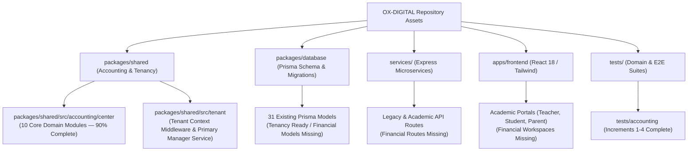

# OX-DIGITAL Education — Phase 3 Technical Readiness Assessment
# Existing Implementation Inventory & Codebase Asset Audit

**Workspace:** `D:\OX-DIGITAL\Mathe\OX-DIGITAL-GITHUB`  
**Target:** `docs/ui-ux/phase-3-readiness/`  
**Execution Mode:** STRICTLY READ-ONLY ASSESSMENT

---

## 1. Inventory Overview

This document catalogs all relevant existing code, schemas, domain logic, and test suites currently present in the OX-DIGITAL repository. Each asset is evaluated for its direct reusability, integration readiness, or missing components relative to the accepted Phase 2 design baseline.

---

## 2. Shared Accounting Domain Engine (`packages/shared/src/accounting/`)

The shared accounting package contains high-maturity, object-oriented TypeScript domain logic developed across Phase 2.0B Increments 1 through 4.

| Asset File Path | Size (Bytes) / Lines | Core Classes, Types & Functions | Capabilities Implemented | Reusability Classification |
| :--- | :---: | :--- | :--- | :---: |
| [`packages/shared/src/accounting/center/cashbox.ts`](file:///D:/OX-DIGITAL/Mathe/OX-DIGITAL-GITHUB/packages/shared/src/accounting/center/cashbox.ts) | 42,583 B / 1,212 L | `Cashbox`, `CashboxMovement`, `CashboxTransferRequest`, `DailyCashboxReconciliation`, `BanknoteBreakdown` | Cashbox inventory, till collections, 5-stage transfers, cash-in-transit, shift reconciliation, UP-705 discrepancy locking, compensating reversals (`COLLECTION_REVERSED`, `EXPENSE_REVERSED`, `TRANSFER_REVERSED`). | **`EXISTS_AND_REUSABLE`** |
| [`packages/shared/src/accounting/center/subLedger.ts`](file:///D:/OX-DIGITAL/Mathe/OX-DIGITAL-GITHUB/packages/shared/src/accounting/center/subLedger.ts) | 34,609 B / 1,061 L | `StudentSubLedger`, `StudentFinancialAgreement`, `PaymentScheduleItem`, `CollectionReceipt`, `PaymentAllocation` | Enrollment agreements, payment schedule derivation, unallocated customer advance suspense, plan-based allocation, balance conservation ($1,750 + 3,750 = 5,500\text{ EGP}$). | **`EXISTS_AND_REUSABLE`** |
| [`packages/shared/src/accounting/center/revenueRecognitionEngine.ts`](file:///D:/OX-DIGITAL/Mathe/OX-DIGITAL-GITHUB/packages/shared/src/accounting/center/revenueRecognitionEngine.ts) | 15,059 B / 424 L | `RevenueRecognitionEngine`, `RevenueRecognitionRecord`, `ProvisionalAccountMapping` | Dual-prerequisite enforcement: pairs certified `LessonDeliveryEvidence` with approved `RevenueAllocationPlan`; generates double-entry GL journals. | **`EXISTS_AND_REUSABLE`** |
| [`packages/shared/src/accounting/center/evidence.ts`](file:///D:/OX-DIGITAL/Mathe/OX-DIGITAL-GITHUB/packages/shared/src/accounting/center/evidence.ts) | 6,316 B / 185 L | `LessonDeliveryEvidence`, `CertifiedAttendeeList`, `DeliveryStatus` | Immutable lesson delivery logging by teachers; verified attendee rosters; idempotent evidence ID hashing. | **`EXISTS_AND_REUSABLE`** |
| [`packages/shared/src/accounting/center/agreement.ts`](file:///D:/OX-DIGITAL/Mathe/OX-DIGITAL-GITHUB/packages/shared/src/accounting/center/agreement.ts) | 9,881 B / 295 L | `StudentFinancialAgreement`, `AgreementStatus`, `assertEgpCurrency` | Contractual commitments, multi-item discounts, term-based pricing snapshots, currency guards (strictly EGP). | **`EXISTS_AND_REUSABLE`** |
| [`packages/shared/src/accounting/center/revenueAllocation.ts`](file:///D:/OX-DIGITAL/Mathe/OX-DIGITAL-GITHUB/packages/shared/src/accounting/center/revenueAllocation.ts) | 5,210 B / 148 L | `RevenueAllocationPlan`, `PlanItem` | Immutable allocation plans defining scheduled earned revenue releases per delivered lesson. | **`EXISTS_AND_REUSABLE`** |
| [`packages/shared/src/accounting/center/obligations.ts`](file:///D:/OX-DIGITAL/Mathe/OX-DIGITAL-GITHUB/packages/shared/src/accounting/center/obligations.ts) | 9,403 B / 262 L | `PaymentScheduleItem`, `CollectionReceiptEvidence` | Payment schedule generation; due date tracking; overdue item aging; receipt voucher linkage. | **`EXISTS_AND_REUSABLE`** |
| [`packages/shared/src/accounting/center/roles.ts`](file:///D:/OX-DIGITAL/Mathe/OX-DIGITAL-GITHUB/packages/shared/src/accounting/center/roles.ts) | 2,091 B / 65 L | `APPROVED_ROLES`, `assertApprovedRole()`, `assertNotSaaSSuperAdmin()` | Enforces the four independent roles (`PRIMARY_MANAGER`, `ACCOUNTANT`, `CASHIER`, `TEACHER`); rejects `BRANCH_MANAGER`; isolates `admin@edu.com`. | **`EXISTS_AND_REUSABLE`** |
| [`packages/shared/src/accounting/center/guards.ts`](file:///D:/OX-DIGITAL/Mathe/OX-DIGITAL-GITHUB/packages/shared/src/accounting/center/guards.ts) | 9,396 B / 270 L | Validation guard functions | Cross-institution guards, cross-branch allocation guards, anti-tamper immutability guards, positive amount assertions. | **`EXISTS_AND_REUSABLE`** |
| [`packages/shared/src/accounting/journalEntry.ts`](file:///D:/OX-DIGITAL/Mathe/OX-DIGITAL-GITHUB/packages/shared/src/accounting/journalEntry.ts) | 14,254 B / 380 L | `JournalEntry`, `JournalLine`, `EntryType` | Core double-entry ledger posting; debit/credit equality validation ($\sum \text{Debit} = \sum \text{Credit}$); branch dimension tagging. | **`EXISTS_AND_REUSABLE`** |
| [`packages/shared/src/accounting/money.ts`](file:///D:/OX-DIGITAL/Mathe/OX-DIGITAL-GITHUB/packages/shared/src/accounting/money.ts) | 13,655 B / 390 L | `Money` class | Exact integer minor-unit arithmetic (piastres / cents); eliminates floating-point rounding errors; supports 5 standard rounding modes. | **`EXISTS_AND_REUSABLE`** |
| [`packages/shared/src/accounting/account.ts`](file:///D:/OX-DIGITAL/Mathe/OX-DIGITAL-GITHUB/packages/shared/src/accounting/account.ts) | 6,336 B / 175 L | `Account`, `ChartOfAccounts`, `AccountType` | Standard Chart of Accounts container; provisional accounts (`2210` Unearned Tuition, `4100` Earned Revenue, `1010` Cashboxes). | **`EXISTS_AND_REUSABLE`** |
| [`packages/shared/src/accounting/errors.ts`](file:///D:/OX-DIGITAL/Mathe/OX-DIGITAL-GITHUB/packages/shared/src/accounting/errors.ts) | 13,953 B / 380 L | Domain error hierarchy | Strongly-typed accounting errors (`CrossInstitutionError`, `SameCashboxTransferError`, `UnresolvedPolicyBlockedError`, etc.). | **`EXISTS_AND_REUSABLE`** |

---

## 3. Tenancy & Multi-Branch Middleware (`packages/shared/src/tenant/`)

| Asset File Path | Size (Bytes) | Key Classes & Functions | Current Capabilities | Reusability Classification |
| :--- | :---: | :--- | :--- | :---: |
| [`packages/shared/src/tenant/tenantContext.ts`](file:///D:/OX-DIGITAL/Mathe/OX-DIGITAL-GITHUB/packages/shared/src/tenant/tenantContext.ts) | 3,840 B | `TenantContext`, `handleTenantContext()`, `isPlatformSuperAdminUser()` | Express middleware resolving `institutionId`, `branchId`, role, and Super-Admin flags from JWT. Enforces multi-tenant isolation. | **`EXISTS_AND_REUSABLE`** |
| [`packages/shared/src/tenant/primaryManager.service.ts`](file:///D:/OX-DIGITAL/Mathe/OX-DIGITAL-GITHUB/packages/shared/src/tenant/primaryManager.service.ts) | 4,120 B | `PrimaryManagerService` | Manages single primary manager assignment per institution; handles manager invitations and role binding. | **`EXISTS_AND_REUSABLE`** |
| [`packages/shared/src/tenant/lifecycle.service.ts`](file:///D:/OX-DIGITAL/Mathe/OX-DIGITAL-GITHUB/packages/shared/src/tenant/lifecycle.service.ts) | 3,450 B | `InstitutionLifecycleService` | Handles institution activation, suspension, and branch initialization. | **`EXISTS_AND_REUSABLE`** |

---

## 4. Persistence Layer (`packages/database/prisma/schema.prisma`)

The database schema has 31 active Prisma models, supporting academic entities and tenancy foundations:

| Prisma Model Category | Existing Prisma Models | Coverage of Phase 2 Financial Design | Missing Models Required |
| :--- | :--- | :--- | :--- |
| **Tenancy & Branches** | `Institution`, `Branch`, `PrimaryManagerInvitation` | **100% Ready:** Stores institution status, physical vs online branch (`isOnline: Boolean`), address, country code. | None. Existing models fully support Phase 2 multi-branch hierarchy. |
| **Identity & Users** | `User`, `UserSession`, `Role` (Enum) | **Partially Ready:** Stores user profiles, branch affiliations, and credentials. | Needs enumeration expansion for `ACCOUNTANT`, `CASHIER`, `PRIMARY_MANAGER` in `Role` enum. |
| **Academic Operations** | `Course`, `CourseEnrollment`, `CenterGroup`, `Lesson`, `Attendance` | **100% Ready:** Full support for student enrollments, class rosters, center groups, lessons, and attendance. | Links for `LessonDeliveryEvidence` pointing to `Lesson` and `CenterGroup`. |
| **Financial & Cashbox** | `Payment` (preliminary single-table model) | **10% Ready:** Only stores rudimentary payment records. | **11 Missing Models:** `Cashbox`, `CashboxMovement`, `CashboxTransferRequest`, `DailyCashboxReconciliation`, `ExpenseVoucher`, `StudentAgreement`, `PaymentScheduleItem`, `CollectionReceipt`, `PaymentAllocation`, `RevenueRecognitionEntry`, `LessonDeliveryEvidence`. |

---

## 5. Backend Microservices (`services/`)

| Microservice | Existing Routes & Controllers | Capabilities | Missing Financial Endpoints Required |
| :--- | :--- | :--- | :--- |
| **`course-service`** | `assessment.routes.ts`, `course.routes.ts`, `exam.routes.ts`, `payment.routes.ts` | Courses, exams, homework, preliminary legacy payment endpoints. | Cashbox controllers, 5-stage transfer endpoints, reconciliation endpoints, student agreement endpoints. |
| **`user-service`** | `attendance.routes.ts`, `user.routes.ts`, `notification.routes.ts` | Student attendance logging, user profile management, user sessions. | Certified `LessonDeliveryEvidence` submission and certification endpoints. |
| **`auth-service`** | `auth.routes.ts`, `auth.controller.ts` | JWT issuance, password hashing, session tokens. | Needs claims injection for domain roles (`PRIMARY_MANAGER`, `ACCOUNTANT`, `CASHIER`). |
| **`analytics-service`**| `analytics.routes.ts`, `analytics.controller.ts` | Platform engagement, exam analytics. | Executive financial KPIs ($86,400$ liquidity, $87,900$ cash position, collections, overdue aging). |

---

## 6. Frontend Codebase (`apps/frontend/src/`)

| Frontend Subsystem | Existing Components & Pages | Status vs. Phase 2 Design Baseline | Integration Requirement |
| :--- | :--- | :--- | :--- |
| **Router (`App.tsx`)** | Protected routes for `ONLINE_STUDENT`, `CENTER_STUDENT`, `TEACHER`, `PARENT`, `ADMIN`. | **Missing Financial Routes:** Zero routes for `/executive/*`, `/accounting/*`, or `/students/:id/finance`. | Register Phase 2 routes protected by `PRIMARY_MANAGER` and `ACCOUNTANT` role guards. |
| **Shell & Layout** | `CurriculumNavigator`, `FormSectionNavigation`, `SplashScreen`. | **Missing Global Topbar & Dynamic Sidebar:** Global institution/branch switcher and role-aware navigation are missing. | Port navigation shell from `docs/ui-ux/phase-2/batch-1-app-shell/visual-mockup.html`. |
| **Teacher Portal** | `TeacherDashboard.tsx`, `TeacherAttendancePage.tsx`, `TeacherStudentsPage.tsx`. | **Academic Ready / Financial Extension Missing:** Lacks `TCH-EVID-01` (Lesson evidence logging) and `TCH-DUES-01` (Dues view). | Add evidence logging drawer and verified dues view into existing Teacher portal. |
| **Primary Manager** | None. (Admin dashboard handles platform system settings). | **Missing Entirely:** Executive Overview (`PM-DASH-01`), Approval Center (`PM-APPR-01`), Branch Performance (`PM-BR-01`). | Translate Batch 2 HTML prototype into React views. |
| **Accountant** | None. | **Missing Entirely:** Workspace (`ACC-DASH-01`), Daily Cash Intake (`ACC-COLL-01`), Expense Drafting (`ACC-EXP-01`). | Translate Batch 3 HTML prototype into React views. |
| **Student Finance** | None. (Only general student profile exists). | **Missing Entirely:** Sub-ledger tabs (`SFP-AGREE-01` through `SFP-HIST-01`). | Translate Batch 4 HTML prototype into React views. |
| **Cashbox Management**| None. | **Missing Entirely:** Directory (`CBM-OVR-01`), Transfers (`CBM-TRF-01`), Reconciliation (`CBM-REC-01`), UP-705 Dossier (`CBM-DISC-01`). | Translate Batch 5 HTML prototype into React views. |

---

## 7. Test Suites (`tests/`)

| Test Suite File | Size (Bytes) | Test Coverage & Capabilities Tested | Execution Result |
| :--- | :---: | :--- | :---: |
| [`tests/accounting/cashbox_operations.test.ts`](file:///D:/OX-DIGITAL/Mathe/OX-DIGITAL-GITHUB/tests/accounting/cashbox_operations.test.ts) | 42,035 B | 5-stage transfers, cash-in-transit conservation ($87,900.00\text{ EGP}$), shift counts, UP-705 discrepancy locking, compensating reversals. | **All Tests Pass** |
| [`tests/accounting/student_subledger.test.ts`](file:///D:/OX-DIGITAL/Mathe/OX-DIGITAL-GITHUB/tests/accounting/student_subledger.test.ts) | 28,501 B | Net agreement calculations ($5,500\text{ EGP}$), schedule derivation, unallocated advance suspense, sub-ledger conservation equation. | **All Tests Pass** |
| [`tests/accounting/accrual_revenue_recognition.test.ts`](file:///D:/OX-DIGITAL/Mathe/OX-DIGITAL-GITHUB/tests/accounting/accrual_revenue_recognition.test.ts) | 21,152 B | Dual-prerequisite pairing (Allocation Plan + `LessonDeliveryEvidence`), debit/credit journal creation, idempotency. | **All Tests Pass** |
| [`tests/accounting/center_integration_boundary.test.ts`](file:///D:/OX-DIGITAL/Mathe/OX-DIGITAL-GITHUB/tests/accounting/center_integration_boundary.test.ts) | 18,670 B | Role enforcement (`PRIMARY_MANAGER`, `ACCOUNTANT`, `CASHIER`, `TEACHER`), `admin@edu.com` isolation, cross-institution rejection. | **All Tests Pass** |
| [`tests/accounting/journal.test.ts`](file:///D:/OX-DIGITAL/Mathe/OX-DIGITAL-GITHUB/tests/accounting/journal.test.ts) | 10,771 B | Double-entry balancing ($\sum D = \sum C$), branch dimension validation, immutability. | **All Tests Pass** |
| [`tests/accounting/money.test.ts`](file:///D:/OX-DIGITAL/Mathe/OX-DIGITAL-GITHUB/tests/accounting/money.test.ts) | 5,705 B | Exact minor-unit piastre arithmetic, rounding modes, currency safety. | **All Tests Pass** |

