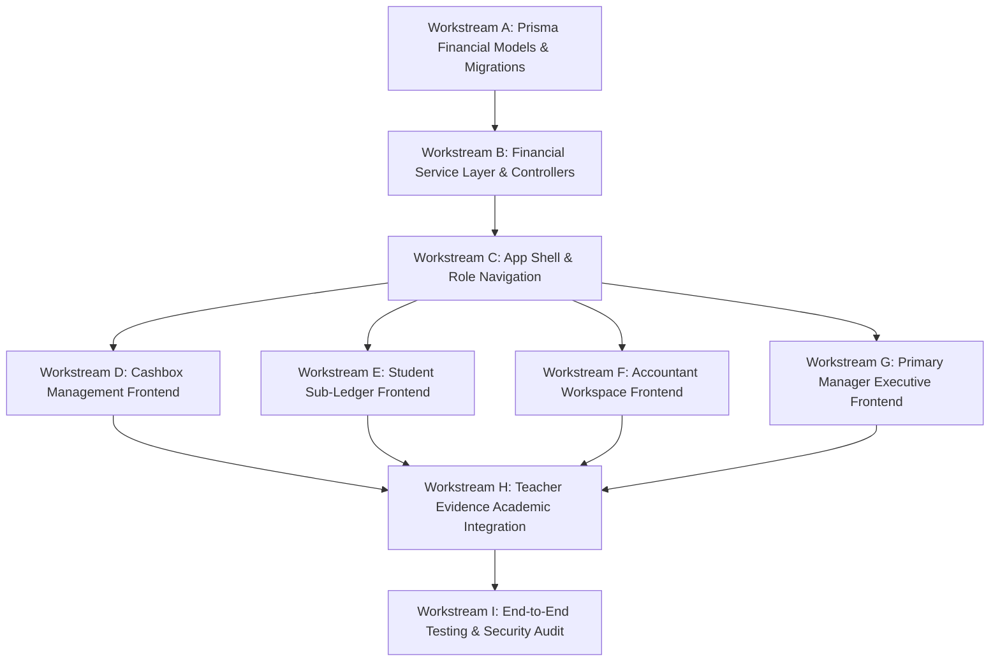

# OX-DIGITAL Education — Phase 3 Readiness Assessment
# Implementation Workstreams & Technical Dependency Map

**Workspace:** `D:\OX-DIGITAL\Mathe\OX-DIGITAL-GITHUB`  
**Target:** `docs/ui-ux/phase-3-readiness/IMPLEMENTATION_WORKSTREAMS_AND_DEPENDENCIES.md`  
**Execution Mode:** STRICTLY READ-ONLY TECHNICAL ASSESSMENT  
**Baseline References:** Phase 2 Batches 1–6, Shared Accounting Domain, Prisma Schema, Frontend Architecture

---

## 1. Master Dependency Sequence & Critical Path

Implementation must be executed in a strictly staged sequence to eliminate technical rework, prevent broken builds, and protect accounting invariants.

---

## 2. Workstream Breakdown

### Workstream A: Database Schema & Prisma Migrations (Financial Models)
- **Scope:** Add the 11 missing financial models and 6 enums to `packages/database/prisma/schema.prisma`. Generate and execute non-breaking SQL migration.
- **Dependencies:** None (Prerequisites: Read-only sign-off from Product Owner).
- **Reusable Assets:** Tenancy entities (`Institution`, `Branch`, `User`) already exist.
- **Missing Work:** Prisma definitions for `Cashbox`, `CashboxMovement`, `CashboxTransferRequest`, `DailyCashboxReconciliation`, `ExpenseVoucher`, `StudentAgreement`, `PaymentScheduleItem`, `CollectionReceipt`, `PaymentAllocation`, `RevenueRecognitionEntry`, `LessonDeliveryEvidence`.
- **Security & Accounting Risks:** Loss of data or schema corruption if migration scripts contain drop operations. Foreign key scoping must strictly enforce multi-tenancy.
- **Verification Gate:** `npx prisma validate && npx prisma migrate dev --create-only`. Review migration script. Zero regressions in existing 31 tables.

---

### Workstream B: Financial Service Layer & Express Controller Wiring
- **Scope:** Create domain repository adapters, Zod request DTOs, and Express controllers in backend services wrapping the `packages/shared/src/accounting/center/` domain engines.
- **Dependencies:** Workstream A (Prisma Client models must exist).
- **Reusable Assets:** Complete domain engines in `packages/shared/src/accounting/center/` (100% of calculation, state machine, and validation logic).
- **Missing Work:**
  - Repositories: `CashboxRepository`, `AgreementRepository`, `ReconciliationRepository`.
  - Transaction Wrappers: `prisma.$transaction` wrappers around domain mutations.
  - Express Routers: `/api/v1/accounting/*`, `/api/v1/executive/*`, `/api/v1/students/:id/*`.
  - Tenancy Middleware: Extraction of `institutionId` and `branchId` from JWT/headers.
- **Security & Accounting Risks:** Non-atomic transactions causing partial updates (e.g. transfer marked received without updating cashbox balance).
- **Verification Gate:** Integration test suite verifying that all API endpoints correctly update database records and return standard JSON error envelopes for invariant violations.

---

### Workstream C: Application Shell & Unified Navigation Integration
- **Scope:** Implement the unified application shell, responsive top bar, role-aware sidebars, branch switcher, and role-based route guards in `apps/frontend/src/`.
- **Dependencies:** Workstream B (Auth and Me API endpoints).
- **Reusable Assets:** Batch 1 interactive prototype (`app_shell_interactive_preview.html`), Tailwind CSS configuration.
- **Missing Work:** `AppShell.tsx`, `PrimaryManagerNav.tsx`, `AccountantNav.tsx`, `TeacherNav.tsx`, `BranchSwitcher.tsx`, `RoleRoute.tsx` updates.
- **Security & Accounting Risks:** Role escalation or unauthorized view access if client routing bypasses server-enforced role checks.
- **Verification Gate:** Verification that `PRIMARY_MANAGER` views cannot be accessed by `ACCOUNTANT` or `TEACHER`, and Super-Admin is strictly quarantined.

---

### Workstream D: Cashbox Management & Liquidity Frontend
- **Scope:** Build the Cashbox Management workspace in React, covering master directory, cashbox movements ledger, 5-stage transfer stepper, and daily reconciliation shift count modal.
- **Dependencies:** Workstream B (Cashbox API), Workstream C (App Shell).
- **Reusable Assets:** Batch 5 prototype (`cashbox_management_preview.html`), `cashbox.ts` domain state machine.
- **Missing Work:** React pages `CashboxDirectory.tsx`, `CashboxDetailLedger.tsx`, `TransferWorkspace.tsx`, and modals `CreateTransferModal.tsx`, `ShiftCountModal.tsx`.
- **Security & Accounting Risks:** Presentation of incorrect cash-in-transit or total cash position. Frontend must reflect backend liquidity conservation ($86,400 + $1,500 = $87,900 EGP).
- **Verification Gate:** Successful execution of a full 5-stage transfer cycle in the UI, updating balances and live in-transit indicators.

---

### Workstream E: Student Financial Profile & Sub-Ledger Frontend
- **Scope:** Build the 8-area Student Financial Profile workspace in React, covering commercial agreement master, payment schedule milestones, collection intake modal, and history timeline.
- **Dependencies:** Workstream B (Student Finance API), Workstream C (App Shell).
- **Reusable Assets:** Batch 4 prototype (`student_financial_profile_preview.html`), `subLedger.ts` waterfall allocation logic.
- **Missing Work:** React pages `AgreementSummary.tsx`, `FinancialTimeline.tsx`, and intake modal `CollectionReceiptModal.tsx`.
- **Security & Accounting Risks:** Violation of 4-tier sub-ledger conservation ($1,750 + $3,750 = $5,500 EGP). Disallowing direct row editing.
- **Verification Gate:** Simulated receipt posting with automatic waterfall allocation across milestones and live recalculation of unallocated prepayment and outstanding receivables.

---

### Workstream F: Accountant Workspace Frontend
- **Scope:** Build the operational workspace for accountants, covering daily till status overview, student collection audits, expense voucher drafting, and shift count declarations.
- **Dependencies:** Workstream D & E (Cashbox and Receipt APIs), Workstream C (App Shell).
- **Reusable Assets:** Batch 3 prototype (`accountant_dashboard_preview.html`).
- **Missing Work:** `AccountantWorkspace.tsx`, `CollectionsAudit.tsx`, `ExpenseDrafting.tsx`, `ShiftReconciliation.tsx`.
- **Security & Accounting Risks:** Accountant self-approving expense vouchers or transfers (must enforce Maker-Checker principle).
- **Verification Gate:** Verified that actions initiated by Accountant transition to `PENDING_APPROVAL` and appear in Primary Manager's queue.

---

### Workstream G: Primary Manager Decision Center & Executive Frontend
- **Scope:** Build the executive portal, including institutional overview dashboard, approval decision center (transfers, vouchers), multi-branch governance, and executive financial reports.
- **Dependencies:** Workstream D, E, F (All operational APIs), Workstream C (App Shell).
- **Reusable Assets:** Batch 2 prototype (`primary_manager_dashboard_preview.html`).
- **Missing Work:** `ExecutiveDashboard.tsx`, `DecisionCenter.tsx`, `BranchGovernance.tsx`, `ExecutiveReports.tsx`.
- **Security & Accounting Risks:** Bypassing approval checks or showing cross-institution data.
- **Verification Gate:** Primary Manager can approve/reject pending transfers and vouchers with mandatory business justifications recorded in the audit trail.

---

### Workstream H: Teacher Evidence & Academic Integration
- **Scope:** Build the teacher lesson delivery evidence upload modal and link verified attendance sessions to the dual-prerequisite revenue recognition trigger.
- **Dependencies:** Workstream B (Evidence and Revenue API), Workstream C (App Shell).
- **Reusable Assets:** Existing academic session views, `revenueRecognitionEngine.ts`.
- **Missing Work:** `LessonEvidenceModal.tsx`, `TeacherDuesView.tsx` (stubbed for variable base), backend hook triggering `recognizeRevenue()`.
- **Security & Accounting Risks:** Recognizing revenue without verified teacher evidence or recognizing revenue on terminated agreements.
- **Verification Gate:** Revenue recognition entry successfully generated only upon submission of valid teacher evidence for an active student agreement.

---

### Workstream I: End-to-End Integration, Security & Audit Testing
- **Scope:** Comprehensive automated end-to-end testing across all 9 workstreams, verifying multi-tenant isolation, RBAC role boundaries, liquidity conservation, sub-ledger conservation, and tamper-evident audit logging.
- **Dependencies:** Workstreams A through H complete.
- **Reusable Assets:** Existing test suites in `tests/accounting/`.
- **Missing Work:** Playwright/Cypress end-to-end browser test suites, API penetration security test suites.
- **Security & Accounting Risks:** Undetected cross-tenant data leaks, race conditions in cashbox transfers, or floating-point arithmetic errors.
- **Verification Gate:** 100% pass rate across all accounting invariant assertions and security tests prior to production deployment.

