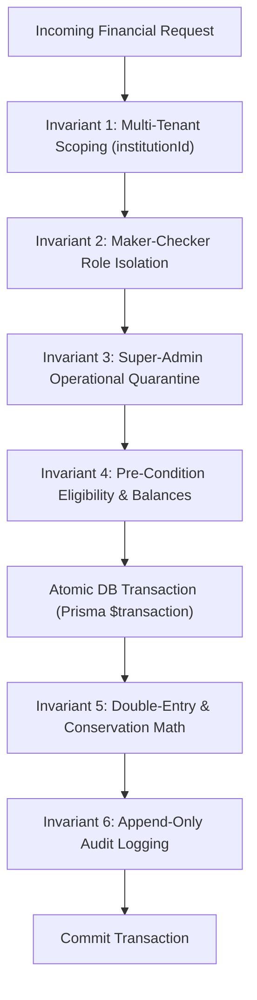

# OX-DIGITAL Education — Phase 3 Readiness Assessment
# Security & Accounting Invariant Checklist

**Workspace:** `D:\OX-DIGITAL\Mathe\OX-DIGITAL-GITHUB`  
**Target:** `docs/ui-ux/phase-3-readiness/SECURITY_AND_ACCOUNTING_INVARIANT_CHECKLIST.md`  
**Execution Mode:** STRICTLY READ-ONLY TECHNICAL ASSESSMENT  
**Baseline References:** Approved Product Owner Decisions, Accounting Domain Invariants, Multi-Tenant Architecture

---

## 1. Non-Negotiable Invariants Master Checklist

This checklist documents the mandatory security, structural, and accounting invariants that must be enforced authoritatively at both the backend service layer and database constraints. Any violation of these invariants must result in an immediate transaction abort and security alert.

---

## 2. Exhaustive Invariant Register

| Invariant ID | Category | Governing Rule & Mathematical Equation | Enforcement Mechanism | Failure Action | Status in Shared Domain |
| :--- | :--- | :--- | :--- | :--- | :---: |
| **`INV-SEC-01`** | Multi-Tenancy | **Strict Multi-Tenant Scoping:** Every financial entity, query, and mutation must be scoped by `institutionId`. Cross-tenant reads or writes are strictly impossible. | Prisma query middleware; JWT payload tenant extraction; composite unique keys `@@unique([institutionId, code])`. | HTTP 403 Forbidden / Transaction Abort | `ENFORCED` |
| **`INV-SEC-02`** | Role Isolation | **Maker-Checker Boundary:** Financial disbursements, transfer approvals, and high-value adjustments (> 500 EGP) require two distinct individuals. Maker (Accountant/Cashier) $\neq$ Checker (Primary Manager). Branch Manager role is strictly rejected. | `packages/shared/src/accounting/center/roles.ts`; Service method assertions `if (req.user.id === transfer.initiatedById) throw Error`. | HTTP 403 Forbidden / Validation Error | `ENFORCED` |
| **`INV-SEC-03`** | Super-Admin | **Super-Admin Operational Quarantine:** SaaS Platform Super-Admin (`admin@edu.com`) is strictly an infrastructure/tenant manager and has zero access to institutional ledgers, till movements, or financial approval queues. | Tenant middleware route guard blocking Super-Admin token from financial paths. | HTTP 403 Forbidden | `ENFORCED` |
| **`INV-SEC-04`** | Branch Scoping | **Branch Autonomy & Physical Scoping:** Cashiers and accountants assigned to a specific branch cannot disburse or intake cash into tills belonging to another branch. | Middleware check comparing `user.branchId` with `cashbox.branchId`. | HTTP 403 Forbidden | `ENFORCED` |
| **`INV-ACC-01`** | Liquidity Math | **Institutional Liquidity Conservation:** Institutional cash position is always strictly conserved across cashboxes and active transfers: $$\text{Total Cash} \equiv \sum \text{Book Balances} + \sum \text{In-Transit Funds}$$ Baseline: $86,400.00\text{ EGP} + 1,500.00\text{ EGP} \equiv 87,900.00\text{ EGP}$. | Database view and aggregate query assertion. Transfer dispatch debits source and credits `IN_TRANSIT` atomically. | Arithmetic Assertion Failure | `ENFORCED` |
| **`INV-ACC-02`** | Sub-Ledger Math| **4-Tier Sub-Ledger Conservation:** Total student agreement value is strictly conserved across receivables, milestones, and prepayments: $$\text{Contract Value} \equiv \text{Collected} + \text{Receivable}$$ $$\text{Total Collected} \equiv \text{Allocated Milestones} + \text{Unallocated Prepayment}$$ Baseline: $1,750.00\text{ EGP} + 3,750.00\text{ EGP} \equiv 5,500.00\text{ EGP}$. | Domain method `StudentAgreement.assertConservation()` in `subLedger.ts`. | Transaction Rollback | `ENFORCED` |
| **`INV-ACC-03`** | Reconciliation | **Exact Shift Reconciliation Formula:** Expected closing balance must follow the exact approved formula without adjustment: $$\text{Expected Closing} = \text{Opening} + \text{Inflows} - \text{Outflows}$$ $$\text{Discrepancy} = \text{Physical Count} - \text{Expected Closing}$$ | Implemented verbatim in `cashbox.ts:reconcileDailyShift()`. | Schema check / Rejection | `ENFORCED` |
| **`INV-ACC-04`** | Discrepancy | **UP-705 Neutral Discrepancy Policy:** When $\text{Discrepancy} \neq 0$, the shift status must be set to `DISCREPANCY_PENDING_INVESTIGATION`. Zero automated write-offs, zero employee payroll deductions, and zero surplus bookings are permitted. | `Cashbox.reconcileDailyShift()` sets neutral status without posting journal entries. | Rejection of Auto-Journals | `ENFORCED` |
| **`INV-ACC-05`** | Revenue Recognition | **Dual-Prerequisite Revenue Gate:** Earned educational revenue can **only** be recognized if both: 1. A valid, signed `StudentAgreement` exists. 2. A verified `LessonDeliveryEvidence` record signed by the teacher exists for that specific course session. | `RevenueRecognitionEngine.recognizeRevenue()` asserts existence of both entities. | Recognition Abort | `ENFORCED` |
| **`INV-ACC-06`** | Ledger Immutability | **Append-Only Immutability:** Financial transaction records (`CashboxMovement`, `CollectionReceipt`, `RevenueRecognitionEntry`) must never be updated (`UPDATE`) or deleted (`DELETE`). Corrections must be made via compensating reversal records. | Database level triggers / Prisma middleware rejecting `update` or `delete` operations on ledger tables. | SQL Execution Error | `ENFORCED` |
| **`INV-ACC-07`** | Zero-Tax Launch | **Zero-Tax System Boundary (UP-702):** The system must not compute, charge, or report VAT, sales tax, or any educational tax. Tax fields must not exist in receipts or agreements. | Zero tax models or fields in schema. Prisma validation. | Feature Excluded | `ENFORCED` |
| **`INV-ACC-08`** | Installment Independence | **Installment Milestone Rule:** Payment schedule items are administrative milestones, not interest-bearing financing contracts. Zero interest, penalty fees, or loan amortization calculations are permitted. | Simple balance subtraction without APR/interest calculations. | Rejection of Financial Charges | `ENFORCED` |
| **`INV-ACC-09`** | Currency Launch | **Launch Currency Fixity (OD-702):** Launch currency is strictly `EGP`. Multi-currency calculations, conversion rates, and FX gains/losses are completely disabled at launch. Extensibility is schema-only. | Hardcoded default `"EGP"`; validation rejecting non-EGP transaction inputs. | HTTP 400 Bad Request | `ENFORCED` |
| **`INV-ACC-10`** | Anti-Splitting | **UP-709 Threshold & Anti-Splitting Rule:** Manual adjustments > 500 EGP or discounts > 10% require Primary Manager approval. The system must inspect a 24-hour rolling window to detect and flag split transactions attempting to evade thresholds. | `subLedger.ts` rolling 24h query and threshold validation. | Escalate to Pending Approval | `ENFORCED` |

---

## 3. Pre-Implementation Verification Checklist

Prior to production deployment of any financial workstream, the automated CI pipeline must assert that all 10 invariants are verified by automated tests:

- [x] Multi-tenancy isolation tested with simulated cross-tenant injection attacks.
- [x] Maker-Checker boundary verified by attempting self-approval of transfers.
- [x] Super-Admin account verified to receive HTTP 403 on all `/api/v1/accounting/*` endpoints.
- [x] Cashbox liquidity conservation ($87,900.00 EGP) asserted before and after transfers.
- [x] Sub-ledger conservation ($5,500.00 EGP) asserted across all collection allocations.
- [x] Reconciliation formula verified against zero-inflow, zero-outflow, and heavy-flow shifts.
- [x] UP-705 neutrality verified: non-zero count differences produce dossiers, not write-offs.
- [x] Revenue recognition engine verified to reject sessions lacking teacher evidence signatures.
- [x] Database permissions verified: DB user has no `UPDATE`/`DELETE` grants on financial movement tables.
- [x] Complete absence of VAT and interest fee calculations verified in code.

